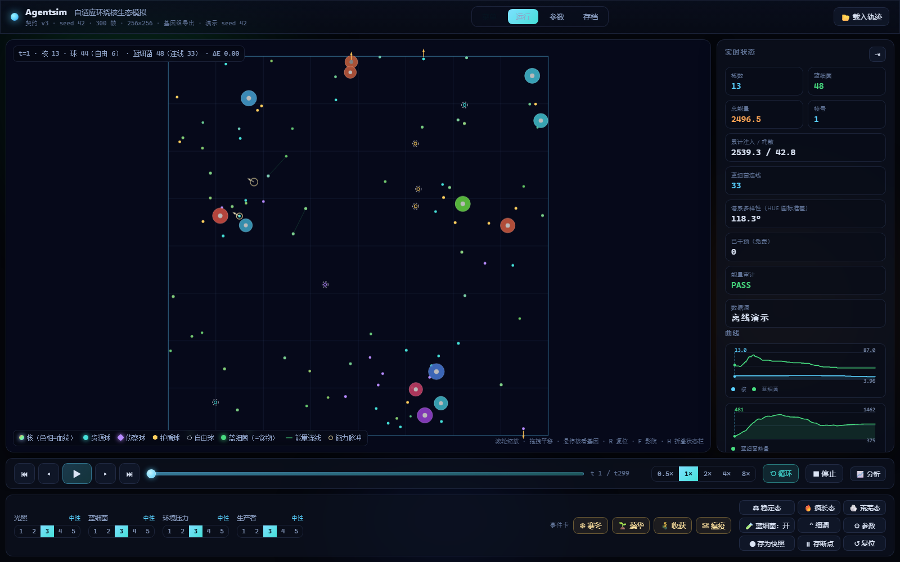

# agentsim — 自适应环绕核生态模拟与生存游戏

**一个会自己"长"出生态的模拟器。** 阳光照下来，蓝细菌光合生长、互相连线分配能量、分裂繁殖；
带着可遗传基因的核去觅食、移动、繁衍、变异；小球绕核旋转，把能量存在球里。

**没有剧本，没有预设平衡。** 种群数量、谱系分化、策略兴衰，全部由能量收支和遗传漂变自己决定。
你的角色是调光照、调生产者，然后看这个生态如何回应你。



<sub>▲ 实际运行界面。大圆=核（颜色=血统 hue）· 小点+绿线=蓝细菌与其能量网络 · 小形状=小球器官 · 右侧=实时状态与生态曲线 · 底部=四轴调控 + 事件卡</sub>

**[⬇ 下载 v3.0.0（Windows x64 免安装，567KB）](https://github.com/zx1414/adaptive-orbit-ecosystem/releases/download/v3.0.0/agentsim-3.0.0-win64.zip)** — 解压后双击 `agentsimw.exe` 即玩

---

## 状态与链接

| | |
| --- | --- |
| **版本** | [`3.0.0`](VERSION) — 首个开源发布 |
| **许可证** | [MIT](LICENSE) — 可商用、可修改、可闭源分发 |
| **平台** | Windows 10 / 11 x64 |
| **测试** | 395 单测 / 20873 断言 / 0 失败 · 8 道门禁 |
| **依赖** | 零第三方库（C++17 标准库 + Win32）；前端原生 JS |
| **仓库** | https://github.com/zx1414/adaptive-orbit-ecosystem |
| **下载** | [GitHub Releases](https://github.com/zx1414/adaptive-orbit-ecosystem/releases/tag/v3.0.0) — 免安装 zip |

---

## 我该看哪里？（按身份选路径）

| 你是… | 从这里开始 |
| --- | --- |
| **只想玩一下** | [立即开始玩](#立即开始玩不用编译) → 双击 `release/agentsimw.exe` |
| **想调参 / 做实验** | [游戏怎么玩](#游戏里能看到什么-怎么玩) + [命令行](#跑一个生态实验命令行) + [参数全表](#命令行参数全表) |
| **想读懂代码** | [架构与数据流](#架构与数据流) → [目录结构](#目录结构) → [`src/`](src/) |
| **想改代码 / 提 PR** | [从源码构建](#从源码构建) → [构建门禁](#构建门禁8-道检查) → [CONTRIBUTING.md](CONTRIBUTING.md) |
| **想接前端 / 写工具** | [HTTP API 全表](#http-api-全表实时模式) + [`/state` 二进制布局](#state-二进制快照布局v2) + [TRACE-CONTRACT](docs/TRACE-CONTRACT.md) |
| **想核对每个数字怎么算出来的** | [数理模型](#数理模型与实现细节完整规格) — 四部分：环境 / 个体 / 决策 / 基础设施 |
| **想知道"生态学上成不成立"** | [生态判据](#生态判据它到底健康吗) + [GOAL-ECOLOGY](docs/GOAL-ECOLOGY.md) + [实验报告](docs/experiments/) |
| **想接手维护** | [HANDOVER](HANDOVER.md) → [CHANGELOG](CHANGELOG.md) → [docs/LOG.md](docs/LOG.md) |

---

## 目录

- [30 秒看懂这个项目](#30-秒看懂这个项目)
- [立即开始玩（不用编译）](#立即开始玩不用编译)
- [游戏里能看到什么 / 怎么玩](#游戏里能看到什么-怎么玩)
- [从源码构建](#从源码构建)
- [跑一个生态实验（命令行）](#跑一个生态实验命令行)
- [生态判据：它到底"健康"吗](#生态判据它到底健康吗)
- [架构与数据流](#架构与数据流)
- [数理模型与实现细节（完整规格）](#数理模型与实现细节完整规格) — 全部公式 / 常数 / 钳制条件
  - [一：环境层与感知层（阳光 / 蓝细菌 / 温度 / 地形 / 传感器）](#数理模型一环境层与感知层)
  - [二：个体与行为（基因 / 代谢 / 摄食 / 繁殖 / 账本 / 主循环）](#数理模型二个体与行为)
  - [三：决策层（8 个策略的算式与失效模式）](#数理模型三决策层)
  - [四：基础设施（RNG / 参数 / 快照 / 存档 / HTTP / CLI）](#数理模型四基础设施)
- [命令行参数全表](#命令行参数全表)
- [HTTP API 全表（实时模式）](#http-api-全表实时模式)
- [构建门禁：8 道检查](#构建门禁8-道检查)
- [目录结构](#目录结构)
- [文档索引](#文档索引)
- [版本控制与发布](#版本控制与发布)
- [常见问题与排错](#常见问题与排错)
- [贡献与许可](#贡献与许可)

---

## 30 秒看懂这个项目

### 它在模拟什么

```text
        ☀ 阳光（昼夜 628 帧循环，可实时调）
             │  光合作用 —— 全系统唯一的能量入口
             ▼
        ● 蓝细菌 ──── 连线 ──── ● 蓝细菌
             │                     ↑ 生产者层：光合 / 互传能量 / 分裂 / 被吃
             │                     ↑ 密度高会互相遮光 → 天然负反馈，不会无限爆炸
             │  捕食 graze
             ▼
        ◉ 核（消费者 + 唯一决策体）
         ╱  │  ╲
       ○   ○   ○   ← 小球（器官）：资源 / 侦察 / 护盾，绕核旋转，能量存在球内
```

### 三句话讲清它的设计取舍

1. **能量是唯一硬约束。** 每 tick 校验 `注入 − 耗散 == 所有活着的实体的能量总和`。
   账不平就立即以 exit 3 崩掉。所以"生态好不好"不是调参调出来的观感，是算出来的结果。
2. **四层单向管线。** `环境 → 感知 → 决策 → 行为 → 账本`。决策层看不到世界、不掷骰子；
   只有行为层能改实体状态。这条约束由 `tools/check.ps1` **静态扫源码**强制执行，违反即构建失败。
3. **完全确定性。** 同一个 seed 跑两次，输出逐字节相同。所以任何"生态演变"都能精确复现、
   精确前后对比——这是能拿它做实验而不是做玩具的前提。

---

## 立即开始玩（不用编译）

### 第 1 步：启动

打开 [`release/`](release/) 文件夹，**双击 `agentsimw.exe`**。

| 会发生什么 | 说明 |
| --- | --- |
| 不弹黑框控制台 | 启动器是无窗口的 Win32 程序 |
| 直接开一个独立应用窗口 | 走 Edge `--app` 模式，没有浏览器标签栏 / 地址栏 |
| 已有实例时不再开新窗口 | 单实例保护：会复用已有窗口并让本进程退出 |
| 关闭窗口 = 退出 | 后台 `agentsim.exe` 随之结束 |

**系统要求**：Windows 10/11 x64，自带 Edge / WebView2 运行时（系统默认就有）。
整个 `release/` 文件夹可以拷到任何 Windows 机器直接跑，**绿色免安装**。

> ⚠️ 不要单独移动 `agentsim.exe` 或 `agentsimw.exe` 中的某一个——启动器需要同目录的 exe。
> `release/frontend/` 也必须与两个 exe 保持同级。

### 第 2 步：开一局


<sub>▲ 菜单页。填种子、初始核数、蓝细菌节点数、帧数、帧率上限、决策策略，然后点「开始模拟」。</sub>

1. 各项参数都有合理默认值，**可以直接点「开始模拟」**
2. 想换风格就改「决策策略」下拉（8 种，见[下文](#8-种决策策略)）
3. 开跑后自动连上实时模拟，画面开始动

### 第 3 步：观察与调控

运行界面分四块，从外到内：

| 位置 | 是什么 | 你能做什么 |
| --- | --- | --- |
| **中间画布** | 生态本体 | 滚轮缩放、拖拽平移、悬停核看基因、点核跟随 |
| **右侧状态栏** | 实时数字 + 5 条曲线 | 读种群/能量/审计/谱系多样性 |
| **底部四轴** | 光照 / 蓝细菌 / 环境压力 / 生产者，各 0~4 五档 | **拖动立即生效，免费无限次** |
| **底部时间轴** | 播放 / 暂停 / 单步 / 倍速 / 循环 | 控制时间推进 |

**画面里每个元素代表什么**：

| 你看到 | 含义 |
| --- | --- |
| 大圆，颜色各异 | **核**。颜色 = hue = **血统**，同色系即近亲 |
| 大圆中间的灰点 | 交互指示：靠近食物/球时会闪白 |
| 小圆点 + 半透明绿线 | **蓝细菌** + 它们的能量传输网络 |
| 圆形 / 菱形 / 六边形的小东西 | **小球**：资源球 / 侦察球 / 护盾球 |
| 空心 + 虚线外圈的小球 | **自由球**（无主，可以被任何核捡走） |
| HUD 上的「阳光 x.xx」 | 当前光照强度（0~1），画面明暗跟着它变 |
| 右上角「能量审计 PASS」 | 每帧恒等式校验通过 |

---

## 游戏里能看到什么 / 怎么玩

### 这游戏的"目标"是什么

**没有通关条件。** 它是个**生态沙盘**：你可以把生态逼到崩溃边缘再拉回来，
也可以观察不同决策策略下种群命运的彻底分化。

真正好玩的地方在于**机制之间的耦合**：改一个参数，影响会沿食物链传导好几层，
而且常常不是你想的方向——这才是"自涌现"的意思。

### 几个值得试的实验

1. **饿死它们**：光照拉到最低档，看核群如何在几十帧内萎缩、最后是否灭绝
   （状态栏会显示「结束原因：灭绝」）
2. **策略对照**：同一个 seed，分别用 `rule` 和 `bandit` 各跑一遍，核数曲线完全不同
3. **看谱系分化**：跑够长时间，盯右侧「谱系多样性（hue 圆标准差）」曲线——
   数值越大说明生态位分化越明显
4. **分叉实验**：存一个档 → 改一个参数 → 继续跑，比较两条世界线的走向
5. **手动干预**：用底部「事件卡」（寒冬 / 繁华 / 收获 / 瘟疫）砸一个冲击进去，看恢复力

### 界面快捷键

| 键 | 作用 |
| --- | --- |
| `空格` | 播放 / 暂停 |
| `←` `→` | 单步（按住 `Shift` 一次 10 帧） |
| `R` | 视角复位（回到全图） |
| `F` | 影院模式（隐藏所有面板，纯看生态） |
| `H` | 折叠 / 展开右侧状态栏 |
| `L` | 循环播放开关 |
| 滚轮 / 拖拽 | 缩放 / 平移 |
| `Esc` | 返回 / 退出影院模式 |

---

## 从源码构建

### 前置要求

| 需要 | 说明 |
| --- | --- |
| **Visual Studio 2022** | 必须勾选「使用 C++ 的桌面开发」（含 MSVC v143 + Windows SDK） |
| PowerShell 5.1+ | Windows 自带 |
| Node.js 18+ | **仅**前端 smoke / 打包 / 生态分析脚本需要；跑模拟器本身不需要 |

### 构建（3 条命令）

```powershell
git clone https://github.com/zx1414/adaptive-orbit-ecosystem.git
cd adaptive-orbit-ecosystem

# 一次构建出三个产物：
#   agentsim.exe   控制台/CLI 主程序
#   agentsimw.exe  无控制台启动器（双击用）
#   unit_tests.exe 单元测试
powershell -NoProfile -ExecutionPolicy Bypass -File tools\build.ps1
```

**预期输出**（最后几行）：

```text
vcvars: C:\Program Files\Microsoft Visual Studio\2022\Community\VC\Auxiliary\Build\vcvars64.bat
flags: /nologo /std:c++17 /W4 /WX /EHsc /permissive- /utf-8 /I src /DAGENTSIM_HAS_GENOME=1
cl agentsim.exe ...
cl unit_tests.exe ...
cl agentsimw.exe ...
build OK
```

编译用 `/W4 /WX`（**警告即错误**），所以能编过就等于零警告。

### 验证构建是否正确

```powershell
# 1) 版本号
build\agentsim.exe --version
```
```text
agentsim 3.0.0
```

```powershell
# 2) 金标准回归：这个数字必须一模一样
build\agentsim.exe --no-render --ticks 2000 --seed 42
```
```text
done tick=2000 nuclei=3 cyano=930 total_energy=36367.17200929 audit=ok policy=rule
                                              ^^^^^^^^^^^^^^^^^^^^^ 这就是金标准
```

> **`total_energy` 不是 `36367.17200929` 说明默认参数下的行为被改动了。**
> 这是有意设计——它让"无意中改了生态"这件事无处藏身。若非有意为之，请查 `git diff src/`。

### 完整门禁

```powershell
powershell -NoProfile -ExecutionPolicy Bypass -File tools\check.ps1
```
```text
...（前略）
[PASS] live-param: --thermal-w-caution
check PASSED          ← 这就是通过标志
```

约 5–6 分钟（395 条单测 + 前端 smoke + 双跑确定性 + 5 个参数探针）。

或用便携包装（自动把输出存到 `build\gate_out.txt`）：

```powershell
tools\gate.bat
```

---

## 跑一个生态实验（命令行）

### 基本跑法

```powershell
# 5000 帧，seed 42，带每帧能量审计
build\agentsim.exe --no-render --ticks 5000 --seed 42 --audit

# 换成别的决策策略（8 选 1）
build\agentsim.exe --no-render --ticks 5000 --seed 42 --policy bandit

# 自定义世界与初始条件
build\agentsim.exe --no-render --ticks 10000 --seed 7 --nuclei 20 --cyano-nodes 800

# 导出种群/能量趋势 CSV（每 100 帧一行）
build\agentsim.exe --no-render --ticks 20000 --seed 42 --stats build\stats.csv --stats-interval 100
```

**输出最后一行格式**：

```text
done tick=5000 nuclei=42 cyano=731 total_energy=18342.51 audit=ok policy=rule
     ^^^^帧数  ^^核数  ^^^蓝细菌数  ^^^^^^^^总能量    ^^^^审计  ^^^^所用策略
```

`audit=ok` 表示全程能量账都是平的。若变成 `audit=fail`，进程会以 **exit 3** 退出。

### 8 种决策策略

同样世界、同样 seed（`--ticks 1000 --seed 42`），换策略会产生**实质不同**的生态命运。
下面是**实测**结果（2026-11-05，v3.0.0 二进制）：

| 策略 | 1000 帧后核数 | 状态 |
| --- | --- | --- |
| `foragebank` | **13** | 存活（最繁盛） |
| `thermal` | 9 | 存活 |
| `stub` | 7 | 存活（几乎不动却活得不错） |
| `hysteresis` | 6 | 存活 |
| `bandit` | 6 | 存活 |
| `riskaverse` | 6 | 存活 |
| `rule` | 3 | 存活（默认策略，最保守） |
| `perceptron` | **灭绝** | 个体全灭 → 进程 exit 5 |

> 这就是"策略真的在起作用"的直接证据：**同一世界、同一随机种子，只因决策方式不同，
> 结局从"13 个核繁荣"到"全灭退出"**。`perceptron` 灭绝不是 bug——它展示了
> 一个未被优化的随机初始化网络在能量约束下必然饿死，正是自然选择该淘汰的类型。

各策略的决策风格：

| 策略 | 决策风格 |
| --- | --- |
| `rule` | 规则驱动：朝最近食物走，饿急了才考虑繁殖（**默认**，基线） |
| `stub` | 空策略：几乎不动，用于对照实验 |
| `perceptron` | 单层感知机：权重构造期随机初始化，可随进化漂移 |
| `thermal` | 趋温策略：按温度适宜度 + 失真规避打分 |
| `hysteresis` | 迟滞策略：带状态记忆，避免来回抖动 |
| `foragebank` | 觅食-储蓄双目标：在"现在吃"和"存着"之间权衡 |
| `bandit` | 多臂老虎机：探索 / 利用权衡 |
| `riskaverse` | 风险规避：偏好安全但收益低的路径 |

### 导出轨迹（给分析脚本用）

```powershell
build\agentsim.exe --no-render --ticks 20000 --seed 42 `
  --trace build\t.json --trace-interval 30 --trace-genome
node tools\analyze.mjs build\t.json
```

`--trace-genome` 会把每个核的 24 个基因一起导出（文件大很多），
分析脚本的判据 3/4（基因多样性、谱系分化）需要它。

---

## 生态判据：它到底"健康"吗

`tools/analyze.mjs` 对轨迹自动判定 6 条生态判据。测量口径：取轨迹**最后 30%** 窗口，
并带**稳态门**——若种群仍在趋势中（未达稳态），判 `DEFER` 而不是硬判 PASS/FAIL。

| # | 判据 | 通过条件 | 当前状态（seed 42） |
| --- | --- | --- | --- |
| 1 | 能量收支紧平衡 | 注入−耗散−存量 相对误差 < 0.15 | ✅ 通过（0.1484） |
| 2 | 种群在承载力附近波动 | 不爆炸、不灭绝 | ✅ 通过 |
| 3 | 遗传多样性不塌缩 | 各基因维度 CV 高于阈值 | ✅ 通过 |
| 4 | 谱系 hue 分化 | 色相圆标准差 > 30° | ❌ **未达标**（实测 9.9°） |
| 5 | 捕食者-猎物振荡 | 窗口内相关性与过零点符合 | ✅ 通过（r=0.018, lag=169） |
| 6 | 调控有效性 | 改光照轴后基因偏好漂移 > 10% | ✅ 通过（+55%） |

> **已知缺口**：判据 4 未达标是当前版本最大的问题。
> 用户已明确「稳态参数后续实现」，因此 v3.0.0 按**框架完整性**发布，
> 判据 4 的标定列入下个版本路线图（见 [CHANGELOG](CHANGELOG.md)）。

---

## 架构与数据流

### 四层单向管线

```text
┌──────────────┐    ┌──────────────┐    ┌──────────────┐    ┌──────────────┐
│   环境        │───▶│    感知       │───▶│    决策       │───▶│    行为       │
│ Environment  │    │ Perception   │    │ Decision     │    │ Behavior     │
│              │    │              │    │              │    │ (唯一写点)    │
│ 蓝细菌 / 光照 │    │ 24 维观察     │    │ 8 种策略      │    │ 移动 / 吃 /   │
│ 温度 / 地形   │    │ 只读、无 RNG  │    │ 不读世界      │    │ 繁殖 / 产球   │
└──────────────┘    └──────────────┘    └──────────────┘    └──────┬───────┘
       ▲                                                          │
       │                                                          ▼
       └──────────────────────────────────────────────── ┌──────────────┐
                                                          │    账本       │
                                                          │   Ledger     │
                                                          │  零和恒等式   │
                                                          └──────────────┘
```

**三条不可违反的红线**（由 `tools/check.ps1` 静态检查，违反即构建失败）：

| # | 红线 | 为什么 |
| --- | --- | --- |
| 1 | `src/decision` 不能 include `environment/`、`sim/`、`ledger/` | 决策层看不到世界，才能保持"纯函数式决策" |
| 2 | `src/perception` 不能 include `decision/` | 感知层不能调策略，才能保证"观察 ≠ 行动" |
| 3 | 除 `src/behavior` 外，任何文件不能给核/球状态赋值 | 只有一个写点，才可能审计能量去向 |

### 能量账本

所有能量变动都走 `AgentLedger`，并带**原因记账**：

`photosynthesis` · `graze` · `locomotion` · `respiration` · `reproduce-loss` ·
`deploy` · `recycle-loss` · `carrion` · `detach` · `force`

每个 tick 校验：

```text
injected − dissipated == Σ(活着的核 + 球 + 蓝细菌节点)
```

不平就以 **exit 3** 退出。这条恒等式是整个项目"生态数据可信"的根基。

### `/state` 二进制快照布局（v2）

实时模式下前端 33ms 拉一次，这是前端唯一的数据源：

```text
偏移  0   magic 0x41 ("A")          u8
偏移  1   version = 2                u8
偏移  2   phase: 0运行/1结束/2暂停     u8
偏移  3   保留                       u8
偏移  4   tick                       i32
偏移  8   worldW, worldH             f32 × 2
偏移 16   ballCount                  i32
偏移 20   nucleusCount               i32
偏移 24   aliveNuclei                i32
偏移 28   freeBallCount              i32
偏移 32   cyanoCount                 i32
偏移 36   linkCount                  i32
偏移 40   cyanoAvgEnergy             f32
偏移 44   全局阳光 sun               f32   ← 前端明暗 + HUD「阳光 x.xx」的来源
偏移 48   保留                       i32
偏移 52   finishReason（定长 28B）    char[28]  "extinct" / "max_ticks" / "paused" / "running"
偏移 80   球记录    25B × n          id u32, owner u32, x f32, y f32, energy f32, type u8, radius f32
          核记录   128B × n          32B 头（id, x, y, energy, cap, speed, hue, alive）+ 24 基因 f32
          蓝细菌    20B × n          id u32, x f32, y f32, energy f32, hue f32
          连线       8B × n          idA u32, idB u32
```

解析权威实现见 [`frontend/js/live-client.js`](frontend/js/live-client.js)（带 stride 自检，版本感知）。

---

## 数理模型与实现细节（完整规格）

上面几节是**怎么用**。这一章是**它到底怎么算的**：每一个公式、每一个常数、每一条钳制条件，都能在源码里找到对应行。

| 你想知道 | 看哪一部分 |
| --- | --- |
| 阳光怎么算、蓝细菌怎么长、温度场怎么来、传感器看到什么 | [数理模型一：环境层与感知层](#数理模型一环境层与感知层) |
| 基因怎么变成行为、代谢方程、繁殖分割、账本恒等式、每 tick 的执行顺序 | [数理模型二：个体与行为](#数理模型二个体与行为) |
| 8 个策略各自的目标函数、内部状态、什么时候会犯蠢 | [数理模型三：决策层](#数理模型三决策层) |
| 随机数怎么保证可复现、113 个参数怎么落地、`/state` 每个字节是什么、存档格式 | [数理模型四：基础设施](#数理模型四基础设施) |

**三条约定**（全章一致）：

1. **写的是代码里真实的算式**，不是教科书里的理想公式。代码用 `x += (y-x)*0.25` 松弛，就写松弛式，不会美化成微分方程。
2. **每个常数都带 `文件:行号`**，可以直接跳过去核对。
3. **参数页默认值 ≠ 运行时默认值。** `ParamSchema` 的 `dflt` 是参数页「恢复默认」的目标值，`Config.h` 里的是真实生效值，两者**故意允许不同**（历史标定结果）。每张参数表都同时列这两列，冲突时以 Config 列为准。

> **读之前先看 [2.11](#211-已删除或未实现的机制避免误读)。** 项目里有一批「注释说有、代码里没有」的东西——硬分离 pass、Q10 温度标度、核的质量/年龄/谱系号、交叉重组、`forage_k` 等参数。这一节把它们逐条列出来，避免照着注释去理解模型。

---

### 数理模型一：环境层与感知层

本部分覆盖：`environment/`（环面几何、阳光、蓝细菌、温度场、地形）、`perception/`（24 维传感器）、`core/Vec2.h`（环面几何原语）、以及组合根 `sim/Simulation.cpp` 中属于环境层的接线段（阳光取值、光合入账、尸体分配、捕食扫描）。

---

#### 1.1 环面几何原语（`core/Vec2.h`）

世界是环面（torus），宽 `W = world.width`、高 `H = world.height`，默认各 1024（`src/core/Config.h:18-19`）。所有环境/感知层的距离计算都经由下列函数，无直线距离分支。

| 函数 | 定义 | 源码位置 |
|---|---|---|
| `wrap(v, w, h)` | $r_x = \mathrm{fmod}(v_x, w)$，若 $r_x<0$ 则 $r_x \mathrel{+}= w$，再若 $r_x \ge w$ 则 $r_x \mathrel{-}= w$； $y$ 同法。 $w \le 0$（或 $h \le 0$）时该分量原样返回 | `src/core/Vec2.h:14-27` |
| `torusDelta(a, b, w, h)` | $d_x = \mathrm{fmod}(b_x-a_x, w)$；若 $d_x > w/2$ 则 $d_x \mathrel{-}= w$，若 $d_x < -w/2$ 则 $d_x \mathrel{+}= w$（ $y$ 同法）。结果分量落在 $[-w/2, w/2]$、 $[-h/2, h/2]$ | `src/core/Vec2.h:30-45` |
| `torusDeltaWrapped(a, b, w, h)` | 与上式等价但去掉 `fmod`：前提是 $a,b$ 已在 $[0,w)\times[0,h)$ 内，只需一次比较 + 一次加减（性能优化，逐位同值） | `src/core/Vec2.h:55-70` |
| `torusDistance(a, b, w, h)` | $\sqrt{d_x^2 + d_y^2}$， $d = \mathrm{torusDelta}(a,b)$ | `src/core/Vec2.h:73-76` |

`length(v) = \sqrt{\mathrm{dot}(v,v)}`（`src/core/Vec2.h:80`）；`normalized(v)` 零向量安全，返回 `{0,0}`（`src/core/Vec2.h:83-87`）。

环境层对外只转发这三项（`src/environment/AgentEnvironment.cpp:15-25`）。`AgentEnvironment` 自身只剩 `SimConfig` 只读引用、tick 计数（`src/environment/AgentEnvironment.cpp:13`）与一个可选障碍谓词 `blockedAt()`（`src/environment/AgentEnvironment.h:25-27`，R1-B 删除 Food 后生产路径无调用方）。环面坐标的唯一权威是 `AgentEnvironment`。

---

#### 1.2 阳光模型 sunLevel（环境层的唯一外部驱动量）

##### 1.2.1 计算式

权威实现在 `Simulation.cpp` 匿名命名空间（`src/sim/Simulation.cpp:100-127`），配置结构 `SunConfig`（`src/core/Config.h:34-42`）：

$$
\text{base}(y) = \text{baseLevel} - \text{verticalGradient}\cdot\frac{y}{H}\quad(\text{仅当 verticalGradient}\neq 0 \wedge H>0)
$$

$$
\text{day}(\text{tick}) = \text{dayAmplitude}\cdot\sin\!\left(\frac{2\pi\cdot\text{tick}}{\text{dayPeriodFrames}}\right)\quad(\text{仅当 dayPeriodFrames}>0 \wedge \text{dayAmplitude}\neq0)
$$

$$
\text{noise}(\text{tick},y) = \text{noiseAmplitude}\cdot\left(\text{hash01}(g_t, g_y, 0) - 0.5\right)
$$

其中 $g_y = \lfloor y\cdot\text{noiseFrequency}\rfloor$， $g_t = \lfloor \text{tick}/\text{noiseSpeed}\rfloor$（`noiseSpeed` $\le 0$ 时 $g_t=0$）。哈希为 splitmix64 finalizer（`src/sim/Simulation.cpp:83-89`），取 53 位归一到 $[0,1)$（`src/sim/Simulation.cpp:91-97`），零 RNG 消耗。

$$
\text{sunLevel} = \min\!\big(1,\ \max(0,\ \text{base} + \text{day} + \text{noise})\big)
$$

钳制实现为 `if (!(v > 0.0)) v = 0.0; if (v > 1.0) v = 1.0;`（`src/sim/Simulation.cpp:124-126`），NaN 归 0。

##### 1.2.2 生产调用点：全图单一标量，取"最暗点"

每帧调用一次， $y$ 与 $H$ 都传世界高度：

`const double sunLevel = sunLevelAt(cfg_.sun, tick_, cfg_.world.height, cfg_.world.height);`

（`src/sim/Simulation.cpp:702-703`）

因此传入 `CyanoField::step()` 的 `sunLevel` 只有**一个全局标量**，逐节点光合全部读同一个值：

- 垂直梯度退化为常数减项： $y=H \Rightarrow \text{base} = \text{baseLevel} - \text{verticalGradient}\cdot\tfrac{H}{H} = \text{baseLevel} - \text{verticalGradient}$，即整幅世界统一压暗，**不产生按 $y$ 的空间差异**。
- 网格噪声退化为 "每 tick 一个标量"： $g_y = \lfloor H\cdot\text{noiseFrequency}\rfloor$ 与位置无关，只有 $g_t$ 随时间变化。

空间光照差异不进入生态收支：前端 `/state` 头部的阳光字段是另一套简化估算（`serveSunEstimate`：只含 `baseLevel` + 白天正弦，无梯度无噪声，`src/app/main.cpp:664-674`），感知的 `s[17]` 采的是**温度**场（温度场不含光），二者都不回灌光合。

##### 1.2.3 参数

| 符号 | 名称 | 默认值 | 单位/范围 | 源码位置 |
|---|---|---|---|---|
| `baseLevel` | 基础光强 | 0.5 | 归一化 | `src/core/Config.h:35` |
| `dayAmplitude` | 昼夜正弦幅度 | 0.5 | — | `src/core/Config.h:36` |
| `dayPeriodFrames` | 昼夜周期 | 628.0 | 帧； $\le 0$ 时昼夜项恒 0 | `src/core/Config.h:37` |
| `verticalGradient` | 垂直梯度 | 0.0 | 系数 × $y/H$ | `src/core/Config.h:38` |
| `noiseAmplitude` | 阳光噪声幅度 | 0.0（关闭） | — | `src/core/Config.h:39` |
| `noiseFrequency` | 噪声空间频率 | 0.125 | 格宽 $=1/\text{freq}$ | `src/core/Config.h:40` |
| `noiseSpeed` | 噪声时间步进 | 1.0 | 每 speed 帧换一格 | `src/core/Config.h:41` |

热改键：`sun_base_level / sun_day_amplitude / sun_day_period_frames / sun_vertical_gradient / sun_noise_amplitude / sun_noise_frequency / sun_noise_speed`（`src/app/RuntimeEnv.cpp:101-107`），下一帧 `step()` 直接读 `cfg_.sun` 生效。默认参数下曲线即 $0.5+0.5\sin(2\pi\,\text{tick}/628)$。

---

#### 1.3 蓝细菌场 CyanoField（唯一生产者 + 唯一食物）

实现：`src/environment/CyanoNode.h/.cpp`。该模块**不碰账本**：`step()` 只返回 `CyanoStepReport` 数字，记账全部由组合根完成（`src/environment/CyanoNode.h:6, 148-156`）。

##### 1.3.1 节点状态变量

`struct CyanoNode { EntityId id; Vec2 pos; double energy; bool alive; double hue; }`（`src/environment/CyanoNode.h:139-145`）

- `id`：实体 id，播种从 `nextId_ = 1` 起递增。
- `pos`：环面坐标，**出生后永不移动**。
- `energy`：储能，初值恒 0。
- `alive`：存活标记；`false` 的节点在当帧末被压缩移除。
- `hue`：遗传色相 $\in[0,360)$。

`CyanoField` 私有状态（`src/environment/CyanoNode.h:272-284`）：`nodes_`（容器序 = 确定性序）、`ballSpawns_`（本帧产球出生点，逐帧重建）、`links_`（最近一次成交的边，两端 `EntityId` 按 (小,大) 存放）、`shade_`（遮蔽量缓存，下标 = `nodes_` 下标）、`worldW_/worldH_`、`linkMoved_/linkEdges_`、`nextId_`、`frameCount_`（连线节流相位，`seed()` 清零）。

##### 1.3.2 参数表（模块默认值 vs 生产镜像值）

`CyanoParams` 模块默认值（`src/environment/CyanoNode.h:46-137`）与 `CyanoTuning` 生产镜像（`src/core/Config.h:242-303`）逐字段同名。构造期与热改都全量逐字段拷贝（`src/sim/Simulation.cpp:161-199` 构造期；`1144-1186` 热改），生产运行吃后者。**两列不同的行加粗**。

| 符号 | 名称 | 模块默认 | 生产镜像 | 单位/范围 | 源码位置 |
|---|---|---|---|---|---|
| `photosynthesisRate` | 最大光合速率 | 1.0 | 1.0 | 能量/tick | `CyanoNode.h:47`；`Config.h:251` |
| `lightHalfSaturation` | 半饱和光强 | 0.5 | 0.5 | 光强 | `CyanoNode.h:48`；`Config.h:252` |
| `metabolismRate` | 每 tick 基础代谢 | 0.02 | 0.02 | 能量/tick | `CyanoNode.h:49`；`Config.h:253` |
| `energyCap` | 单节点储能上限 | 100.0 | 100.0 | 能量 | `CyanoNode.h:50`；`Config.h:254` |
| `reproductionCost` | 分裂成本（亲代扣） | 40.0 | 40.0 | 能量 | `CyanoNode.h:51`；`Config.h:255` |
| `reproductionProbability` | 分裂概率 | 0.01 | 0.01 | [0,1]/tick | `CyanoNode.h:52`；`Config.h:256` |
| `reproductionOffset` | 子节点最大偏移 | 125.0 | 125.0 | 世界单位 | `CyanoNode.h:53`；`Config.h:260` |
| `minSeparation` | 分裂最小同类间距 | 10.0 | 10.0 | 世界单位 | `CyanoNode.h:54`；`Config.h:261` |
| `ballSpawnCost` | 产球扣款 | 30.0 | 30.0 | 能量 | `CyanoNode.h:55`；`Config.h:262` |
| `ballSpawnProbability` | 产球概率 | 0.02 | 0.02 | [0,1]/tick | `CyanoNode.h:56`；`Config.h:263` |
| `ballRadius` | 球初始能量倍数 | 1.0 | 1.0 | 倍率 | `CyanoNode.h:57`；`Config.h:264` |
| `ballSpawnMinDist` | 产球最小距 | 10.0 | 10.0 | 世界单位 | `CyanoNode.h:58`；`Config.h:265` |
| `ballSpawnMaxDist` | 产球最大距 | 30.0 | 30.0 | 世界单位 | `CyanoNode.h:59`；`Config.h:266` |
| `linkRadius` | 连线最大环距 | 60.0 | 60.0 | 世界单位 | `CyanoNode.h:60`；`Config.h:267` |
| `linkMaxNeighbors` | 每节点最多邻居 | 3 | 3 | 个 | `CyanoNode.h:61`；`Config.h:268` |
| `linkTransferRate` | 富→穷转移比例 | 0.1 | 0.1 | [0,1] | `CyanoNode.h:62`；`Config.h:269` |
| `linkDeadband` | 转移死区 | 1.0 | 1.0 | 能量 | `CyanoNode.h:63`；`Config.h:270` |
| `linkCheckInterval` | 连线结算间隔 | 1 | 1 | 帧 | `CyanoNode.h:71`；`Config.h:271` |
| `maxNodes` | 节点数硬上限 | 256 | **4096**（取自 `SimConfig::cyanoMaxNodes`） | 个 | `CyanoNode.h:77`；`Config.h:272,314`；`Simulation.cpp:155` |
| `nodeSeedCount` | 初始播种节点数 | 32 | **512**（取自 `SimConfig::cyanoNodeCount`） | 个 | `CyanoNode.h:80`；`Config.h:273,310`；`Simulation.cpp:154` |
| `cyanoColonies` | 聚落中心数 | 0（均匀撒点） | **64** | 个； $\le 0$ = 均匀模式 | `CyanoNode.h:89`；`Config.h:286` |
| `clusterSpread` | 聚落撒点半径 | 45.0 | 45.0 | 世界单位 | `CyanoNode.h:90`；`Config.h:287` |
| `shadeK` | 自遮光强度 | 0.05 | **0.20** | — | `CyanoNode.h:123`；`Config.h:296` |
| `shadeRadius` | 遮蔽半径 | 60.0 | 60.0 | 世界单位 | `CyanoNode.h:124`；`Config.h:297` |
| `shadeSigma` | 高斯衰减宽度 | 30.0 | 30.0 | 世界单位 | `CyanoNode.h:125`；`Config.h:298` |
| `grazeRefugeEnergy` | 不可捕食储备 | 0.0（旧语义） | **15.0** | 能量 | `CyanoNode.h:136`；`Config.h:302` |
| `hueJitterSigma` | 分裂色相抖动 $\sigma$ | 8.0 | **20.0** | 度 | `CyanoNode.h:113`；`Config.h:285` |
| `conversionMode` | 转化率公式形态 | 1 | 1 | 0/1/2/3 | `CyanoNode.h:102`；`Config.h:274` |
| `conversionRate` | 转化率基率 | 0.6 | 0.6 | — | `CyanoNode.h:103`；`Config.h:275` |
| `conversionExponent` | 惩罚指数（占位，未消费） | 1.0 | 1.0 | — | `CyanoNode.h:104`；`Config.h:276` |
| `conversionSpeedRef` | 速度参考值 | 40.0 | 40.0 | 速度 | `CyanoNode.h:105`；`Config.h:277` |
| `conversionAccelRef` | 加速度参考值 | 60.0 | 60.0 | 加速度 | `CyanoNode.h:106`；`Config.h:278` |
| `conversionWSpeed` | mode 3 速度权重 | 1.0 | 1.0 | — | `CyanoNode.h:107`；`Config.h:279` |
| `conversionWAccel` | mode 3 加速度权重 | 1.0 | 1.0 | — | `CyanoNode.h:108`；`Config.h:280` |
| `conversionMinRate` | 转化率下限 | 0.05 | 0.05 | — | `CyanoNode.h:109`；`Config.h:281` |
| `conversionMaxRate` | 转化率上限 | 1.0 | 1.0 | — | `CyanoNode.h:110`；`Config.h:282` |

热改键（`src/app/RuntimeEnv.cpp:139-164, 274-275`）：`cyano_photosynthesis_rate`、`cyano_metabolism_rate`、`cyano_reproduction_probability`、`cyano_reproduction_offset`、`cyano_energy_cap`、`cyano_link_distance`、`cyano_max_links`、`cyano_link_check_interval`、`cyano_transfer_rate`、`cyano_transfer_deadband`、`cyano_min_node_separation`、`cyano_conversion_mode/-rate/-exponent/-speed_ref/-accel_ref/-w_speed/-w_accel/-min_rate/-max_rate`、`cyano_hue_jitter`、`cyano_light_half_saturation`、`cyano_ball_spawn_probability`、`cyano_ball_spawn_cost`、`cyano_nodes`。热改经 `applyConfig` 逐字段写回 `CyanoParams`，下一帧生效（`src/sim/Simulation.cpp:1144-1186`）；`nodeSeedCount/maxNodes` 属构造期引导参数，热改不重撒世界（`src/sim/Simulation.h:50-52`）。

三个运行时字段在当前源码中**有写点无读点**（全文检索无任何读取点）：`runtime.cyanoEnabled`（`Config.h:152`；只写于 `RuntimeEnv.cpp:270`）、`runtime.cyanoInitialEnergy`（`Config.h:149`）、`runtime.cyanoColonies`（`Config.h:151`；只写于 `RuntimeEnv.cpp:145`）。节点播种能量恒为 0（`CyanoNode.cpp:139, 153, 626`）。

##### 1.3.3 播种 seed(count, W, H, rng)

`src/environment/CyanoNode.cpp:105-158`。先记 `worldW_/worldH_`，`frameCount_ = 0`（重置连线节流相位），清 `links_`、清 `nodes_`；`count <= 0` 直接返回（零 RNG 消耗）。

两种分布模式互斥，判据 `cyanoColonies > 0 && clusterSpread > 0`（`CyanoNode.cpp:119-121`）：

**聚落模式**（生产默认，`cyanoColonies = 64`）：

1. 每聚落 2 抽中心： $c_i = \mathrm{wrap}\big(U_1 W,\ U_2 H\big)$（全图均匀）。
2. 每节点 3 抽： $\theta = 2\pi U_3$， $r = \text{clusterSpread}\cdot\sqrt{U_4}$（圆盘内均匀， $\sqrt{}$ 保证面积均匀），
   $$\text{pos} = \mathrm{wrap}\big(c_{i \bmod N_c} + r(\cos\theta, \sin\theta)\big)$$
3. 色相为节点第 3 抽： $\text{hue} = \mathrm{wrapHue}(360\,U_5)$。

**均匀模式**（`cyanoColonies <= 0`，模块默认）：每节点 3 抽 $x = U_1 W$、 $y = U_2 H$、 $\text{hue} = 360\,U_3$。

两模式节点均 `energy = 0.0`、`alive = true`、`id = nextId_++`（`CyanoNode.cpp:132-142, 147-157`）。

组合根调用 `cyano_.seed(cp.nodeSeedCount, W, H, rng_)`（`src/sim/Simulation.cpp:233-234`），默认播种 512 个节点、64 个聚落（`Config.h:310, 286`）。播种顺序固定在 `spawnNuclei()` 之后，以锁定 RNG 流（`src/sim/Simulation.cpp:149-152`）。

##### 1.3.4 追加播种 appendSeed(count, W, H, rng)

`src/environment/CyanoNode.cpp:616-633`。不清场（`nodes_/links_/frameCount_` 一概不动）；逐节点先查 `nodes_.size() >= maxNodes` 护栏，满了立即停（截断点不消耗 RNG）；每实际追加节点恰 3 抽（ $x, y, \text{hue}$），能量 0。唯一调用方是 `bloom` 事件（`src/sim/Simulation.cpp:1189-1200`；事件参数 `cyanoNodesToAdd = 120`、`cyanoNodesIfDisabled = 150`，`src/app/EnvControl.cpp:184-190`）。追加不记任何账（能量从光合长出时才 `injectPrimary`）。

##### 1.3.5 每 tick 阶段顺序与 RNG 消耗序

`step(sunLevel, W, H, rng)`（`src/environment/CyanoNode.cpp:160-371`）固定 7 段：

| 阶段 | 动作 | RNG 消耗 | 源码位置 |
|---|---|---|---|
| 1 | 光合（逐存活节点） | 0 | `CyanoNode.cpp:173-198` |
| 2 | 代谢 + 饿死判定 + 上限截断 | 0 | `CyanoNode.cpp:206-221` |
| 2.5 | 连线能量传输（按 `linkCheckInterval` 节流） | 0 | `CyanoNode.cpp:233-236`；`386-548` |
| 3 | 产球判定（每存活节点恰 1 抽） | 1/节点 | `CyanoNode.cpp:242-252` |
| 4 | 产球位置（每产球节点 2 抽：距离、角度） | 2/产球 | `CyanoNode.cpp:263-274` |
| 5 | 分裂判定（每存活节点 1 抽）+ 通过者 2 抽高斯 | 1/节点 + 2/通过者 | `CyanoNode.cpp:284-300` |
| 6 | 分裂位置（每亲代 2 抽：半径、角度）+ 间距校验 + 上限复查 | 2/亲代 | `CyanoNode.cpp:307-358` |
| 7 | 压缩尸体槽位、`++frameCount_` | 0 | `CyanoNode.cpp:365-369` |

死节点在所有判定段一律 `continue`、不消耗随机数；阶段 3/5 的判定集合取帧初快照 `frameStartCount`（`CyanoNode.cpp:283`），本帧新生儿不参与本帧判定。

##### 1.3.6 光合（含自遮光）

逐存活节点（`src/environment/CyanoNode.cpp:174-198`）：

$$
\text{localSun}_i = \text{sunLevel}\cdot\exp\!\big(-\text{shadeK}\cdot \text{shade}_i\big)
$$

$$
\text{gain}_i = \text{photosynthesisRate}\cdot\frac{\text{localSun}_i}{\text{localSun}_i + \text{lightHalfSaturation}}\quad(\text{Michaelis–Menten 饱和})
$$

$$
\text{room}_i = \max(0,\ \text{energyCap} - E_i),\qquad
\text{credited}_i = \min(\text{gain}_i,\ \text{room}_i)
$$

$$
E_i \mathrel{+}= \text{credited}_i,\qquad \text{report.photosynthesisGain} \mathrel{+}= \text{credited}_i
$$

短路条件：`sunLevel <= 0` 时 gain 取 0；`localSun` 下溢为 0 时同样取 0（防 `lightHalfSaturation = 0` 的 0/0 NaN）（`CyanoNode.cpp:178-185`）。入账口径是 **credited 而非 gain**（`CyanoNode.cpp:189-196`）：已封顶节点入账 0，绝不产生负 gain。

遮蔽量 `shade_[i]` 由上一结算帧的 `linkTransfer()` 缓存（见 1.3.8）：

$$
\text{shade}_i = \sum_{\substack{j \neq i\\ j\ \text{alive}\\ d_{ij} < \text{shadeRadius}}} \exp\!\left(-\frac{d_{ij}^2}{2\,\text{shadeSigma}^2}\right),
\qquad d_{ij} = \mathrm{torusDistance}(\text{pos}_i, \text{pos}_j)
$$

一帧滞后语义：节点位置永不移动，滞后只来自帧间存活集合变化（`CyanoNode.h:230-234`）。`shade_.size() != nodes_.size()` 时按新尺寸补零（`CyanoNode.cpp:173`）。

数值参考（默认参数、无遮蔽）： $\text{sunLevel}=1$ 时 $\text{gain} = 1.0\times1/(1+0.5) = 0.6667$； $\text{sunLevel}=0.5$ 时 $\text{gain} = 0.5$（单测钉死，`tests/unit/test_cyano.cpp:50-53`）。生产 `shadeK = 0.20` 下，`shade = 1` 时 $\text{localSun} = e^{-0.2} = 0.8187$， $\text{gain} = 0.6208$（降 6.9%）。

##### 1.3.7 代谢与饿死

`src/environment/CyanoNode.cpp:206-221`。采用**线性常数型**（非能量加权型）：

$$
\text{loss} = \text{metabolismRate}\quad(\text{每 tick 固定}),\qquad E_i \mathrel{-}= \text{loss}
$$

- 若 $E_i \le 0$（饿死）：`report.metabolismLoss += loss + E_i`（ $E_i$ 此时为负，等价于实际耗散 = 死前能量）、 $E_i \leftarrow 0$、`alive = false`、`continue`。
- 否则 `report.metabolismLoss += loss`；再若 $E_i > \text{energyCap}$ 则 $E_i \leftarrow \text{energyCap}$（纯状态归一，不入任何账目字段）。

净增长参考（默认参数、无遮蔽、满光、能量远低于上限）： $0.6667 - 0.02 = 0.6467$ 能量/tick/节点；从 0 涨到 `energyCap = 100` 约需 155 tick。

##### 1.3.8 连线能量再分配 linkTransfer()

`src/environment/CyanoNode.cpp:386-548`。零 RNG、确定性、零和（内部转移，不改任何账目字段）。每次调用先 `linkMoved_ = 0`、`linkEdges_ = 0`、`links_.clear()`，并把 `shade_.assign(n, 0)` 清零后重算。

**遮蔽与候选同扫**：`wantShade = shadeK > 0 && shadeRadius > 0 && shadeSigma > 0`；`twoSigma2 = 2 shadeSigma^2`（`CyanoNode.cpp:397-400`）。

退化分支（`n < 2`、`linkMaxNeighbors <= 0` 或 `linkRadius <= 0`，`CyanoNode.cpp:401-422`）：不做连线；若 `wantShade && n >= 2` 则跑一趟仅遮蔽的对称对扫描（ $i<j$， $d < \text{shadeRadius}$ 时 $w = \exp(-d^2/\text{twoSigma2})$ 加到两端）。

**候选表**（`CyanoNode.cpp:423-520`）：每个存活节点收集所有 $d_{ij} \le \text{linkRadius}$ 的存活节点，按 `(距离, 对方下标)` 升序排序后截取前 `linkMaxNeighbors` 个（不足照收）。空间加速：`cellSize = max(linkRadius, shadeRadius)`；当 $W \ge 3\,\text{cellSize}$ 且 $H \ge 3\,\text{cellSize}$ 时建环面网格桶、只扫 3×3 邻域（`CyanoNode.cpp:436-438, 460-508`），否则退回全对扫描（`CyanoNode.cpp:441-458`）。遮蔽对先收集、再按 `(i,j)` 字典序回放，保证浮点加法序列与全对扫描一致。

**成边规则**（`CyanoNode.cpp:523-547`）：双向互选才成边（ $i$ 选 $j$ 且 $j$ 选 $i$），只从 $j>i$ 一侧处理一次。设 $a,b$ 为两端：

$$
\text{diff} = |E_a - E_b|,\qquad
\text{amount} =
\begin{cases}
\text{diff}\cdot\text{linkTransferRate}, & \text{diff} > \text{linkDeadband}\\
0\ (\text{跳过该边，防抖}), & \text{否则}
\end{cases}
$$

$$
E_{hi} \mathrel{-}= \text{amount},\qquad E_{lo} \mathrel{+}= \text{amount},\qquad
\text{linkMoved_} \mathrel{+}= \text{amount},\qquad \text{linkEdges_} \mathrel{+}= 1
$$

成交边的两端 `EntityId` 记入 `links_`。`step()` 仅在 `frameCount_ % linkCheckInterval == 0` 的帧调用本函数（`CyanoNode.cpp:233-236`）：`interval = 1`（默认）即每帧结算； $N > 1$ 时跳过帧既不重算拓扑也不结算能量，`links()` 与 `shade_` 保持上一结算帧快照（`CyanoNode.h:217-227`）。

遮蔽缓存另有独立重算入口 `refreshShadeCache()`（`CyanoNode.cpp:646-666`）：同公式、只算遮蔽、不建连线不结算能量，仅在读档后调用以消除"读档第一帧光合分叉"（`src/sim/Simulation.cpp:1691-1694`）。

##### 1.3.9 产球（自由球生产）

**判定**（`src/environment/CyanoNode.cpp:242-252`）：每存活节点抽 1 次 $U$（无论是否通过都必须抽，参数变化不得改变随机流）：

$$
U < \text{ballSpawnProbability}\ \wedge\ E_i \ge \text{ballSpawnCost}
\;\Longrightarrow\;
E_i \mathrel{-}= \text{ballSpawnCost},\qquad
\text{ballEnergyTotal} \mathrel{+}= \text{ballSpawnCost}\cdot\text{ballRadius}
$$

**位置**（`CyanoNode.cpp:263-274`）：每产球节点 2 抽：

$$
\text{off} = \text{ballSpawnMinDist} + U_1\,(\text{ballSpawnMaxDist}-\text{ballSpawnMinDist}),\qquad
\theta = 2\pi U_2
$$

$$
\text{spawn} = \mathrm{wrap}\big(\text{pos}_{parent} + \text{off}\cdot(\cos\theta, \sin\theta)\big)
$$

出生点经 `lastBallSpawns()` 交给组合根；组合根为每球创建一个自由球实体，初始能量 `per = ballEnergyTotal / ballsProduced`、速度 0（`src/sim/Simulation.cpp:713-739`）。

**账目口径（重要）**：产球时组合根**不调用任何账本函数**——能量只是从节点搬到新球实体，两者都在存活集合内（`src/sim/Simulation.cpp:714-724, 738`）。默认 `ballRadius = 1.0` 时每球恰好带走 `ballSpawnCost \times 1.0 = 30`，与节点扣款相等；若 `ballRadius \neq 1` 则球的初始能量与节点扣款不相等且组合根不做差额入账，审计恒等式会失衡（这是该参数必须保持 1.0 的原因）。

自由球随后每帧按 `take = E \cdot kFreeDriftK` 慢散热，`kFreeDriftK = 0.0002`（`src/sim/Simulation.cpp:624-629`，`dissipate("ballDrift")`）；自由球池上限 `kFreeBallCap = 256`，超限回收最老的蓝细菌源球并全额耗散（`dissipate("cyanoBallExpire")`，`src/sim/Simulation.cpp:69, 741-756`）。

##### 1.3.10 分裂繁殖

**判定**（`src/environment/CyanoNode.cpp:284-300`）：每存活节点恰 1 抽：

$$
U < \text{reproductionProbability}\ \wedge\ \text{nodes\_.size()} < \text{maxNodes}\ \wedge\ E_i \ge \text{reproductionCost}
$$

`hasRoom` 是对**帧初快照**判定的，且能量检查发生在产球扣款（阶段 3）之后。通过者立即再抽 2 次构造高斯抖动（无论后续间距校验是否放行都恰消耗）：

$$
u_1 = \text{foldCentered}(U_1)\in(0,1],\qquad u_2 = U_2\in[0,1)
$$

$$
r = \sqrt{-2\ln u_1},\qquad g = r\cos(2\pi u_2)
$$

`foldCentered(u) = 2(u<0.5 ? u : 1-u)`（`CyanoNode.cpp:59-63`）。常量 `kGaussEps = 1e-12`（`CyanoNode.cpp:49`）已声明但函数体内无引用点。

**位置**（`CyanoNode.cpp:307-322`）：1 次 $u$ 单抽映射到两段半径（近段概率质量 0.7）：

$$
\text{nearSpan} = 0.5\cdot\text{reproductionOffset},\qquad
\text{radius} =
\begin{cases}
\dfrac{u}{0.7}\,\text{nearSpan}, & u < 0.7\\[4pt]
\text{nearSpan} + \dfrac{u-0.7}{0.3}\big(\text{reproductionOffset}-\text{nearSpan}\big), & u \ge 0.7
\end{cases}
$$

$$
\theta = 2\pi U_2,\qquad
\text{childPos} = \mathrm{wrap}\big(\text{pos}_{parent} + \text{radius}\cdot(\cos\theta, \sin\theta)\big)
$$

常量 `kReproNearFraction = 0.7`、`kReproNearSpan = 0.5`（`CyanoNode.cpp:55-56`）。默认 `reproductionOffset = 125` 下：70% 子代落在 $[0, 62.5)$，30% 落在 $[62.5, 125)$。

**间距校验**（`CyanoNode.cpp:327-337`）：对全部存活节点（亲代自身豁免；本帧已出生的兄弟子代计入）求最小环距，若 $< \text{minSeparation}$ 则放弃：不扣能量、`births` 不加、不记 `reproductionLoss`，但已抽的随机数照常消耗。

**上限复查**（`CyanoNode.cpp:338-343`）：`push_back` 前再查一次 `nodes_.size() >= maxNodes`（阶段 5 的 `hasRoom` 基于帧初快照，同帧多亲代会突破上限）；复查不补抽 RNG。

**真正分裂**（`CyanoNode.cpp:345-357`）：

$$
E_{parent} \mathrel{-}= \text{reproductionCost},\qquad
E_{child} = 0.5\cdot\text{reproductionCost},\qquad
\text{report.reproductionLoss} \mathrel{+}= 0.5\cdot\text{reproductionCost}
$$

即 `reproductionCost = 40` 时：亲代扣 40、子代得 20、另 20 记作耗散。子代 `id = nextId_++`、`alive = true`；子代色相见 1.3.15。

##### 1.3.11 死亡与移除条件

| 通道 | 触发条件 | 能量处理 | 源码位置 |
|---|---|---|---|
| 饿死 | 代谢后 $E_i \le 0$ | $E_i \leftarrow 0$，`alive = false`，实际耗散 = 死前能量 | `CyanoNode.cpp:210-215` |
| 被捕食抽干 | `graze()` 后 $E_i \le 0$（仅 `grazeRefugeEnergy <= 0` 可达） | $E_i \leftarrow 0$，`alive = false` | `CyanoNode.cpp:562-569` |
| 移除 | 每帧末压缩 `erase(remove_if(!alive))`，保序、零 RNG | 尸体能量必为 0，不丢能量 | `CyanoNode.cpp:365-367` |

节点被 `graze()` 标记死亡后当帧末即被清除；组合根在核循环中读取 `cyanoNodes()` 时容器仍含本帧尸体标记（`src/sim/Simulation.h:96-98`）。`maxNodes` 按 `nodes_.size()` 计，尸体已先被压缩，不会蚕食出生空间。

##### 1.3.12 捕食 graze(id, rawEnergy, conversionRate) 与捕食避难所

`src/environment/CyanoNode.cpp:550-573`：

$$
\text{want} = \max(0,\ \text{rawEnergy}\cdot\text{conversionRate}),\qquad
\text{edible} = E_i - \text{grazeRefugeEnergy},\qquad
\text{avail} = \max(0,\ \text{edible})
$$

$$
\text{taken} = \min(\text{want},\ \text{avail}),\qquad E_i \mathrel{-}= \text{taken}
$$

返回 `taken`；若扣后 $E_i \le 0$ 则归零并 `alive = false`（仅 `refuge <= 0` 时可达）。`id` 不存在或已死返回 0。本函数零 RNG 消耗。

`grazeRefugeEnergy > 0`（生产值 15，`Config.h:302`）时节点保留一份不可食储备，被捕食永不被抽死（扣后 $E_i \ge \text{refuge}$）；饿死通道不受影响（`CyanoNode.h:127-136`）。

组合根调用（`src/sim/Simulation.cpp:478-537`）：闸门 `n.alive && genome.cyanoPreference > 0 && n.digestCooldown == 0`；在 `bp_.cyanoPredationRadius` 内做平方距离确定性扫描取最近存活节点（严格 $d^2 < r^2$，贴边不算）。每口量：

$$
\text{want} = \text{cyanoPreference}\cdot\text{grazeBiteFraction}\cdot E_{prey}
$$

（`grazeBiteFraction` 默认 0.15，`src/core/Config.h:193`；与核自身能量无关）。进食后 `digestCooldown = \lceil 1/(0.5 + \text{cyanoDigestion}) \rceil`，每帧减 1（`Simulation.cpp:533-534, 541`）。被吃走的能量经 `AgentBehavior::absorbPrey`（`src/behavior/AgentBehavior.cpp:768-774`）记 `ledger.transfer(preyId, n.id, amount)`（零和搬运，不改注入/耗散总额）。

##### 1.3.13 捕食转化率 cyanoConversionRate(...)

`src/environment/CyanoNode.cpp:75-103`。设 `base = baseRate`（调用方传 `conversionRate \times genome.cyanoDigestion`）、`okSpeed = maxSpeed > 0 && speedRef > 0`、`okAccel = maxAccel > 0 && accelRef > 0`：

$$
\text{rate} =
\begin{cases}
\text{base}, & \text{mode} = 0\ \text{或未知}\\[4pt]
\text{base}\cdot\dfrac{\text{speedRef}}{\text{speedRef}+\text{maxSpeed}}, & \text{mode} = 1\ (\text{okSpeed 否则 base})\\[8pt]
\text{base}\cdot\dfrac{\text{accelRef}}{\text{accelRef}+\text{maxAccel}}, & \text{mode} = 2\ (\text{okAccel 否则 base})\\[8pt]
\text{base}\cdot p_s\cdot p_a, & \text{mode} = 3
\end{cases}
$$

$$
p_s =
\begin{cases}
w_{speed}\dfrac{\text{speedRef}}{\text{speedRef}+\text{maxSpeed}}, & \text{okSpeed}\\
1, & \text{否则}
\end{cases},
\qquad
p_a =
\begin{cases}
w_{accel}\dfrac{\text{accelRef}}{\text{accelRef}+\text{maxAccel}}, & \text{okAccel}\\
1, & \text{否则}
\end{cases}
$$

`baseRate <= 0` 时直接返回 0；最后若 `minRate < maxRate` 则把 rate 钳到 $[\text{minRate}, \text{maxRate}]$。参数 `exponent` 被 `(void)` 显式弃用（R1-B 占位，`CyanoNode.cpp:80`）。

默认 `mode = 1`、`conversionRate = 0.6`、`conversionSpeedRef = 40`、`conversionMinRate = 0.05`、`conversionMaxRate = 1.0` 时：

$$
\text{rate} = 0.6\cdot\text{cyanoDigestion}\cdot\frac{40}{40+\text{maxSpeed}}
$$

##### 1.3.14 尸体营养注入 fertilize(nodeId, amount)

`src/environment/CyanoNode.cpp:579-590`：

$$
\text{room} = \max(0,\ \text{energyCap} - E_i),\qquad
\text{accepted} = \min(\text{amount},\ \text{room}),\qquad E_i \mathrel{+}= \text{accepted}
$$

`amount <= 0`、`id` 不存在或已死返回 0；溢出部分由调用方耗散，能量绝不滞留模块内。

尸体包来源：核死亡时 $\text{carrionShare} = 0.3\cdot E_{death}$（`kDeathCarrionFraction = 0.3`，`src/behavior/AgentBehavior.cpp:34, 588-598`），其余 70% 当场 `dissipate("death")`。

组合根分配（`src/sim/Simulation.cpp:653-691`）：每帧把 `carrion_`（核死亡的 30% 遗产包）分配给 `kCarrionSearchRadius = 200`（`Simulation.cpp:57`）内最近的存活节点（按下标序取第一个最近者，平距取小下标，零 RNG）：

- `accepted > 0`：`ledger.transfer(0, best, accepted)`
- `cr.energy > accepted`：溢出部分 `ledger.dissipate("death", overflow)`
- 半径内无节点：全额 `ledger.dissipate("death", cr.energy)`

##### 1.3.15 遗传色相

- 播种： $\text{hue} = \mathrm{wrapHue}(360\,U)$，区间 $[0,360)$（`CyanoNode.cpp:141, 155, 628`）。
- 分裂： $\text{child.hue} = \mathrm{wrapHue}(\text{parent.hue} + \text{hueJitterSigma}\cdot g)$（`CyanoNode.cpp:354`）， $g$ 为 2.10 的高斯样本。
- `wrapHue(h)`：先 `fmod(h, 360)`；负值 `+360`；再对 $\ge 360$ 容错减一次（`CyanoNode.cpp:65-70`）。
- 色相参与状态哈希（双跑确定性守卫）与存档（`src/sim/Simulation.cpp:1075, 1512`），**不参与能量收支**。

##### 1.3.16 能量收支总账（组合根接线）

`CyanoStepReport` 字段（`CyanoNode.h:148-156`）与账本动作的对应（`src/sim/Simulation.cpp:704-777`）：

| 报告字段 | 含义 | 账本动作 |
|---|---|---|
| `photosynthesisGain` | 本帧光合实存进节点的总额 | `injectPrimary(kCyanoPoolId = 0, gain)`（`Simulation.cpp:707`） |
| `metabolismLoss` | 本帧代谢实耗（含饿死清算） | `dissipate("cyanoMetabolism", loss)`（`Simulation.cpp:708`） |
| `reproductionLoss` | 本帧分裂耗散（子代没拿到的另一半） | `dissipate("cyanoReproduction", loss)`（`Simulation.cpp:709`） |
| `ballsProduced` / `ballEnergyTotal` | 产球数 / 球带走能量 | **不入账**（节点→球，零和；`Simulation.cpp:714-738`） |
| `births` | 新增节点数 | 不入账（分裂守恒由 `reproductionLoss` 表达） |
| `linkTransferred` | 连线内部转移量（仅观测） | 不入账（零和） |

每帧内部守恒断言：

$$
\Delta E_{cyano} = E_{cyano}^{after} - E_{cyano}^{before}
$$

$$
\big|\Delta E_{cyano} - (\text{photo} - \text{metab} - \text{repro})\big| \le 10^{-6}\cdot\max(1,\ |E^{before}|)
$$

违反则 `auditOk_ = false`（`src/sim/Simulation.cpp:771-777`）。另有尸体流水闭合断言 $|\text{carrionEnergyIn} - \text{carrionEnergyOut}| \le 10^{-9}\max(1, \text{in})$（`Simulation.cpp:785-788`），以及全局零和恒等式 `injected - dissipated = \sum 存活实体能量`（`src/ledger/AgentLedger.h:2-4`，判定 `src/ledger/AgentLedger.cpp:29-32`，容差 $10^{-9}\max(1,\text{totalInjected})$，`Simulation.cpp:791-792`）。

`Simulation::totalEnergy()` 求和口径包含蓝细菌全部存活节点能量（`src/sim/Simulation.cpp:1019`），故节点能量天然在审计恒等式右侧。

##### 1.3.17 边界与钳制条件汇总

| 条件 | 行为 | 源码位置 |
|---|---|---|
| `sunLevel <= 0` 或 `localSun == 0` | gain = 0（不求值 0/0） | `CyanoNode.cpp:178-185` |
| $E_i$ 已达 `energyCap` | 光合入账 = 0（credited） | `CyanoNode.cpp:193-196` |
| 预置能量 $>$ `energyCap` | 代谢段截断到上限，不记任何 gain | `CyanoNode.cpp:218-220` |
| `count <= 0`（seed） | 空场，零 RNG | `CyanoNode.cpp:112` |
| `nodes_.size() >= maxNodes` | 分裂拒绝（随机数照抽）；`appendSeed` 立即停 | `CyanoNode.cpp:291, 343, 621` |
| 子代距最近同类 $<$ `minSeparation` | 放弃分裂（不扣能量、不记损失） | `CyanoNode.cpp:327-337` |
| 能量 $<$ `ballSpawnCost` | 不产球（判定仍消耗 1 抽） | `CyanoNode.cpp:245-246` |
| 能量 $<$ `reproductionCost` | 不分裂 | `CyanoNode.cpp:292` |
| 能量差 $\le$ `linkDeadband` | 跳过该边（防抖，不计边数） | `CyanoNode.cpp:538` |
| `n < 2` / `linkRadius <= 0` / `linkMaxNeighbors <= 0` | 退化分支：只算遮蔽、无连线 | `CyanoNode.cpp:401-422` |
| `linkCheckInterval <= 0` | `linkTransfer()` 永不调用（连线与遮蔽缓存都不刷新，遮蔽恒为初始 0） | `CyanoNode.cpp:233` |
| `grazeRefugeEnergy <= 0` | 退化为 $\min(\text{want}, E)$，可抽死 | `CyanoNode.cpp:558-569` |
| `rawEnergy \times rate <= 0` | `want = 0`（防负注能） | `CyanoNode.cpp:554-555` |

---

#### 1.4 温度场 TemperatureField

`src/environment/TemperatureField.h/.cpp`。**温度场没有时间演化**：类中没有 tick 成员，也没有任何 per-tick 更新调用；`generate()` 只在构造期执行一次，此后仅提供只读采样 `sample()` 与 `distortion()`（`TemperatureField.h:14-42`）。因此**不存在扩散项、衰减项或边界松弛方程**——场 = 基线 + 静态高斯源叠加。

##### 1.4.1 生成

`src/environment/TemperatureField.cpp:30-46`。若 `cfg.sources` 非空则直接采用（零 RNG）；否则撒 `sourceCount` 个源，每源 4 抽：

$$
x = U_1\cdot(W>0\,?\,W:1),\qquad y = U_2\cdot(H>0\,?\,H:1),\qquad
A = -0.4 + 0.8\,U_3,\qquad R = 100 + 200\,U_4
$$

$A \in [-0.4, 0.4)$（正为热源、负为冷源）， $R \in [100, 300)$；若 $R \le 0$ 则置 1（数值容错）。默认 3 个源 → 构造期消耗 12 次 `nextDouble`。构造顺序在核出生之前（`src/sim/Simulation.cpp:144-145`）。

##### 1.4.2 采样

`src/environment/TemperatureField.cpp:54-60`。单源贡献（高斯，用环面最小环距）：

$$
q_k = \frac{d_{k,x}^2 + d_{k,y}^2}{2R_k^2},\qquad
\text{contribution}_k = A_k\,e^{-q_k},\qquad
(d_{k,x}, d_{k,y}) = \mathrm{torusDelta}(\text{center}_k, \text{pos})
$$

$$
\text{sample}(\text{pos}) = \mathrm{clamp01}\!\left(\text{baseline} + \sum_{k} A_k\,e^{-q_k}\right)
$$

`clamp01`：负值归 0、超过 1 归 1（`TemperatureField.cpp:48-52`）。

##### 1.4.3 失真度

$$
\text{distortion}(\text{pos}) = \mathrm{clamp01}\Big(\big|\text{sample}(\text{pos}) - \text{preferred}\big|\cdot\text{distortionK}\Big)
$$

（`TemperatureField.cpp:70-72`）`preferred` 为全局常量"最适温度"（`TemperatureField.cpp:68`）。

##### 1.4.4 与太阳/环境参数的耦合

温度场与阳光**没有函数耦合**：`generate` 不接收 `sunLevel`，`sample` 不读 tick。温度只通过两条路径影响系统：

1. **感知**：`s[16] = distortion`，`s[17] = clamp01(sample + terrain.temperatureOffset)`（`src/perception/AgentSensors.cpp:207-210`）；温度失真放大读噪声（见 1.6.3）。
2. **呼吸**：行为层乘性温度因子 $1 + \text{respirationTempK}\cdot d$，`respirationTempK = 1.5`（`src/behavior/AgentBehavior.h:158`）；实现在 `src/behavior/AgentBehavior.cpp:385-388`，入参为 `temp_.distortion(n.pos)`（`src/sim/Simulation.cpp:446-447`）。

##### 1.4.5 参数

| 符号 | 名称 | 默认值 | 单位/范围 | 源码位置 |
|---|---|---|---|---|
| `sourceCount` | 随机源个数 | 3 | 个 | `src/core/Config.h:93` |
| `baseline` | 基线温度 | 0.5 | 归一化 [0,1] | `src/core/Config.h:94` |
| `preferred` | 最适温度 | 0.5 | 归一化 | `src/core/Config.h:95` |
| `distortionK` | 失真放大系数 | 2.0 | — | `src/core/Config.h:96` |
| `sources` | 显式源列表 | 空（= 随机撒） | — | `src/core/Config.h:97` |
| `TemperatureSource::amplitude` | 单源幅度 | $-0.4+0.8U$ | $[-0.4, 0.4)$ | `TemperatureField.cpp:42`；`Config.h:88` |
| `TemperatureSource::radius` | 单源高斯半径 | $100+200U$ | $[100, 300)$ | `TemperatureField.cpp:43`；`Config.h:89` |

温度场**没有运行时热改键**：`RuntimeEnv` 键表（`src/app/RuntimeEnv.cpp:93-276` 全表核对）无温度场条目，`applyConfig` 也不镜像温度场。`distortionK = 2` 时 $|\text{sample} - \text{preferred}| \ge 0.5$ 即达失真上限 1。

---

#### 1.5 地形 Terrain

`src/environment/Terrain.h/.cpp`。三类圆形 blob：障碍（阻挡移动）、水域（提高移动耗能）、温度区（叠加温度偏移）。所有判定用环面最小环距。

##### 1.5.1 生成（撒点算法，非噪声场）

`src/environment/Terrain.cpp:29-83`。显式提供的 blob 组直接采用（零 RNG）；某组为空则按 `count` 撒点。 $W \le 0$ 或 $H \le 0$ 时只接受显式 blob（`Terrain.cpp:37`）。

对任一待撒组（半径 $r$ = 组默认半径）：

$$
\text{marginX} = 0.02\,W,\qquad \text{marginY} = 0.02\,H
$$

$$
c = \big(\text{marginX} + U_1(W - 2\,\text{marginX}),\ \text{marginY} + U_2(H - 2\,\text{marginY})\big)
$$

每 blob 最多重试 64 次，接受条件为与同组已放 blob 的环距 $\ge 2r$：

$$
\min_{b \in \text{已放}} \mathrm{torusDistance}(c, b) \ge 2r
$$

64 次全失败则放弃该 blob（该组实际数量少于 `count`，保证终止与确定性）。温度区撒完后统一写入 `b.strength = cfg.thermalStrength`（`Terrain.cpp:81`）。

默认三个 `count` 全 0 → 不撒点、不消耗任何 RNG（`src/core/Config.h:101, 109-111`；`src/sim/Simulation.cpp:139-142`）。构造顺序在一切出生引导之前，以锁定 RNG 流。

##### 1.5.2 判定与影响公式

| 接口 | 公式 | 源码位置 |
|---|---|---|
| `inside(b, fallbackR, pos)` | $r = b.\text{radius} > 0\ ?\ b.\text{radius} : \text{fallbackR}$； $r \le 0$ 返回 false；判据 $\mathrm{torusDistance}(b, \text{pos}) \le r$（含边界） | `src/environment/Terrain.cpp:85-89` |
| `blocked(pos)` | 任一障碍 blob 命中（fallback 半径 = `obstacleRadius`） | `Terrain.cpp:91-95` |
| `inWater(pos)` | 任一水域 blob 命中（fallback 半径 = `waterRadius`） | `Terrain.cpp:97-101` |
| `moveCostMultiplier(pos)` | $\text{waterCostMultiplier}$（在水域）或 $1.0$ | `Terrain.cpp:103-105` |
| `temperatureOffset(pos)` | $\displaystyle\sum_{b}\big[b.\text{strength}\cdot(1 - d_b/r_b)\big]$，仅对 $d_b < r_b$ 求和（线性衰减圆盘：中心 = strength，边界 = 0） | `Terrain.cpp:107-117` |

水域倍率在行为层的用法： $\text{loco} = \text{locomotionCost}\cdot v^{\beta}\cdot dt\cdot\text{locoMul}$（`src/behavior/AgentBehavior.cpp:366-370`， $\beta$ 默认 2.0）。

##### 1.5.3 移动解算 resolveMove(from, to)

`src/environment/Terrain.cpp:119-156`。步骤：

1. $\text{target} = \mathrm{wrap}(\text{to})$；若 `blocked(from)`（实体已陷入障碍）则目标合法时返回 target，否则返回 from（`Terrain.cpp:120-122`）。
2. **防隧穿采样**：令 $d = \mathrm{torusDelta}(\text{from}, \text{target})$，依次采样 $t \in \{0.25, 0.5, 0.75\}$ 处的 $\text{mid} = \mathrm{wrap}(\text{from} + t\,d)$，首个被挡的 $t$ 记为 `hi0`（初值 1.0）； $d = (0,0)$ 时跳过（`Terrain.cpp:128-137`）。
3. 若 `!blocked(target)` 且 `hi0 >= 1.0` → 返回 target（与无地形时逐位一致）（`Terrain.cpp:138`）。
4. 若 $d = (0,0)$ → 返回 from（`Terrain.cpp:139`）。
5. 沿 from→target 二分 8 次：`lo = 0`、`hi = hi0`，中点被挡则 `hi = mid`、否则 `lo = mid`（`Terrain.cpp:142-153`）。
6. `lo <= 0` → 返回 from（全程被挡，原地不动）；否则返回 $\mathrm{wrap}(\text{from} + lo\,d)$（`Terrain.cpp:154-155`）。

调用点在行为层位置积分之后：`newPos = wrap(pos + vel*dt)`，terrain 非空时 `newPos = terrain->resolveMove(pos, newPos)`（`src/behavior/AgentBehavior.cpp:356-359`）。

##### 1.5.4 参数

| 符号 | 名称 | 默认值 | 单位/范围 | 源码位置 |
|---|---|---|---|---|
| `obstacleCount` | 障碍个数 | 0 | 个 | `src/core/Config.h:109` |
| `waterCount` | 水域个数 | 0 | 个 | `src/core/Config.h:110` |
| `thermalZoneCount` | 温度区个数 | 0 | 个 | `src/core/Config.h:111` |
| `obstacleRadius` | 障碍半径 | 24.0 | 世界单位 | `src/core/Config.h:116` |
| `waterRadius` | 水域半径 | 60.0 | 世界单位 | `src/core/Config.h:118` |
| `waterCostMultiplier` | 水域移动耗能倍率 | 1.8 | $\ge 1$ | `src/core/Config.h:119` |
| `thermalRadius` | 温度区半径 | 100.0 | 世界单位 | `src/core/Config.h:121` |
| `thermalStrength` | 温度区中心偏移 | 0.15 | 温度单位 | `src/core/Config.h:122` |
| `TerrainBlob::radius` | 显式 blob 半径 | 100.0 | $\le 0$ 时回退组默认 | `src/core/Config.h:104` |
| `TerrainBlob::strength` | 显式温度区强度 | 1.0 | 温度单位 | `src/core/Config.h:105` |

地形同样**没有运行时热改键**（`RuntimeEnv` 键表无地形条目；`width/height` 在拒绝名单 `kRejectKeys` 中，`src/app/RuntimeEnv.cpp:292`）。

---

#### 1.6 感知层 AgentSensors

纯函数：只读环境、不写任何状态（`src/perception/AgentSensors.h:56`）。输出 24 维 `SensorVector`（`src/core/SensorTypes.h:37-50`，`kDim = 24`）。

##### 1.6.1 有效感知半径

$$
R = \text{effectiveSenseRadius}(\text{cfg.senseRadius}, n_{scout}) =
\begin{cases}
0.25\cdot\text{base}, & n_{scout} \le 0\ (\text{"原生盲区"})\\[4pt]
\min\!\big(\text{base}\cdot\sqrt{1+n_{scout}},\ 4\,\text{base}\big), & n_{scout} > 0
\end{cases}
$$

（`src/perception/AgentSensors.cpp:74-79`；基准半径取 `PolicyConfig::senseRadius` ，其值 $= 24.0$，`src/core/Config.h:45`）。侦察球是感知的唯一来源：资源球/护盾球在函数签名中没有入口（`AgentSensors.h:14-21`；`AgentSensors.cpp:13-14`）。组合根按核名下 `BallType::Scout` 逐个计数（`src/sim/Simulation.cpp:346-349`）。 $R$ 同时是所有归一化分母（`AgentSensors.cpp:95, 133`）。

##### 1.6.2 s[0..9]：蓝细菌候选（唯一食物特征）

候选扫描（`src/perception/AgentSensors.cpp:98-122`）：按 `cyanoNodes` 容器序扫描存活节点， $d = |\mathrm{torusDelta}(\text{self}, \text{pos})|$，只收 $d \le R$（贴边算在内）；插入排序维护**最近 3 个**（距离相等时先扫到者优先，确定性 tie-break）。

对第 $i$ 个候选（ $i = 0,1,2$；不足则槽位保持 0）：

$$
s[2i] = \frac{\Delta x_i}{d_i},\qquad s[2i+1] = \frac{\Delta y_i}{d_i}\qquad(\text{仅 } d_i > 0 \text{ 时写入})
$$

$$
s[6+i] = \mathrm{clamp}_{[0,1]}\!\left(1 - \frac{d_i}{R}\right)\qquad(\text{归一化接近度})
$$

$$
s[9] =
\begin{cases}
\min\!\big(1,\ d_0/R\big), & \text{有候选}\\
0, & \text{无候选}
\end{cases}
$$

（`AgentSensors.cpp:134-156, 175-179`）。与自身重合的节点只贡献 `s[9] = 0`（方向/接近度不写入）。聚合方式 = **最近邻前 3（升序）**，不是求和，也不是加权平均。

##### 1.6.3 读噪声

$$
\text{amp} = 0.15\cdot\frac{v}{1+v}\cdot\big(1 + 3.0\cdot d\big),\qquad d = \text{temp.distortion(self)}
$$

`kReadNoiseK = 0.15`（`AgentSensors.cpp:40`）、`kTempGain = 3.0`（`AgentSensors.cpp:44`）、`readNoiseAmp(v) = k\cdot v/(1+v)`（`AgentSensors.cpp:47-50`，`v<0` 先钳 0）。 $v \ge 0$ 时 amp 对速度单调递增： $d=0$ 时上界 0.15， $d=1$ 时上界 0.6（温度失真把噪声放大 4 倍）； $v = 0$ 时 amp 恒 0（温度因子不凭空造噪声）。仅当 `rng != nullptr` 时计算 amp（否则 amp 恒 0，`AgentSensors.cpp:129-131`）。

逐候选独立抽 3 个 $U(-\text{amp}, +\text{amp})$ 偏移并叠加：

$$
s[2i] \mathrel{+}= a_x,\qquad s[2i+1] \mathrel{+}= a_y,\qquad
s[6+i] \leftarrow \mathrm{clamp}_{[0,1]}\big(s[6+i] + a_p\big)
$$

其中 $a_\bullet = \text{amp}\cdot(2U-1)$（`perturbCandidate`，`AgentSensors.cpp:59-66`；抽取 `AgentSensors.cpp:146-151`）。

加噪后 $s[0..5]$ 逐一**重新归一化**为单位向量（长度为 0 则写零向量），保证决策层点积语义不被破坏（`AgentSensors.cpp:159-170`）。`s[9]` 有独立噪声通道（P2-8 修复，不再复用候选 0 的偏移），仅在 `candN > 0 && amp > 0` 时抽 1 次并钳回 $[0,1]$（`AgentSensors.cpp:176-179`）。

**RNG 消耗**：每帧至多 $3\times 3 + 1 = 10$ 次 `nextDouble`；`amp == 0`（速度为 0 或 rng 为空）时一次都不抽（`AgentSensors.cpp:9-12`）。

##### 1.6.4 s[10..17]：自身与空间状态

| 维 | 含义 | 公式 | 源码位置 |
|---|---|---|---|
| `s[10]` | 速度 x（缩放） | $v_x\cdot\dfrac{1}{1+v}$ | `AgentSensors.cpp:182-185` |
| `s[11]` | 速度 y（缩放） | $v_y\cdot\dfrac{1}{1+v}$ | 同上 |
| `s[12]` | 速度大小归一化 | $v\cdot\dfrac{1}{1+v}$（= s[10..11] 的模长） | `AgentSensors.cpp:187` |
| `s[13]` | 距最近边界距离 | $\mathrm{clamp}_{[0,1]}\!\left(\dfrac{\min\big(\min(x,\,W-x),\ \min(y,\,H-y)\big)}{0.5\min(W,H)}\right)$ | `AgentSensors.cpp:191-196` |
| `s[14]` | 本帧读噪声幅度（元信息，非随机数） | amp | `AgentSensors.cpp:201` |
| `s[15]` | 保留维 | 0 | `AgentSensors.cpp:203` |
| `s[16]` | 温度失真度 | $\text{temp.distortion(self)}$ | `AgentSensors.cpp:207` |
| `s[17]` | 归一化温度（含地形偏移） | $\mathrm{clamp01}\big(\text{sample} + \text{terrain.temperatureOffset}\big)$（terrain 非空）或 $\text{sample}$ | `AgentSensors.cpp:208-210` |

`s[13]` 仅在 $W > 0 \wedge H > 0$ 时写入（`AgentSensors.cpp:191`）。

##### 1.6.5 s[18..23]：社会/施力感知（确定性尾部，零 RNG）

哨兵约定：`s[18] == 1 && s[19] == 0 && s[20] == 0` 等价于"无邻居或在视距外"；`s[23] == 1` 等价于"无可施力球"（`AgentSensors.cpp:213-215`）。

| 维 | 公式 | 无信息时 | 源码位置 |
|---|---|---|---|
| `s[18]` | $\mathrm{clamp}_{[0,1]}\big(\lvert\text{nearest.dist}\rvert/\text{nearest.sightRadius}\big)$，仅当 `found && sightRadius > 1e-12` | 1.0 | `AgentSensors.cpp:216-234` |
| `s[19]` | 邻居方向 x，防御性再归一化（长度 $\le 10^{-12}$ 或非有限 → 0） | 0.0 | `AgentSensors.cpp:219-229` |
| `s[20]` | 邻居方向 y，同上 | 0.0 | 同上 |
| `s[21]` | $\mathrm{clamp}_{[0,1]}(\text{energyRatio})$（NaN/负值归 0） | 0.0 | `AgentSensors.cpp:236` |
| `s[22]` | $\mathrm{clamp}_{[0,8]}(\text{targets.count})/8$，`kMaxForceTargets = 8`（`src/core/SensorTypes.h:18`） | 0.0 | `AgentSensors.cpp:237-243` |
| `s[23]` | $\mathrm{clamp}_{[0,1]}\big(\lvert\text{items}[0].\text{dist}\rvert/R\big)$，分母用有效半径 $R$ | 1.0（`count == 0` 或 $R \le 10^{-12}$） | `AgentSensors.cpp:245-249` |

三个输入由组合根每帧计算后传入（`src/sim/Simulation.cpp:396-421`）：

- `nearest`： $O(n)$ 扫描其它存活核，视距 `sight = genome.nucleusSightRadius`（ $\le 0$ 时取 170），比较 $d^2$（用无 `fmod` 的 `torusDeltaWrapped`），要求 $d^2 > 10^{-24}$ 且 $d^2 < \text{sight}^2$；方向为 self→邻居单位向量（`Simulation.cpp:396-417`）。
- `energyRatio = n.energy / n.cap`（`cap <= 0` 时 0）（`Simulation.cpp:418`）。
- `targets`：`genome.forceRange` 内的自由球（`ownerId == 0`），按环距升序插入前 8（`Simulation.cpp:356-388`）。`TargetList` 只含自由球，不含核自身名下已归属的球。

##### 1.6.6 聚合方式、方向约定与代价

- **聚合**：蓝细菌维 = 最近 3 个（升序，无加权）；邻居维 = 单个最近邻；施力球维 = 数量密度 + 最近者距离。全部为最近邻/计数，无求和场。
- **方向**：均为 self→目标的**环面最小位移**单位向量（跨接缝正确）； $s[0..5]$ 加噪后再归一化， $s[19..20]$ 由组合根给单位向量、感知层再归一化。
- **归一化分母**：距离维一律除以有效感知半径 $R$（`s[9]`、`s[23]`）或基因视距（`s[18]`）；能量比除以容量；速度维除以 $1+v$。
- **代价**：代码中**没有感知能量代价**，也没有感知的 CPU 计价字段。实付代价只有两项：每帧至多 10 次 `nextDouble` 的 RNG 消耗，以及候选扫描的 $O(N_{cyano})$ 遍历 + 常数 3 槽插入排序。

| 符号 | 名称 | 默认值 | 单位/范围 | 源码位置 |
|---|---|---|---|---|
| `senseRadius` | 基础探测半径 | 24.0 | 世界单位（参数页范围 [1,1000]） | `src/core/Config.h:45` |
| `kReadNoiseK` | 读噪声系数 | 0.15 | 硬编码常量 | `src/perception/AgentSensors.cpp:40` |
| `kTempGain` | 温度失真放大增益 | 3.0 | 硬编码常量 | `src/perception/AgentSensors.cpp:44` |
| `kMaxForceTargets` | 施力目标槽数 | 8 | 个 | `src/core/SensorTypes.h:18` |
| `kDim` | 传感器维数 | 24 | 维 | `src/core/SensorTypes.h:46` |
| `n_{scout}` | 侦察球数 | 0 | 个（ $\le 0$ → 1/4 半径） | `src/sim/Simulation.cpp:346-349` |

热改键：`sense_radius`（`src/app/RuntimeEnv.cpp:95`）。`kReadNoiseK` 与 `kTempGain` 是匿名命名空间硬编码常量，无配置入口（`AgentSensors.cpp:38-44` 注释亦声明此点）。

---

#### 1.7 环境能量注入与耗散总表

##### 1.7.1 每 tick 的能量注入

系统的常规能量注入**只有一条通道**：蓝细菌光合，且入账量 = 实际存进节点的量（credited）：

$$
\Phi_{tick} = \sum_{i:\ \text{alive}} \min\!\left(\frac{\text{photosynthesisRate}\cdot L_i}{L_i + \text{lightHalfSaturation}},\ \max(0,\ \text{energyCap} - E_i)\right)
$$

$$
L_i = \text{sunLevel}(t)\cdot e^{-\text{shadeK}\cdot\text{shade}_i}
$$

入账动作 `ledger_.injectPrimary(kCyanoPoolId = 0, \Phi_{tick})`（`src/sim/Simulation.cpp:707`；池 id 定义 `Simulation.cpp:39`）。

- **与太阳强度的关系**： $L_i$ 正比于 `sunLevel`，但分子分母同阶，故 $\Phi$ 对光强**次线性饱和**（ $L \to \infty$ 时每节点趋近 `photosynthesisRate`）。
- **与总面积的关系**：**无直接关系**。注入只与存活节点数及其能量余量有关；节点数由播种/分裂/饿死/捕食决定，与世界面积只有间接联系（聚落半径、遮蔽半径是世界单位）。
- 单节点上界 $\text{gain}_i \le \tfrac{2}{3}$（默认 `photosynthesisRate = 1`，`sunLevel` 被钳在 1 以内、`lightHalfSaturation` 取 0.5；遮蔽只会把 $L_i$ 压得更低）。
- 总上限则至多 $\tfrac{2}{3}N$，默认 $N = 512$ 时约 $341.3$ 能量/tick，实际还受能量帽余量截断（节点涨满后该节点注入降为 0）。
- 全图注入用**同一标量** `sunLevel`（见 1.2.2）；空间光照差异只出现在前端渲染与感知的 `s[17]` 温度采样中（温度场不含光）。

##### 1.7.2 一次性 / 事件注入

| 通道 | 量 | 源码位置 |
|---|---|---|
| 构造期蓝细菌库存 | `injectPrimary(kCyanoPoolId, cyano_.totalEnergy())`；但 `seed()` 节点能量恒 0，实际注入 0 | `src/sim/Simulation.cpp:235`；`CyanoNode.cpp:139, 153` |
| 事件 `harvest` | 每存活核 $+8$，单次总额上限 `capPerEvent`（默认 2000）；先 `injectPrimary(0, injected)` 再逐核 `transfer(0, id, 8)` | `src/app/main.cpp:413-433` |
| 事件 `bloom` | 追加节点（默认请求 120 个），新节点能量 0 → 账面零注入 | `src/app/main.cpp:464-469`；`src/sim/Simulation.cpp:1189-1200` |
| 事件 `winter` | 每核 $-5$（能量 $<5$ 跳过），`dissipate("event:winter")` | `src/app/main.cpp:434-448` |
| 事件 `plague` | 能量 $>$ `richThreshold` 的核 $-12$，`dissipate("event:plague")` | `src/app/main.cpp:449-463` |

##### 1.7.3 与环境层相关的耗散原因

| reason | 来源 | 量 | 源码位置 |
|---|---|---|---|
| `cyanoMetabolism` | 蓝细菌代谢（含饿死清算） | `report.metabolismLoss` | `src/sim/Simulation.cpp:708` |
| `cyanoReproduction` | 分裂耗散（子代没拿的另一半） | $0.5\cdot\text{reproductionCost}$ 每次 | `src/sim/Simulation.cpp:709`；`CyanoNode.cpp:357` |
| `ballDrift` | 自由球慢散热 | $E \times 0.0002$ 每帧 | `src/sim/Simulation.cpp:624-629` |
| `cyanoBallExpire` | 自由球池超 256 时回收最老的蓝细菌源球 | 该球全部能量 | `src/sim/Simulation.cpp:741-756` |
| `death` | 尸体营养溢出 / 半径 200 内无分解者 | 溢出全额 / 全额 | `src/sim/Simulation.cpp:679-688` |

恒等式 $\Phi + \text{harvest} - \sum\text{dissipate} = \sum \text{存活实体能量}$ 必须成立（`src/ledger/AgentLedger.h:2-4`），每帧以 $10^{-9}\max(1, \text{totalInjected})$ 容差断言（`src/sim/Simulation.cpp:790-792`）。

---

#### 1.8 参数索引与"默认值不一致"说明

##### 1.8.1 参数页 schema 默认值 ≠ 运行时实际值（本域相关）

`ParamSchema` 的 `dflt` 是参数页"恢复默认"的目标值，与 `Config.h` 的历史实际值允许不同（`src/core/Config.h:137-139` 的既有约定）。本域差异项：

| 键 | schema 默认 | 运行时实际 | 源码位置 |
|---|---|---|---|
| `cyano_predation_radius` | 12.0 | 14.0 | `src/app/ParamSchema.cpp:122`；`src/core/Config.h:184` |
| `cyano_conversion_rate` | 1.0 | 0.6 | `ParamSchema.cpp:124`；`Config.h:275` |
| `cyano_conversion_speed_ref` | 20.0 | 40.0 | `ParamSchema.cpp:126`；`Config.h:277` |
| `cyano_conversion_accel_ref` | 6.0 | 60.0 | `ParamSchema.cpp:127`；`Config.h:278` |
| `cyano_conversion_min_rate` | 0.1 | 0.05 | `ParamSchema.cpp:130`；`Config.h:281` |
| `cyano_hue_jitter` | 8.0 | 20.0 | `ParamSchema.cpp:132`；`Config.h:285` |
| `cyano_colonies` | 4.0 | 64 | `ParamSchema.cpp:113`；`Config.h:286` |
| `sun_base_level` | 1.0 | 0.5 | `ParamSchema.cpp:70`；`Config.h:35` |
| `sun_day_period_frames` | 1000.0 | 628.0 | `ParamSchema.cpp:72`；`Config.h:37` |
| `sun_vertical_gradient` | 0.2 | 0.0 | `ParamSchema.cpp:73`；`Config.h:38` |
| `sun_noise_amplitude` | 0.2 | 0.0 | `ParamSchema.cpp:74`；`Config.h:39` |
| `sun_noise_frequency` | 1.0 | 0.125 | `ParamSchema.cpp:75`；`Config.h:40` |
| `sun_noise_speed` | 0.5 | 1.0 | `ParamSchema.cpp:76`；`Config.h:41` |

##### 1.8.2 建造顺序对 RNG 流的锁定

构造期顺序固定为：地形撒点 → 温度场撒源 → 核出生 → 蓝细菌播种（`src/sim/Simulation.cpp:139-152, 233-234`）。默认地形三 count 为 0 时不消耗 RNG，故默认配置下地形不改变下游随机流。默认配置消耗：温度场 12 抽（3 源 × 4），蓝细菌聚落播种 $2N_c + 3N$ 抽（默认 $2\times64 + 3\times512 = 1664$）。

---

### 数理模型二：个体与行为

本部分描述 agentsim 中「核（Nucleus）」这一实体的完整数值模型：基因 → 表型的映射、每 tick 的状态更新方程、摄食/繁殖/死亡分支、账本零和恒等式，以及组合根 `Simulation::step()` 的固定步骤序。所有公式均为源码实际算式（含代码中的近似与钳制），常数给出 `文件:行号` 引用。

时间基准：生产路径恒为 $dt = 1.0$（`src/sim/Simulation.cpp:335`），全文所有"每 tick"量即该 $dt=1$ 下的量。空间为环面（torus），世界尺寸默认 $W=H=1024$（`src/core/Config.h:18-19`）。

---

#### 2.1 基因组：24 个实数参数 + 遗传色相

##### 2.1.1 参数清单与字段顺序

`Genome` 由 4 个按球类型下标的数组（各 3 项）与 12 个标量组成，共 24 个可遗传参数，另有 1 个不计入参数计数的遗传色相 `hue`（`src/core/Genome.h:82-103`）。球类型下标固定为 0 = Resource、1 = Scout、2 = Shield，`kBallTypeCount = 3`（`src/core/Genome.h:26`）。

| 序 | 字段 | 含义 | 声明位置 |
|---|---|---|---|
| 1-3 | `affinity[0..2]` | 对应类型球的径向弹簧回拉速率 | `src/core/Genome.h:83` |
| 4-6 | `orbitRadius[0..2]` | 对应类型球的轨道半径偏置 | `src/core/Genome.h:84` |
| 7-9 | `absorbPreference[0..2]` | 回收该类型球时的能量返还倍率 | `src/core/Genome.h:85` |
| 10-12 | `repelStrength[0..2]` | 对应类型球的近距排斥速率 | `src/core/Genome.h:86` |
| 13 | `maxSpeed` | 移动限速 | `src/core/Genome.h:88` |
| 14 | `maxAccel` | 每帧合加速度模长上限；同时是点名施力的加速度上限 | `src/core/Genome.h:89` |
| 15 | `energyThreshold` | 繁殖能量门槛 $k$ | `src/core/Genome.h:90` |
| 16 | `mutationRate` | 个体变异率（自身也可变异） | `src/core/Genome.h:91` |
| 17 | `cyanoPreference` | 捕食意愿（0 = 严格不捕食的哨兵值） | `src/core/Genome.h:92` |
| 18 | `cyanoDigestion` | 消化效率（进转化率与消化冷却） | `src/core/Genome.h:94` |
| 19 | `nucleusSightRadius` | 察觉其他核的社会感知半径 | `src/core/Genome.h:95` |
| 20 | `nucleusPersonalSpace` | 个人空间半径（小于它对邻核施斥力） | `src/core/Genome.h:96` |
| 21 | `nucleusRepelStrength` | 对邻核的斥力强度 | `src/core/Genome.h:97` |
| 22 | `nucleusCohesion` | 聚拢倾向（0 = 独行） | `src/core/Genome.h:98` |
| 23 | `forceRange` | 可施力环距上限 | `src/core/Genome.h:99` |
| 24 | `forceCostK` | 施力代价系数 $k$ | `src/core/Genome.h:100` |
| — | `hue` | 遗传色相 $[0,360)$，不计入 24 参数 | `src/core/Genome.h:102` |

##### 2.1.2 初始化区间与钳制（Clamp）区间

`GenomeRanges` 为 24 个参数各定义一对 `Init` 区间（均匀初始化）与一对 `Clamp` 区间（变异后的合法域）。**代码中不存在 gamma 映射或指数映射**：24 个基因值均为线性量纲，直接作为物理参数进入算式（落地位置见 2.1.5）；唯一的非线性表型映射是轨道半径偏置 $0.5+\text{orbitRadius}/240$（2.3.5）。

| 参数 | Init 区间 | Clamp 区间 | 源码位置 |
|---|---|---|---|
| `affinity[i]` | $[0.1,\ 1.0)$ | $[10^{-4},\ 10.0]$ | `src/core/Genome.h:31-32` |
| `orbitRadius[i]` | $[30,\ 200)$ | $[10,\ 300]$ | `src/core/Genome.h:33-34` |
| `absorbPreference[i]` | $[0.5,\ 1.5)$ | $[0.1,\ 3.0]$ | `src/core/Genome.h:35-36` |
| `repelStrength[i]` | $[0.5,\ 3.0)$ | $[0.1,\ 6.0]$ | `src/core/Genome.h:37-38` |
| `maxSpeed` | $[30,\ 100)$ | $[5,\ 300]$ | `src/core/Genome.h:41-42` |
| `maxAccel` | $[1,\ 20)$ | $[0.5,\ 50]$ | `src/core/Genome.h:43-44` |
| `energyThreshold` | $[80,\ 200)$ | $[20,\ 1000]$ | `src/core/Genome.h:45-46` |
| `mutationRate` | $[0.01,\ 0.2)$ | $[0.001,\ 0.5]$ | `src/core/Genome.h:47-48` |
| `cyanoPreference` | $[0.0,\ 1.0)$ | $[0.0,\ 1.0]$ | `src/core/Genome.h:51-52` |
| `cyanoDigestion` | $[0.1,\ 1.0)$ | $[0.05,\ 1.0]$ | `src/core/Genome.h:53-54` |
| `nucleusSightRadius` | $[40,\ 300)$ | $[10,\ 600]$ | `src/core/Genome.h:57-58` |
| `nucleusPersonalSpace` | $[15,\ 80)$ | $[5,\ 200]$ | `src/core/Genome.h:59-60` |
| `nucleusRepelStrength` | $[0.5,\ 6.0)$ | $[0.1,\ 20.0]$ | `src/core/Genome.h:61-62` |
| `nucleusCohesion` | $[0.0,\ 3.0)$ | $[0.0,\ 10.0]$ | `src/core/Genome.h:63-64` |
| `forceRange` | $[30,\ 150)$ | $[10,\ 400]$ | `src/core/Genome.h:67-68` |
| `forceCostK` | $[0.005,\ 0.05)$ | $[10^{-4},\ 1.0]$ | `src/core/Genome.h:69-70` |
| `hue` | $[0,\ 360)$ | 环绕到 $[0,360)$（不钳制） | `src/core/Genome.h:73-74` |

上表为 `GenomeRanges` 的结构默认值；实际传入的 `ranges` 来自 `ColonyConfig::genomeRanges`（`src/core/Config.h:82`），可经资源包参数 `affinity_*` / `orbit_radius_*` / `absorb_preference_*` / `repel_strength_*` / `max_speed` / `max_accel` / `energy_threshold` / `mutation_rate` / `cyano_preference` / `cyano_digestion` / `nucleus_*` / `force_range` / `force_cost_k` 覆写（键 → 区间映射见 `src/app/RuntimeEnv.cpp:169-240`，同族三类型键写同一对区间）。

##### 2.1.3 出生初始化

$$x_i \leftarrow \text{InitMin}_i + (\text{InitMax}_i - \text{InitMin}_i)\cdot u,\qquad u \sim U[0,1)$$

`genomeRandomize`（`src/core/Genome.cpp:66-97`）按固定遍历顺序恰好抽取 25 次 `nextDouble()`：4 个数组各 3 次（顺序 `affinity → orbitRadius → absorbPreference → repelStrength`，`src/core/Genome.cpp:70-81`），12 个标量按声明序各 1 次（`src/core/Genome.cpp:83-94`），`hue` 最后 1 次（`src/core/Genome.cpp:96`）。

初始化时**不归一化 affinity**（`src/core/Genome.h:105-109`）。组合根出生时依次调用 `genomeRandomize` 与 `genomeNormalizeAffinity`（`src/sim/Simulation.cpp:314-315`）：

$$\hat a_i = \frac{\mathrm{clamp}(a_i,\ a_{\min},\ a_{\max})}{\sum_{j=0}^{2}\mathrm{clamp}(a_j,\ a_{\min},\ a_{\max})},\qquad \sum_i \hat a_i = 1$$

若钳后总和 $\le 0$ 或非有限，三分量均分 $1/3$（`src/core/Genome.cpp:126-135`）。归一化后单个分量可能低于 `affinityClampMin`（除法所致），故调用序必须是"钳制 → 归一化"，之后不得再钳 affinity（`src/core/Genome.h:116-122`）。钳位函数用 `!(v >= lo)` 同时拦截 $v<lo$ 与 NaN，统一落到下界（`src/core/Genome.cpp:17-21`）。

##### 2.1.4 变异（只作用于子代）

子代基因由父代拷贝后调用 `genomeMutate`（`src/core/Genome.cpp:137-176`）。对第 $i$ 个参数：

$$\Delta x_i = g_i \cdot \bigl(\rho \cdot (C_i^{\max} - C_i^{\min})\bigr)\cdot \kappa,\qquad g_i \sim \mathcal N(0,1)$$

- $\rho$ = 变异前的 `mutationRate` **快照**，全部 sigma 共用同一值（`src/core/Genome.cpp:144`）；
- $C_i^{\max}-C_i^{\min}$ = 该参数 Clamp 区间宽度（步长与合法域成正比）；
- $\kappa$ = `ColonyConfig::mutationCoefficient`，默认 $0.25$（`src/core/Config.h:79`），参数名 `mutation_coefficient`（`src/app/RuntimeEnv.cpp:135`）。

色相单独处理，**不乘** `mutationRate`：

$$\Delta h = g\cdot \sigma_{\text{hue}}\cdot \kappa,\qquad \sigma_{\text{hue}}=8.0\ \text{度}$$

（`src/core/Genome.cpp:172`； $\sigma$ 定义在 `src/core/Genome.h:74`。）标准正态样本用 Box–Muller，每次恰好消耗 2 次 `nextDouble()`：

$$g = \sqrt{-2\ln u_1}\cdot\cos(2\pi u_2),\qquad u_1 = 1-\text{nextDouble}\in(0,1],\quad u_2=\text{nextDouble}\in[0,1)$$

（`src/core/Genome.cpp:52-57`；取 $1-u$ 以避免 $\ln 0$。）变异收尾固定执行 `genomeClamp` 与 `genomeNormalizeAffinity`（`src/core/Genome.cpp:174-175`）；hue 在 `genomeClamp` 内环绕而非钳制（`src/core/Genome.cpp:118`）：

$$h \leftarrow \mathrm{fmod}(h, 360),\quad \text{若 } h<0\ \text{则}\ h \mathrel{+}= 360$$

**重组/交叉：没有实现。** `genomeMutate` 是唯一的遗传算子，子代基因组 = 父代拷贝 + 加性高斯扰动（`src/core/Genome.cpp:137-176`，唯一调用点 `src/behavior/AgentBehavior.cpp:273`）。变异只作用于子代，亲代基因逐位不动（`src/behavior/AgentBehavior.cpp:250,267-273`）。

##### 2.1.5 基因 → 表型的落地位置

| 基因 | 生效位置 | 生效算式 |
|---|---|---|
| `maxSpeed` | `apply` 步骤 2 | `effectiveMax = maxSpeed * (1 + 0.5*boost)`（`src/behavior/AgentBehavior.cpp:323-348`） |
| `maxAccel` | 同步骤 2；`applyNamedForce` | 加速度模长上限 `min(maxAccel, bp.forceMax)`（`src/behavior/AgentBehavior.cpp:333-341,675`） |
| `energyThreshold` | 繁殖门槛 | $k=\text{threshold}\times\text{reproductionCostRatio}$（`src/behavior/AgentBehavior.cpp:260-262`） |
| `mutationRate` | 子代变异步长 | 2.1.4（`src/core/Genome.cpp:144-169`） |
| `cyanoPreference` | 捕食意愿闸 + 每口量 | `pref > 0` 才捕食； $w=\text{pref}\cdot f\cdot E_{\text{prey}}$（`src/sim/Simulation.cpp:478,524-525`） |
| `cyanoDigestion` | 转化率基数 + 消化冷却 | $0.6\times\text{dig}$ 进 `cyanoConversionRate`；冷却 $\lceil 1/(0.5+\text{dig})\rceil$（`src/sim/Simulation.cpp:504-509,533-534`） |
| `orbitRadius[t]` | 球轨道目标半径 | $R^{*}=(10+0.5E)\,(0.5+\text{orbitRadius}[t]/240)$（`src/behavior/AgentBehavior.cpp:482-484`） |
| `affinity[t]` | 径向弹簧速率 | `springRate = 0.3*affinity[t]`（`src/behavior/AgentBehavior.cpp:485`） |
| `repelStrength[t]` | 近距排斥速率 | `repelRate = 0.3*repelStrength[t]`（`src/behavior/AgentBehavior.cpp:486`） |
| `absorbPreference[t]` | 回收返还率 | $\text{give}=\min(E\cdot 0.5\cdot\text{pref},\ E)$（`src/behavior/AgentBehavior.cpp:220-227`） |
| `nucleusSightRadius` | 社会聚拢视野 | $\text{eff}=\text{base}(1+0.4\,\text{mod}[0])$（`src/behavior/AgentBehavior.cpp:713-714`） |
| `nucleusPersonalSpace` | 斥力半径 | $\text{eff}=\text{base}(1+0.4\,\text{mod}[1])$（`src/behavior/AgentBehavior.cpp:715-716`） |
| `nucleusRepelStrength` | 斥力强度 | $\text{eff}=\text{base}(1+0.4\,\text{mod}[2])$（`src/behavior/AgentBehavior.cpp:717-718`） |
| `nucleusCohesion` | 聚拢强度 | $\text{eff}=\text{base}(1+0.4\,\text{mod}[3])$（`src/behavior/AgentBehavior.cpp:719-720`） |
| `forceRange` | 施力距离校验 | `torusDist > forceRange` 即拒绝（`src/behavior/AgentBehavior.cpp:622,669`） |
| `forceCostK` | 施力代价 | $\text{cost}=k\,\lvert a\rvert^{2}$（`src/behavior/AgentBehavior.cpp:629,680`） |
| `hue` | 渲染 / 轨迹导出 | 无物理作用（`src/app/main.cpp:576,1451`） |

##### 2.1.6 非法基因守卫

`Genome` 是 POD，直接构造或夹具改写都可能产生 NaN/负数。所有消费点统一经过 `geneOr`（`src/behavior/AgentBehavior.cpp:59-61`）：

$$x_{\text{use}} = \begin{cases} x_{\text{gene}}, & x_{\text{gene}} \ge 0\ \wedge\ x_{\text{gene}} \le 10^{300}\\ x_{\text{fallback}}, & \text{NaN / 负值 / } +\infty\end{cases}$$

该守卫把 $0$ 视为合法值。基因非法时回退到 `BehaviorParams` 的退役常数（如 `maxSpeed` → 40、`maxAccel` → `bp.moveK = 60`、`forceCostK` → 0.01）。

##### 2.1.7 RNG 消耗契约（确定性）

| 操作 | `nextDouble()` 次数 | 位置 |
|---|---|---|
| `genomeRandomize` | 恰好 25 | `src/core/Genome.cpp:45` |
| `genomeMutate` | 恰好 50（25 个 Box–Muller 高斯） | `src/core/Genome.cpp:46` |
| `reproduce` 成功路径 | 52（变异 50 + 出生偏移 2） | `src/behavior/AgentBehavior.cpp:249,280-282` |
| `reproduce` 拒绝路径 | 0（先检查后消耗） | `src/behavior/AgentBehavior.cpp:256-262` |
| 出生位置退避 | 每次尝试 2 | `src/sim/Simulation.cpp:289-290` |

---

#### 2.2 个体状态变量

##### 2.2.1 `Nucleus` 结构

| 字段 | 类型 | 默认值 | 语义 | 源码位置 |
|---|---|---|---|---|
| `id` | `EntityId`（uint64） | 0 | 全局唯一实体号，由 `nextNucleusId_` 从 1 起递增分配 | `src/behavior/AgentBehavior.h:105`、`src/sim/Simulation.h:157` |
| `pos` | `Vec2` | {0,0} | 世界坐标，恒在 $[0,W)\times[0,H)$ | `src/behavior/AgentBehavior.h:106` |
| `vel` | `Vec2` | {0,0} | 速度（世界单位/tick） | `src/behavior/AgentBehavior.h:107` |
| `energy` | double | 0（出生 60.0） | 体能，与球能分离计量 | `src/behavior/AgentBehavior.h:108`、`src/sim/Simulation.cpp:309` |
| `cap` | double | 0.0 | 菌落容量，每帧末重算并硬截断 | `src/behavior/AgentBehavior.h:109` |
| `balls` | `vector<Ball>` | 空 | 隶属球，上限 3 | `src/behavior/AgentBehavior.h:110`、`src/behavior/AgentBehavior.cpp:16` |
| `speed` | double | 0 | 上一帧实际速度的缓存 | `src/behavior/AgentBehavior.h:111` |
| `alive` | bool | true | 死亡后置 false，尸体延迟压缩 | `src/behavior/AgentBehavior.h:112` |
| `detached_` | `vector<Ball>` | 空 | 自然脱离交接缓冲，组合根每帧取走 | `src/behavior/AgentBehavior.h:115` |
| `genome` | `Genome` | 见 2.1 | 24 参数 + hue | `src/behavior/AgentBehavior.h:120` |
| `effSight / effSpace / effRepel / effCohesion` | double | 0 | 本帧生效社会参数缓存（调试/trace 用） | `src/behavior/AgentBehavior.h:123-126` |
| `digestCooldown` | int | 0 | 消化冷却帧； $>0$ 期间不捕食 | `src/behavior/AgentBehavior.h:130` |
| `carrion_` | `Carrion` | {0,0}, 0 | 死亡时暂存的营养包（30% 遗产） | `src/behavior/AgentBehavior.h:134`、`src/behavior/AgentBehavior.h:98-101` |
| `lastMealPos` | `Vec2` | {0,0} | 上次成功捕食位置（迁移回报判定用） | `src/behavior/AgentBehavior.h:138` |
| `hasMealPos` | bool | false | 是否已有进食点 | `src/behavior/AgentBehavior.h:139` |

**代码中不存在**的字段（需求提及但源码无此概念，如实说明）：

- 核**没有质量、没有半径、没有朝向（heading）**。核的"体型"由标量 `cap`（菌落容量）代表（2.3.7）；半径概念只存在于 `Ball`。
- 核**没有谱系编号或亲代 id**：`Nucleus` 无 `parentId` / `generation` 字段，子代只得到新 `id`（`src/sim/Simulation.cpp:563`）。谱系只能靠 `genome` 距离与 `hue` 相似性事后推断。
- 核**没有年龄变量**：无 `age`，也无老死分支（2.3.8）。

##### 2.2.2 `Ball` 结构（核的附属实体）

| 字段 | 默认值 | 语义 | 源码位置 |
|---|---|---|---|
| `id` | 0 | 全局唯一球 id | `src/behavior/AgentBehavior.h:50` |
| `angle` | 0 | 相对核的轨道角（rad， $[0,2\pi)$） | `src/behavior/AgentBehavior.h:51` |
| `radius` | 10.0 | 轨道半径 = 球到核的最小环距 | `src/behavior/AgentBehavior.h:52` |
| `energy` | 0 | 球储能（改它必须走账本） | `src/behavior/AgentBehavior.h:53` |
| `lastOmega` | 0 | 上一帧实际角速度（失控时唯一保留状态） | `src/behavior/AgentBehavior.h:54` |
| `type` | Resource | 0/1/2 | `src/behavior/AgentBehavior.h:55` |
| `cap` | 60.0 | 单球仓库容量（仅 Resource 计入菌落容量） | `src/behavior/AgentBehavior.h:56`、`src/behavior/AgentBehavior.cpp:45` |
| `pos` / `vel` | {0,0} | 世界坐标 / 速度 | `src/behavior/AgentBehavior.h:58-59` |
| `ownerId` | 0 | 宿主核 id；0 = 自由球 | `src/behavior/AgentBehavior.h:60` |
| `r7Lane` | false | 积分车道：true = 世界积分权威，false = 极坐标轨道模型 | `src/behavior/AgentBehavior.h:68` |

球半径（负载半径）恒为

$$R_{\text{load}}(E) = 10 + 0.5\cdot\max(E,0)$$

（`src/behavior/AgentBehavior.cpp:482-483,809`、`src/sim/Simulation.cpp:832,837`）。**这是能量到几何长度的唯一映射，不是球体积/质量关系**：代码中没有 $\tfrac{4}{3}\pi r^{3}$ 之类的密度换算，球半径与储能是线性关系。

##### 2.2.3 色相继承规则

- 出生： $h=\mathrm{wrap}(360\cdot u)$， $u\sim U[0,1)$，即 $[0,360)$ 均匀（`src/core/Genome.cpp:96`）。
- 子代： $h_{\text{child}}=\mathrm{wrap}\bigl(h_{\text{parent}}+g\cdot\sigma_{\text{hue}}\cdot\kappa\bigr)$， $\sigma_{\text{hue}}=8.0$（`src/core/Genome.cpp:172,118`）。
- 色相**不影响任何物理量**，仅用于前端渲染与 `--trace-genome` 导出（`src/app/main.cpp:576,1451`）。蓝细菌节点有独立的色相继承通道（ $\sigma=20$，`src/core/Config.h:285`），与核色相互不相干。

---
#### 2.3 每 tick 行为层：`AgentBehavior::apply`

入口签名见 `src/behavior/AgentBehavior.h:206-210`，实现 `src/behavior/AgentBehavior.cpp:287-611`。死核直接返回、不耗能（`src/behavior/AgentBehavior.cpp:291-293`）。代码内部编号 1→7，其中 5 号（进食）整段已删除，6 号拆为 6a/6b/6c。

##### 2.3.1 步骤 1：写通道扰动

$$A = k_{w}\cdot\frac{s}{1+s},\qquad s = \lvert vel\rvert$$

$$d_x \leftarrow d_x + A\,(2u_1-1),\qquad d_y \leftarrow d_y + A\,(2u_2-1),\qquad u_i\sim U[0,1)$$

（`src/behavior/AgentBehavior.cpp:306-312`） $A$ 对 $s$ 单调递增且上界为 $k_w$（`BehaviorParams::writeNoiseK` $=0.25$，`src/behavior/AgentBehavior.h:159`）； $A=0$ 时一次随机数都不抽。

##### 2.3.2 步骤 2：移动、限加速、限速、阻尼、环面推进

冲刺意愿 `boost` 先钳到 $[0,1]$（NaN/负值归 0，`src/behavior/AgentBehavior.cpp:320-322`）：

$$v_{\max}^{\text{eff}} = \text{maxSpeed}\cdot(1+0.5\cdot\text{boost}),\qquad \text{boost}\in[0,1]$$

方向单位化（零向量安全）：

$$\hat d = \frac{(d_x,d_y)}{\lVert(d_x,d_y)\rVert}$$

速度意图与社会加速度合成（ $k_{\text{move}}=60.0$）：

$$\tilde v = \hat d\cdot k_{\text{move}} + a_{\text{ext}}$$

**限加速**（上限取基因 `maxAccel`；基因非法时回退到 `bp.moveK` 而非 `bp.maxAccel`，见 `src/behavior/AgentBehavior.cpp:333`）：

$$\lVert \tilde v - v_{t-1}\rVert > a_{\max}\ \Rightarrow\ \tilde v \leftarrow v_{t-1} + (\tilde v - v_{t-1})\cdot\frac{a_{\max}}{\lVert \tilde v - v_{t-1}\rVert}$$

（`src/behavior/AgentBehavior.cpp:331-341`）

**限速**（只缩不放，`src/behavior/AgentBehavior.cpp:342-348`）：

$$\lVert \tilde v\rVert > v_{\max}^{\text{eff}}\ \Rightarrow\ \tilde v \leftarrow \tilde v\cdot\frac{v_{\max}^{\text{eff}}}{\lVert\tilde v\rVert}$$

**阻尼**（`nucleus_damping`，默认 $1.0$，`src/core/Config.h:177`、`src/app/RuntimeEnv.cpp:260`）：

$$v_t = \tilde v\cdot\lambda_{\text{damp}},\qquad \lambda_{\text{damp}}\in[0,1]$$

**位置推进 + 环面 wrap**（地形非空时额外过障碍求解）：

$$p_t = \mathrm{resolveMove}\bigl(p_{t-1},\ \mathrm{wrap}(p_{t-1} + v_t\,dt)\bigr)$$

$$\mathrm{wrap}(x) = \mathrm{fmod}(x,W);\quad \text{负值 } +W;\quad \ge W \text{ 时 } -W$$

（`src/core/Vec2.h:14-27`；`src/behavior/AgentBehavior.cpp:352-360`）`resolveMove` 先在 from→to 线段的 $1/4$、 $1/2$、 $3/4$ 处采样，命中障碍则从被挡点起做 8 次二分回退（`src/environment/Terrain.cpp:119-154`）。

**转向限制的实现方式**：没有显式角速度上限，转向由"每帧合加速度模长 $\le a_{\max}$"间接约束——高速核无法急转，低速核可以（`src/behavior/AgentBehavior.cpp:326-341`）。也没有惯性项： $\lambda_{\text{damp}}=1.0$ 时速度完全由本帧指令决定。

##### 2.3.3 步骤 3：运动代谢

$$\text{loco} = k_{\text{loco}}\cdot s^{\,\beta}\cdot dt\cdot \mu_{\text{terrain}}$$

- $k_{\text{loco}}$ = `locomotionCost`，默认 $0.0002$（`src/core/Config.h:171`，参数 `speed_cost_k`）；
- $\beta$ = `speedCostExponent`，默认 $2.0$（`src/core/Config.h:172`，参数 `speed_cost_exponent`）；
- $\mu_{\text{terrain}}$ = `Terrain::moveCostMultiplier(n.pos)`：水域内 $1.8$，否则 $1.0$（`src/environment/Terrain.cpp:103-105`、`src/core/Config.h:119`）。

代码在有地形时走 `std::pow`， $\beta=2.0$ 时特化为 $s\cdot s$ 以保证逐位恒等（`src/behavior/AgentBehavior.cpp:368-370`）。限额支出：

$$\text{spend} = \min(\text{loco},\ E),\qquad E \leftarrow E - \text{spend},\qquad \text{ledger.dissipate}("\text{locomotion}",\ \text{spend})$$

（`src/behavior/AgentBehavior.cpp:371-379`） $s$ 用的是**本帧更新后**的 `n.speed`（`src/behavior/AgentBehavior.cpp:353`）， $\mu_{\text{terrain}}$ 用的是**移动后**的位置。

##### 2.3.4 步骤 4：被动呼吸（基础项 + 速度项，再乘温度因子）

$$d = \mathrm{clamp01}(\text{tempDistortion}),\qquad T = 1 + k_T\cdot d$$

$$B = \begin{cases}\dfrac{k_{\text{resp}}}{1 + 0.35\,n_{\text{shield}}}, & n_{\text{shield}} > 0\\[4pt] k_{\text{resp}}, & n_{\text{shield}} = 0\end{cases}$$

$$\text{resp} = \bigl(B + k_{\text{resp2}}\cdot s^{2}\bigr)\cdot T\cdot dt$$

$$\text{spend} = \min(\text{resp},\ E),\qquad E \leftarrow E - \text{spend},\qquad \text{ledger.dissipate}("\text{respiration}",\ \text{spend})$$

（`src/behavior/AgentBehavior.cpp:385-409`）

- $k_{\text{resp}}$ = `respirationBase`：`BehaviorParams` 结构默认 $0.008$（`src/behavior/AgentBehavior.h:156`），构造期被 `NucleusTuning::respirationBase` 覆盖为 $0.03$（`src/core/Config.h:170`、`src/sim/Simulation.cpp:205`；参数 `basal_cost` 与 `respiration_base` 映射同一字段，`src/app/RuntimeEnv.cpp:126-127`）。**生产路径取 0.03。**
- $k_{\text{resp2}}$ = `respirationK` $=0.0004$（`src/behavior/AgentBehavior.h:157`）。该字段**没有** Config 通道，不受资源包覆盖。
- $k_T$ = `respirationTempK` $=1.5$（`src/behavior/AgentBehavior.h:158`），同样无 Config 通道。
- $n_{\text{shield}}$ = 宿主名下 Shield 球个数（`src/behavior/AgentBehavior.cpp:393-396`）；系数 $0.35$ 为硬编码。

温度失真度由环境层给出（`src/environment/TemperatureField.cpp:54-72`）：

$$\text{tempDistortion}(p) = \mathrm{clamp01}\Bigl(\bigl|\,\mathrm{sample}(p) - T_{\text{pref}}\,\bigr|\cdot k_{\text{dist}}\Bigr)$$

$$\mathrm{sample}(p) = \mathrm{clamp01}\Bigl(T_{\text{base}} + \sum_k A_k\exp\Bigl(-\frac{\lVert \Delta_k(p)\rVert^{2}}{2 r_k^{2}}\Bigr)\Bigr)$$

默认 $T_{\text{base}}=0.5$、 $T_{\text{pref}}=0.5$、 $k_{\text{dist}}=2.0$（`src/core/Config.h:94-96`）。**代码中没有 Q10 公式**：温度对代谢的影响是上述线性乘性因子 $(1+k_T d)$，不是 $Q_{10}^{(T-T_0)/10}$。

##### 2.3.5 步骤 6：球控制（轨道模型与失控漂移）

对每个 `r7Lane == false` 的球（`src/behavior/AgentBehavior.cpp:428`）计算控制增益

$$G(d) = \frac{1}{1 + (d/h)^{2}},\qquad h = \text{handoffRadius} = 60.0$$

（`src/behavior/AgentBehavior.cpp:65-75`； $h$ 见 `src/behavior/AgentBehavior.h:164`，无 Config 通道。） $G<0.2 \iff d>2h=120$ 即失控阈值（`src/behavior/AgentBehavior.h:160-163`）。

**受控分支** $G\ge 0.2$（`src/behavior/AgentBehavior.cpp:487-504`）：

$$\omega = G,\qquad \theta \leftarrow \mathrm{fmod}(\theta + \omega\,dt + 2\pi,\ 2\pi)$$

轨道目标半径与径向松弛：

$$R^{*} = \Bigl(10 + 0.5\max(E_b,0)\Bigr)\cdot\Bigl(0.5 + \frac{\text{orbitRadius}[t]}{240}\Bigr)$$

$$r' = \begin{cases} r + (R^{*}-r)\cdot\min(1,\ 0.3\,a_t\,dt), & r < R^{*}\ (\text{用近距排斥速率外推})\\[2pt] r + (R^{*}-r)\cdot\min(1,\ 0.3\,s_t\,dt), & r \ge R^{*}\ (\text{用径向弹簧速率回拉})\end{cases}$$

其中 $a_t$ = `affinity[t]`、 $s_t$ = `repelStrength[t]`（`src/behavior/AgentBehavior.cpp:473-486`）。位置与半径同源重建： $p \leftarrow \mathrm{wrap}(p_{\text{nuc}} + r'\hat\theta)$，`b.radius` $\leftarrow \mathrm{torusDistance}(p_{\text{nuc}}, p)$（`src/behavior/AgentBehavior.cpp:502-504`）。

**失控分支** $G<0.2$（`src/behavior/AgentBehavior.cpp:505-514`）：

$$\theta \leftarrow \mathrm{fmod}(\theta + \omega_{\text{last}}\,dt + 2\pi,\ 2\pi),\qquad p \leftarrow \mathrm{wrap}(p + v\,dt),\qquad r \leftarrow \mathrm{torusDistance}(p_{\text{nuc}}, p)$$

当 $E_b > \text{detachEnergy} = 120.0$（`src/behavior/AgentBehavior.h:183`）时记入待脱离列表。失控判据用的是**当前真实环距** `env.torusDistance(n.pos, b.pos)`，不是 `b.radius`（`src/behavior/AgentBehavior.cpp:453-464`）。

**两分支共用：球缓慢散热**

$$\text{drift} = k_{\text{loco}}\cdot r\cdot 0.05\cdot dt,\qquad \text{take}=\min(\text{drift}, E_b),\qquad E_b\leftarrow E_b-\text{take},\qquad \text{ledger.dissipate}("\text{ballDrift}",\text{take})$$

（`src/behavior/AgentBehavior.cpp:518-523`；系数 $0.05$ 硬编码， $k_{\text{loco}}$ 同上。）

**6a 自然脱离结算**：待脱离球经 `detachBall` 从 `balls` 移入 `detached_`，能量逐位不变、**账面零操作**（`src/behavior/AgentBehavior.cpp:533-541,152-159`，倒序摘除以保持下标有效）。

##### 2.3.6 步骤 6b：内部动作触发（产球 / 回收）

每帧**无条件**抽取一次 roll（无论是否触发都消耗 1 次 RNG，使 RNG 流与能量状态解耦，`src/behavior/AgentBehavior.cpp:546-548`）：

$$\text{roll}\sim U[0,1);\qquad \text{roll} < p_{\text{act}} = 0.10$$

（ $p_{\text{act}}$ = `kActionRollP`，`src/behavior/AgentBehavior.cpp:39`）判定用参考容量：

$$\text{capRef} = \begin{cases} n.\text{cap}, & n.\text{cap} > 0\\ 4\cdot\text{energyThreshold}, & \text{否则}\end{cases}$$

（`src/behavior/AgentBehavior.cpp:550-551`）分支优先级为 产球 > 回收（无繁殖：繁殖需要种群容器，由组合根承担）：

- **产球**： $E > 0.6\cdot\text{capRef}$ 时调 `deployBall`；当前无 Scout 球则产 Scout，否则产 Resource（`src/behavior/AgentBehavior.cpp:552-563`）。
- **回收**： $E < 0.25\cdot\text{capRef}$ 且球数 $>0$ 时调 `recycleBall`（`src/behavior/AgentBehavior.cpp:564-566`）。

常数：`kDeployTriggerFrac` $=0.6$、`kRecycleEnergyFrac` $=0.25$、`kReproTriggerFrac` $=0.9$（**声明但未使用**，繁殖由组合根独立判定，`src/behavior/AgentBehavior.cpp:36-38`）。

**产球 `deployBall`**（`src/behavior/AgentBehavior.cpp:92-146`）：

- 门槛 $E > 8.0$ 且 `balls.size() < 3`（`kDeployCost`、`kMaxBalls`，`src/behavior/AgentBehavior.cpp:15-16`）；
- 扣 $8.0$ 并 `dissipate("deploy", 8.0)`；
- 若扣后 $E > 10.0$：再扣 $10.0$、球得 $10.0$、`transfer(n.id, b.id, 10.0)`（`kBallSeedEnergy`，`src/behavior/AgentBehavior.cpp:20,120-124`）；
- 球 id $=(n.\text{id}\ll 16)\ |\ \mathtt{0xB000}\ |\ (\text{serial}\ \&\ \mathtt{0x0FFF})$，serial 为进程级单调计数（`src/behavior/AgentBehavior.cpp:111-113`）；
- $\theta = u\cdot 2\pi$（1 次 RNG）， $R = R_{\text{load}}(E_b)\cdot(0.5+\text{orbitRadius}[t]/240)$；
- $p = \mathrm{wrap}\bigl(p_{\text{nuc}} + R(\cos\theta,\sin\theta)\bigr)$， $v=\{0,0\}$，`ownerId = n.id`，`r7Lane = true`（`src/behavior/AgentBehavior.cpp:114-144`）。

**回收 `recycleBall`**（`src/behavior/AgentBehavior.cpp:211-235`）取末位球：

$$\text{give} = \min\bigl(E_b\cdot 0.5\cdot \text{absorbPreference}[t],\ E_b\bigr),\qquad \text{loss} = E_b - \text{give}$$

$$\text{ledger.transfer}(b.\text{id}\to n.\text{id},\ \text{give});\quad n.E \mathrel{+}= \text{give};\quad \text{ledger.dissipate}("\text{recycle-loss}",\ \text{loss})$$

另记一条金额为 0 的 `dissipate("recycle", 0.0)` 作为事件痕迹（`src/behavior/AgentBehavior.cpp:233`）。

##### 2.3.7 步骤 6c：容量结算

$$n.\text{cap} = \text{nativeCap} + \sum_{b\in\text{balls},\ b.\text{type}=\text{Resource}} b.\text{cap}$$

（`src/behavior/AgentBehavior.cpp:80-86`；`nativeCap` $=200.0$，`src/behavior/AgentBehavior.h:180`，无 Config 通道；球 `cap` $=60.0$。）

$$E > n.\text{cap}\ \Rightarrow\ \text{excess}=E-n.\text{cap},\quad E\leftarrow n.\text{cap},\quad \text{ledger.dissipate}("\text{capOverflow}",\ \text{excess})$$

（`src/behavior/AgentBehavior.cpp:573-580`）该步排在 6b 之后、死亡判定之前，本帧溢出不留到下一帧。

##### 2.3.8 步骤 7：能量下限与死亡

$$E \le 0\ \Rightarrow\ \text{死亡}$$

（`src/behavior/AgentBehavior.cpp:582`）

$$\text{left} = \max(E,0),\qquad E\leftarrow 0,\qquad \text{alive}\leftarrow\text{false}$$

$$\text{carrion} = k_{\text{death}}\cdot\text{left},\quad k_{\text{death}}=0.3\ (\texttt{src/behavior/AgentBehavior.cpp:34}),\qquad \text{lost} = (1-k_{\text{death}})\cdot\text{left}$$

$$\text{ledger.dissipate}("\text{death}",\ \text{lost});\qquad n.\text{carrion\_} = \{\,p_{\text{death}},\ 0.3\cdot\text{left}\,\}$$

（`src/behavior/AgentBehavior.cpp:588-599`）球随核死亡全额耗散：每个 $E_b>0$ 的球 `dissipate("death", E_b)` 后清零，容器清空、速度归零（`src/behavior/AgentBehavior.cpp:600-609`）。

**核没有老死、也没有被捕食致死通道**：核的唯一死亡判定是 $E\le0$；`Nucleus` 无年龄字段；核与核之间不转移任何能量（`src/core/Genome.h:12-15`）。

---

#### 2.4 摄食：核捕食蓝细菌节点

捕食在**组合根**内、`apply()` 之后执行（`src/sim/Simulation.cpp:478-537`），因为 `CyanoField` 属环境层而行为层不能 include 它。行为层只保留唯一写点 `absorbPrey`（`src/behavior/AgentBehavior.cpp:768-774`）。

三级闸门（`src/sim/Simulation.cpp:478`）：

1. `n.alive == true`；
2. `n.genome.cyanoPreference > 0`（ $=0$ 为严格哨兵，绝不捕食）；
3. `n.digestCooldown == 0`。

目标：半径 $r_p$ = `cyanoPredationRadius`（默认 $14.0$，`src/core/Config.h:184`，参数 `cyano_predation_radius`）内**最近**的存活节点，平方距离扫描、无随机（`src/sim/Simulation.cpp:490-497`）。

每口请求量：

$$\text{want} = \text{cyanoPreference}\cdot f\cdot E_{\text{prey}},\qquad f = \text{grazeBiteFraction} = 0.15$$

（`src/core/Config.h:193`、`src/sim/Simulation.cpp:524-525`）`want` **与核自身能量无关**（`src/sim/Simulation.cpp:510`）。

转化率（`src/environment/CyanoNode.cpp:75-103`）， $\text{base} = k_{\text{conv}}\cdot\text{cyanoDigestion}$， $k_{\text{conv}}=0.6$：

$$\text{rate} = \begin{cases} \text{base}, & \text{mode}=0\\ \text{base}\cdot\dfrac{v_{\text{ref}}}{v_{\text{ref}}+\text{maxSpeed}}, & \text{mode}=1\ \text{（默认）}\\[6pt] \text{base}\cdot\dfrac{a_{\text{ref}}}{a_{\text{ref}}+\text{maxAccel}}, & \text{mode}=2\\[6pt] \text{base}\cdot w_v\dfrac{v_{\text{ref}}}{v_{\text{ref}}+\text{maxSpeed}}\cdot w_a\dfrac{a_{\text{ref}}}{a_{\text{ref}}+\text{maxAccel}}, & \text{mode}=3\end{cases}$$

随后钳到 $[\text{conversionMinRate},\ \text{conversionMaxRate}] = [0.05,\ 1.0]$（`src/core/Config.h:281-282`）。默认 $v_{\text{ref}}=40$、 $a_{\text{ref}}=60$、 $w_v=w_a=1$、 $k_{\text{conv}}=0.6$（`src/core/Config.h:275-280`）。`conversionExponent` 被显式忽略（`src/environment/CyanoNode.cpp:80`）。

迁移回报（默认关闭）：若本口猎物位置距上次进食点 $>\text{migrationRadius}=120$，则

$$\text{effRate} = \min\bigl(1,\ \text{rate}\cdot(1+\text{migrationBonus})\bigr)$$

`migrationBonus` 默认 $0.0$（`src/core/Config.h:199-200`、`src/sim/Simulation.cpp:516-523`）。

实际取得量（`src/environment/CyanoNode.cpp:550-573`）：

$$\text{edible} = E_{\text{node}} - E_{\text{refuge}},\qquad \text{avail}=\max(\text{edible},0)$$

$$\text{taken} = \min\bigl(\max(\text{want}\cdot\text{effRate},\,0),\ \text{avail}\bigr)$$

$E_{\text{refuge}}$ = `grazeRefugeEnergy` 默认 $15.0$（`src/core/Config.h:302`）。捕食避难所使节点永远保留储备、不会被吃死： $E \ge$ refuge 恒成立（`src/environment/CyanoNode.cpp:562-569`）。

进账（`src/behavior/AgentBehavior.cpp:768-774`）：

$$n.E \mathrel{+}= \text{taken},\qquad \text{ledger.transfer}(\text{preyId}\to n.\text{id},\ \text{taken})$$

零和搬运，不改注入/耗散总额。

**损耗去向**： $1-\text{effRate}$ 部分根本没有离开节点（`taken` 已按转化率折算），即"没吃到的部分"留在蓝细菌体内，不构成耗散。因此核的同化效率就是 $\text{effRate}$ 本身，不存在第二个同化系数。

捕食后：

$$n.\text{digestCooldown} = \left\lceil \frac{1}{0.5 + \text{cyanoDigestion}}\right\rceil,\qquad n.\text{lastMealPos} = n.\text{pos}$$

（`src/sim/Simulation.cpp:529-534`）冷却在每帧末统一递减（`src/sim/Simulation.cpp:541`），不耗能。**没有捕食失败/逃脱判定**，摄食也不产生任何几何量变化。

---

#### 2.5 生长与繁殖

##### 2.5.1 没有"能量 → 质量"的生长通道

代码中**不存在** mass 变量，也没有"能量转质量"的方程。核的尺寸语义只有两条：

1. `cap`（菌落容量）每帧由 Resource 球数量重算，是能量上限而非质量（`src/behavior/AgentBehavior.cpp:80-86,573`）；
2. 球的负载半径 $R_{\text{load}}(E)=10+0.5E$ 随球能线性增长（`src/behavior/AgentBehavior.cpp:482-483`）。

因此"生长"在实现上等价于：能量积累 → 触发产球（2.3.6）→ Resource 球抬高 `cap` → 可继续积累能量。

##### 2.5.2 繁殖（`AgentBehavior::reproduce`）

在组合根中批量执行（`src/sim/Simulation.cpp:553-571`），行为层实现见 `src/behavior/AgentBehavior.cpp:251-286`。

$$k = \text{energyThreshold}\cdot\text{reproductionCostRatio},\qquad \text{reproductionCostRatio}\ \text{默认}\ 1.0$$

（`src/core/Config.h:173`，参数 `reproduction_cost_ratio`。）判据 $E > k$（严格大于，`src/behavior/AgentBehavior.cpp:262`）。

零和分割：

$$E_{\text{parent}} \leftarrow E_{\text{parent}} - k,\qquad E_{\text{child}} = f\cdot k,\qquad \text{ledger.dissipate}("\text{reproduce-loss}",\ (1-f)k)$$

$$f = \texttt{kChildEnergyFraction} = 0.5$$

（`src/behavior/AgentBehavior.cpp:27,277-278`） $f$ 是硬编码常量：`NucleusTuning::childEnergyRatio`（`src/core/Config.h:174`，参数 `child_energy_ratio`）**当前无消费者**，改它不影响行为。

子代继承（`src/behavior/AgentBehavior.cpp:267-282`）：

- 全字段拷贝（含 `genome`、`cap`、`speed`、`vel`、`lastMealPos`）；
- `id` 换新；`balls` 与 `detached_` 清空（球是亲代资产）；
- `genome` 经 `genomeMutate`（必变异，2.1.4）；
- `digestCooldown` 归零；
- 出生位置： $p = \mathrm{wrap}\bigl(p_{\text{parent}} + (2u_x-1)\delta,\ (2u_y-1)\delta\bigr)$， $\delta=\texttt{kBirthOffset}=12.0$（`src/behavior/AgentBehavior.cpp:31,280-282`）。均匀方形分布，不是圆盘。`NucleusTuning::reproductionOffset` 默认 $25.0$ 同样**无消费者**。

种群护栏（不是生态承载力）：`aliveCount_ < maxNuclei`，默认 $1200$（`src/core/Config.h:75`；采样与执行各检查一次，`src/sim/Simulation.cpp:548-549,562`）。

**繁殖冷却：没有。** 唯一时间约束是门槛 $E>k$ 本身：一次繁殖扣掉 $k$，需再攒回 $k$ 才能生第二个。消化冷却只限制捕食，不限制繁殖。

##### 2.5.3 亲代与子代的能量守恒（S10 红线）

$$E_{\text{child}} = f\cdot k \le k = \text{亲代实付}$$

差额 $(1-f)k$ 记 `dissipate("reproduce-loss")`，不做 `injectInitial`（`src/behavior/AgentBehavior.cpp:283`）。

---

#### 2.6 上限与钳制汇总

| 量 | 上界 / 钳制 | 触发点 | 源码位置 |
|---|---|---|---|
| 核速度 | $v_{\max}^{\text{eff}}=\text{maxSpeed}(1+0.5b)$， $\text{maxSpeed}\in[5,300]$、 $b\in[0,1]$，最大 $450$ | 只缩不放 | `src/behavior/AgentBehavior.cpp:320-348` |
| 核加速度 | $\lVert\Delta v\rVert\le\text{maxAccel}\in[0.5,50]$ | 超出按比例缩 | `src/behavior/AgentBehavior.cpp:333-341` |
| 核能量 | $E\le \text{cap}=200+60\,n_{\text{resource}}$， $n_{\text{resource}}\le3$，最大 $380$ | 超出部分 `capOverflow` 耗散 | `src/behavior/AgentBehavior.cpp:80-86,573-580` |
| 核体能非负 | $\text{spend}=\min(\text{cost},E)$；死亡时 $E\leftarrow\max(E,0)$ | 三处限额支出 | `src/behavior/AgentBehavior.cpp:374,404,588` |
| 球数 | 每核 $\le3$ | 产球/收编/换主均检查 | `src/behavior/AgentBehavior.cpp:16,96,172,959` |
| 球速度 | $\max(\text{类型上限},\ v_{\text{nuc}}\cdot\text{followBoost})$；Resource 20 / Scout 30 / Shield 15，followBoost 1.5 | 按比例缩 | `src/behavior/AgentBehavior.cpp:913-929`、`src/core/Config.h:228-232` |
| 球负载半径 | $R_{\text{load}}=10+0.5E_b$，无硬上界 | 线性 | `src/behavior/AgentBehavior.cpp:482-483` |
| 施力加速度 | `applyForce` $\le 8.0$；`applyNamedForce` $\le\min(\text{maxAccel},8.0)$ | 钳制 | `src/behavior/AgentBehavior.cpp:626,675`、`src/behavior/AgentBehavior.h:191` |
| 自由球池 | $\ge256$ 时回收最老的蓝细菌源球 | 溢出即耗散 | `src/sim/Simulation.cpp:69,741-756` |

---

#### 2.7 核与核之间：社会力（零能量转移）

`AgentBehavior::socialAccelerations`（`src/behavior/AgentBehavior.cpp:703-762`）只累加加速度，不改位置、不耗能、不消耗 RNG，是两阶段积分的"算加速度"阶段：先对全体核算出 $a_{\text{social}}$，再在 `apply` 里统一积分，消除"谁先动谁占便宜"的顺序依赖（`src/sim/Simulation.cpp:425-428`）。

本帧生效值（决策层 `mod[4]` 调制表型，基因本身不被改写）：

$$x_{\text{eff}} = x_{\text{gene}}\cdot\bigl(1 + 0.4\cdot\mathrm{clamp}(\text{mod},-1,1)\bigr),\qquad x\in\{\text{sight},\text{space},\text{repel},\text{cohesion}\}$$

（`src/behavior/AgentBehavior.cpp:29,708-720`）对每个邻居 $j$（ $d$ 为环面最小距离）：

$$d < \text{effSpace}_i:\qquad a_i \mathrel{+}= \text{effRepel}_i\Bigl(1-\frac{d}{\text{effSpace}_i}\Bigr)\cdot\widehat{u}_{j\to i}$$

$$\text{effSpace}_i \le d < \text{effSight}_i\ \wedge\ \text{effCohesion}_i>0:\qquad a_i \mathrel{+}= \text{effCohesion}_i\Bigl(1-\frac{d}{\text{effSight}_i}\Bigr)\cdot\widehat{u}_{i\to j}$$

（`src/behavior/AgentBehavior.cpp:744-760`）两式互斥（else-if）。死核不施力也不受力（`src/behavior/AgentBehavior.cpp:725,733`）。

**硬分离在 `Simulation::step` 里单独 pass——实际代码中该 pass 未实现**：`src/behavior/AgentBehavior.cpp:303` 声称"硬分离在 Simulation::step 里单独 pass"，但 `src/sim/Simulation.cpp` 全文无相关代码；`NucleusTuning::minSeparation` / `repelK` / `forageK` / `forageRadius` / `wanderK` / `wanderTurnRate` 均无消费者，仅被 `RuntimeEnv` 写入配置（`src/app/RuntimeEnv.cpp:261-266`）。

---

#### 2.8 账本零和恒等式

##### 2.8.1 恒等式

$$\text{injected}_{\text{total}} - \text{dissipated}_{\text{total}} = \sum_{\text{活体}} E$$

（`src/ledger/AgentLedger.h:2-4`）三个计数器 `injected_` / `dissipated_` / `transferred_`，其中 `transfer` **只累加流量、不改总量**（`src/ledger/AgentLedger.cpp:19-22`），因此不影响恒等式。

##### 2.8.2 活体能量总和（sumLiving）的的精确组成

`Simulation::totalEnergy()`（`src/sim/Simulation.cpp:1001-1021`）：

$$\sum_{\text{活体}} E = \sum_{n:\ \text{alive}} \Bigl(n.E + \sum_{b\in n.\text{balls}} E_b + \sum_{b\in n.\text{detached\_}} E_b\Bigr) + \sum_{b\in\text{freeBalls\_}} E_b + \sum_{c\in\text{carrion\_}} E_c + E_{\text{cyano}}$$

死核（`alive == false`）**不计入**；其 `carrion_` 在尸体压缩前已被搬到组合根 `carrion_` 容器（`src/sim/Simulation.cpp:586-590`），故仍被计入。

##### 2.8.3 断言位置与失败行为

审计在每次 `step()` 末尾执行一次（`src/sim/Simulation.cpp:791-792`）：

$$\text{tol} = 10^{-9}\cdot\max\bigl(1,\ \text{injected}_{\text{total}}\bigr)$$

$$\text{auditOk} \leftarrow \Bigl|\,\bigl(\text{injected}-\text{dissipated}\bigr) - \sum_{\text{活体}}E\,\Bigr| \le \text{tol}$$

（`src/ledger/AgentLedger.cpp:29-32`）

另有两条**局部**审计在同一处把 `auditOk_` 置 false：

1. 蓝细菌收支闭合： $\bigl|\Delta E_{\text{cyano}} - (\text{photo} - \text{metab} - \text{repro})\bigr| > 10^{-6}\max(1,|E_{\text{cyano}}^{t-1}|)$（`src/sim/Simulation.cpp:771-777`）；
2. 尸体流水闭合： $\bigl|\text{carrionEnergyIn} - \text{carrionEnergyOut}\bigr| > 10^{-9}\max(1,\text{carrionEnergyIn})$（`src/sim/Simulation.cpp:785-788`）。

失败后的行为：

- `Simulation::runTo` 立即返回 `false`（`src/sim/Simulation.cpp:987-993`）；
- CLI 主循环置 `auditFailed`，先写完本帧 stats/trace 再 `break`（`src/app/main.cpp:1355,1465`），最后 `return 3`（`src/app/main.cpp:1479`）；
- serve 模式事件执行后同样检查，失败 `std::exit(3)`（`src/app/main.cpp:472-476`）；
- 读档（`deserializeState`）结束时用同一容差重算一次审计（`src/sim/Simulation.cpp:1701-1702`）。

##### 2.8.4 账目原因枚举

| reason | 触发点 | 源码位置 |
|---|---|---|
| `locomotion` | 运动代谢 | `src/behavior/AgentBehavior.cpp:377` |
| `respiration` | 被动呼吸 | `src/behavior/AgentBehavior.cpp:407` |
| `deploy` | 产球固定成本 8.0 | `src/behavior/AgentBehavior.cpp:98` |
| `recycle` / `recycle-loss` | 回收事件痕迹（0 额）/ 未返还部分 | `src/behavior/AgentBehavior.cpp:231-233` |
| `reproduce-loss` | 繁殖差额 $(1-f)k$ | `src/behavior/AgentBehavior.cpp:278` |
| `applyForce` | 施力代价 $k\lvert a\rvert^{2}$ | `src/behavior/AgentBehavior.cpp:643,691` |
| `ballDrift` | 球散热（核名下 + 自由球） | `src/behavior/AgentBehavior.cpp:522`、`src/sim/Simulation.cpp:628` |
| `capOverflow` | 超出菌落容量 | `src/behavior/AgentBehavior.cpp:578` |
| `death` | 死亡 70% + 球能全额；尸体溢出/无分解者 | `src/behavior/AgentBehavior.cpp:594,603`、`src/sim/Simulation.cpp:681,686` |
| `ball_loss` | 换主/失主对原主扣款 | `src/behavior/AgentBehavior.cpp:980` |
| `cyanoMetabolism` / `cyanoReproduction` / `cyanoBallExpire` | 蓝细菌侧 | `src/sim/Simulation.cpp:708-709,755` |
| `event:winter` / `event:plague` | 事件通道 | `src/app/main.cpp:445,460` |

注入通道：`injectInitial`（核出生 60.0，`src/sim/Simulation.cpp:329`）、`injectPrimary`（蓝细菌光合，`src/sim/Simulation.cpp:707`；事件丰收，`src/app/main.cpp:431`）。

---
#### 2.9 主循环：`Simulation::step()` 的固定步骤

`tick_` 从 0 起，`step()` 末尾自增（`src/sim/Simulation.cpp:790`）；`runTo(end)` 循环至 `tick_ >= end` 或审计失败（`src/sim/Simulation.cpp:987-993`）。

**迭代顺序（确定性）**：所有实体遍历一律按容器下标升序（`nuclei_`、`cyano_.nodes()`、`freeBalls_`），无排序、无哈希遍历；平局（等距）取小下标（`src/sim/Simulation.cpp:652,966`）。尸体压缩只删除 `!alive` 元素并保持相对顺序（`src/sim/Simulation.cpp:603-608`），故迭代序在压缩前后一致。

固定步骤：

1. **逐核主循环**（`i` 升序，跳过死核，`src/sim/Simulation.cpp:339-552`）：
   1. 统计 Scout 球数 `scoutCount`（`src/sim/Simulation.cpp:346-349`）；
   2. 构造 `TargetList`：`freeBalls_` 中落在 `genome.forceRange` 内的球，按环距升序插入排序取前 8（`src/sim/Simulation.cpp:356-388`）；
   3. 最近邻核扫描（视野 `nucleusSightRadius` 内，平方距离，`src/sim/Simulation.cpp:396-417`）；
   4. `energyRatio = E / cap`（`cap <= 0` 时 0，`src/sim/Simulation.cpp:418`）；
   5. `sense(...)` → 24 维 `SensorVector`（含读噪声，消耗 RNG，`src/sim/Simulation.cpp:419-421`）；
   6. `policy_->decide(sv, targets)` → `ActionVector`（决策层零 RNG、零实体写入，`src/decision/IDecisionPolicy.h:27-30`）；
   7. `socialAccelerations` → `socialAcc`（`src/sim/Simulation.cpp:428`）；
   8. `applyNamedForce`（仅当 `act.forceSlot >= 0`，`src/sim/Simulation.cpp:432-445`）；
   9. `apply(n, act, ..., socialAcc)` → 移动/耗能/球控/动作/容量/死亡（`src/sim/Simulation.cpp:446-447`）；
   10. 捕食 + `absorbPrey` + 设置消化冷却（`src/sim/Simulation.cpp:478-537`）；
   11. 死亡计数 `--aliveCount_; ++deathCount_`（`src/sim/Simulation.cpp:539`）；
   12. 消化冷却递减（`src/sim/Simulation.cpp:541`）；
   13. 繁殖闸收集下标（`E > energyThreshold` 且 `aliveCount_ < maxNuclei`，`src/sim/Simulation.cpp:548-551`）。
2. **批量繁殖**：`nuclei_.reserve(size + count)` 后按收集序逐亲代 `reproduce`，执行期复查护栏；成功后 `++aliveCount_`（`src/sim/Simulation.cpp:553-571`）。
3. **交接缓冲结算**：全体核的 `detached_` 移入 `freeBalls_`（能量原样）；死核的 `carrion_` 移入组合根 `carrion_` 并累加 `carrionEnergyIn_`（`src/sim/Simulation.cpp:578-592`）。此步**必须在尸体压缩之前**，否则死核 `detached_` 里的球能量会随 erase 凭空消失（`src/sim/Simulation.cpp:572-577`）。
4. **`ballWorldStep()`**：球力场求和 + 世界积分（只推进 `r7Lane` 球，`src/sim/Simulation.cpp:813-946`）。
5. **`ballOwnership()`**：`detachRadius` 内最近核持有，换主/失主结算（`src/sim/Simulation.cpp:955-985`）。
6. **尸体压缩**：`deadCount > 2*aliveCount_` 时删除死核（`src/sim/Simulation.cpp:603-608`）。
7. **自由球**：非 R7 车道的球做漂移积分 + 速度阻尼 $0.99$；所有自由球按 $E\cdot2\times10^{-4}$ 逐帧散热（`src/sim/Simulation.cpp:609-630`）。
8. **自由球拾取**：按核顺序、按球顺序，`adoptBall` 收编 `adoptRadius = 18` 内的自由球（`src/sim/Simulation.cpp:631-647`、`src/behavior/AgentBehavior.h:182`）。
9. **尸体营养分配**：每个 `Carrion` 找 $200$ 半径内最近存活蓝细菌节点，`fertilize` 接受量走 `transfer(0, best, accepted)`，溢出或找不到分解者全额 `dissipate("death")`（`src/sim/Simulation.cpp:653-691`）。
10. `env_.tick()`（`src/sim/Simulation.cpp:692`）。
11. **蓝细菌推进**：以世界最暗点光照 `sunLevelAt(cfg.sun, tick_, H, H)` 驱动 `cyano_.step()`，按报告记 `injectPrimary` / `dissipate`；模块产出的自由球以实体形式 push 进 `freeBalls_`（**不再注入**，能量只是换持有者，`src/sim/Simulation.cpp:702-739`）。
12. **自由球池上限**：`size >= 256` 时回收最老的蓝细菌源球，能量 `dissipate("cyanoBallExpire")`（`src/sim/Simulation.cpp:741-756`）。
13. **两条局部审计**（蓝细菌收支、尸体流水，`src/sim/Simulation.cpp:771-788`）。
14. `++tick_`；`auditOk_ = ledger_.audit(tol, totalEnergy())`（`src/sim/Simulation.cpp:790-792`）。

**每 tick 的 RNG 消耗点（顺序固定）**：`sense` 读噪声（每候选 3 次 × 至多 3 个候选 + s[9] 1 次，`src/perception/AgentSensors.cpp:134-179`）→ `apply` 写噪声 2 次 → `apply` 动作 roll 1 次 → 产球 1 次（若触发）→ 批量繁殖 52 次/亲代 → `cyano_.step` 的固定消耗序（`src/environment/CyanoNode.h:8-32`）。捕食段、社会力段、球力场段**零 RNG**（`src/sim/Simulation.cpp:465-467`）。

---

#### 2.10 参数总表

##### 2.10.1 行为层常量（`AgentBehavior.cpp` 匿名命名空间，无 Config 通道）

| 符号 | 名称 | 默认值 | 单位/范围 | 源码位置 |
|---|---|---|---|---|
| $k_{\text{deploy}}$ | 产球固定成本 | 8.0 | 能量 | `src/behavior/AgentBehavior.cpp:15` |
| $n_{\text{ball}}^{\max}$ | 每核球数上限 | 3 | 个 | `src/behavior/AgentBehavior.cpp:16` |
| $R_0$ | 球基准半径 | 10.0 | 世界单位 | `src/behavior/AgentBehavior.cpp:17` |
| $E_{\text{seed}}$ | 产球种子能量 | 10.0 | 能量 | `src/behavior/AgentBehavior.cpp:20` |
| $k_{\text{rec}}$ | 回收返还率 | 0.5 | — | `src/behavior/AgentBehavior.cpp:22` |
| $f$ | 子代能量分成 | 0.5 | $[0,1]$ | `src/behavior/AgentBehavior.cpp:27` |
| $k_{\text{mod}}$ | 社会参数调制上限 | 0.4 | — | `src/behavior/AgentBehavior.cpp:29` |
| $\delta$ | 出生偏移半宽 | 12.0 | 世界单位 | `src/behavior/AgentBehavior.cpp:31` |
| $k_{\text{death}}$ | 尸体营养比例 | 0.3 | $[0,1]$ | `src/behavior/AgentBehavior.cpp:34` |
| $p_{\text{act}}$ | 内部动作触发概率 | 0.10 | $[0,1]$ | `src/behavior/AgentBehavior.cpp:39` |
| $c_{\text{ball}}$ | Resource 球容量 | 60.0 | 能量 | `src/behavior/AgentBehavior.cpp:45` |
| — | Shield 呼吸减免系数 | 0.35 | — | `src/behavior/AgentBehavior.cpp:398` |
| — | 球散热系数 | 0.05 | — | `src/behavior/AgentBehavior.cpp:518` |
| — | 自由球池衰减系数 | 0.0002 | 1/tick | `src/sim/Simulation.cpp:624` |
| — | 尸体搜索半径 | 200.0 | 世界单位 | `src/sim/Simulation.cpp:57` |
| — | 自由球池上限 | 256 | 个 | `src/sim/Simulation.cpp:69` |
| — | 自由球速度阻尼 | 0.99 | — | `src/sim/Simulation.cpp:615-616` |

##### 2.10.2 行为参数（`BehaviorParams` 与 Config 镜像）

| 符号 | 名称 | 默认值（生产路径） | 单位/范围 | 源码位置 |
|---|---|---|---|---|
| $k_{\text{move}}$ | 方向→速度增益 | 60.0 | 速度 | `src/behavior/AgentBehavior.h:147` |
| $k_{\text{loco}}$ | 运动代谢系数 | 0.0002 | 能量/速度 $^{\beta}$ | 结构默认 `src/behavior/AgentBehavior.h:152`；Config `src/core/Config.h:171`；镜像 `src/sim/Simulation.cpp:206` |
| $\beta$ | 运动代谢指数 | 2.0 | $[1,4]$ | `src/core/Config.h:172` |
| $\lambda_{\text{damp}}$ | 核速度阻尼 | 1.0 | $[0,1]$ | `src/core/Config.h:177` |
| $r_{\text{ratio}}$ | 繁殖成本比 | 1.0 | $[0,2]$ | `src/core/Config.h:173` |
| $k_{\text{resp}}$ | 基础呼吸 | 0.03 | 能量/tick | `src/core/Config.h:170`（结构默认 0.008：`src/behavior/AgentBehavior.h:156`） |
| $k_{\text{resp2}}$ | 呼吸速度项系数 | 0.0004 | 能量/(速度²·tick) | `src/behavior/AgentBehavior.h:157` |
| $k_T$ | 呼吸温度强度 | 1.5 | — | `src/behavior/AgentBehavior.h:158` |
| $k_w$ | 写通道扰动强度 | 0.25 | — | `src/behavior/AgentBehavior.h:159` |
| $h$ | 球控制参考半径 | 60.0 | 世界单位 | `src/behavior/AgentBehavior.h:164` |
| $\text{nativeCap}$ | 核原生能量上限 | 200.0 | 能量 | `src/behavior/AgentBehavior.h:180` |
| $r_{\text{adopt}}$ | 自由球拾取半径 | 18.0 | 世界单位 | `src/behavior/AgentBehavior.h:182` |
| $E_{\text{detach}}$ | 自然脱离阈值 | 120.0 | 能量 | `src/behavior/AgentBehavior.h:183` |
| $r_p$ | 捕食判定半径 | 14.0 | 世界单位 | `src/core/Config.h:184`（参数 `cyano_predation_radius`） |
| $f$ | 每口口粮系数 | 0.15 | — | `src/core/Config.h:193` |
| $a_{\max}^{\text{force}}$ | 施力加速度硬上限 | 8.0 | 世界单位/tick² | `src/behavior/AgentBehavior.h:191` |
| `migrationBonus` | 迁移回报 | 0.0 | $\ge 0$ | `src/core/Config.h:199` |
| `migrationRadius` | 迁移回报距离阈值 | 120.0 | 世界单位 | `src/core/Config.h:200` |
| `forceRadius` | 施力半径 fallback | 40.0 | 世界单位 | `src/behavior/AgentBehavior.h:188` |
| `forceCostK` | 施力代价 fallback | 0.01 | — | `src/behavior/AgentBehavior.h:192` |

##### 2.10.3 种群与遗传

| 符号 | 名称 | 默认值 | 单位/范围 | 源码位置 |
|---|---|---|---|---|
| $N_0$ | 初始核数 | 12 | 个 | `src/core/Config.h:70` |
| $N_{\max}$ | 核数性能护栏 | 1200 | 个 | `src/core/Config.h:75` |
| $\kappa$ | 全局变异系数 | 0.25 | $\ge 0$ | `src/core/Config.h:79` |
| $E_0$ | 核出生能量 | 60.0 | 能量 | `src/sim/Simulation.cpp:309` |
| $d_{\text{sep}}$ | 出生最小间距 | 20.0 | 世界单位 | `src/sim/Simulation.cpp:274` |
| $0.8\cdot\text{nativeCap}$ | 初始可育上限 | 160.0 | 能量 | `src/sim/Simulation.cpp:321` |
| $\sigma_{\text{hue}}$ | 子代色相抖动 | 8.0 | 度 | `src/core/Genome.h:74` |

##### 2.10.4 球力场（`BallFieldParams`，经 `BallTuning` 镜像）

| 字段 | 名称 | 结构默认 → 生产值 | 单位/范围 | 源码位置 |
|---|---|---|---|---|
| `damping` | 球速度阻尼 | 0.90 → 0.92 | $[0.5,1]$ | `src/behavior/AgentBehavior.h:76`、`src/core/Config.h:220` |
| `radialK` | 径向弹簧系数 | 0.03 → 0.05 | — | `src/behavior/AgentBehavior.h:77`、`src/core/Config.h:221` |
| `tangentialK` | 切向驱动 | 2.0 → 1.0 | — | `src/behavior/AgentBehavior.h:78`、`src/core/Config.h:222` |
| `nearRepelRadius` | 近核排斥半径 | 25.0 → 8.0 | 世界单位 | `src/behavior/AgentBehavior.h:79`、`src/core/Config.h:223` |
| `ballRepelRadius` | 球间排斥半径 | 10.0 → 6.0 | 世界单位 | `src/behavior/AgentBehavior.h:80`、`src/core/Config.h:224` |
| `ballRepelK` | 球间排斥强度 | 1.2 → 0.5 | — | `src/behavior/AgentBehavior.h:81`、`src/core/Config.h:225` |
| `sameOwnerAttractRadius` | 同宿主吸引半径 | 40.0 → 0.0（关闭） | 世界单位 | `src/behavior/AgentBehavior.h:82`、`src/core/Config.h:226` |
| `sameOwnerAttractK` | 同宿主吸引强度 | 0.15 → 0.05 | — | `src/behavior/AgentBehavior.h:83`、`src/core/Config.h:227` |
| `maxSpeedShield` / `Resource` / `Scout` | 球类型限速 | 25 / 50 / 80 → 15 / 20 / 30 | 世界单位/tick | `src/behavior/AgentBehavior.h:84-86`、`src/core/Config.h:228-230` |
| `followCoupling` | 跟随弹簧耦合 | 15.0 → 4.0 | — | `src/behavior/AgentBehavior.h:87`、`src/core/Config.h:231` |
| `followBoost` | 跟随加速倍率 | 1.5 → 1.5 | — | `src/behavior/AgentBehavior.h:88`、`src/core/Config.h:232` |
| `detachRadius` | 归属保持半径 | 400.0 → 60.0 | 世界单位 | `src/behavior/AgentBehavior.h:89`、`src/core/Config.h:219` |
| `lossCost` | 失球惩罚 | 5.0 → 0.2 | 能量 | `src/behavior/AgentBehavior.h:90`、`src/core/Config.h:218` |

结构默认值为 v2.3.1 标定、仅供行为层独立单测；生产路径由 `Simulation` 构造期与 `applyConfig` 从 `cfg_.ball` 逐字段覆盖（`src/sim/Simulation.cpp:217-231,1119-1133`）。

##### 2.10.5 球世界积分与归属的算式

球力场（`AgentBehavior::ballFieldAccel`，`src/behavior/AgentBehavior.cpp:801-858`）。记 $d$ = 源核到球的环面位移模， $R^{*}$ = 轨道目标半径， $a_t$ = `affinity[t]`， $s_t$ = `repelStrength[t]`：

$$a \mathrel{+}= \hat u\cdot\bigl(-a_t\,(d - R^{*})\cdot k_{\text{rad}}\cdot dt\bigr)\qquad\text{（径向弹簧）}$$

$$a \mathrel{+}= \hat t\cdot\bigl(a_t\,k_{\text{tan}}\cdot dt\bigr),\qquad \hat t = (-\hat u_y,\ \hat u_x)\qquad\text{（切向逆时针驱动）}$$

$$d < r_{\text{near}}:\quad a \mathrel{+}= \hat u\cdot s_t\Bigl(1-\frac{d}{r_{\text{near}}}\Bigr)dt\qquad\text{（近核排斥）}$$

$$a \mathrel{+}= \widehat{u}_{o}\cdot\bigl(-a_t\,(d_o - R^{*})\cdot k_{\text{rad}}k_{\text{follow}}\cdot dt\bigr),\qquad d_o < r_{\text{detach}}\qquad\text{（跟随耦合）}$$

球间作用（`src/behavior/AgentBehavior.cpp:868-893`）， $\hat u$ 由 $o\to b$ 位移单位化：

$$d < r_{\text{rr}}:\quad a \mathrel{+}= \hat u\,k_{\text{rr}}\Bigl(1-\frac{d}{r_{\text{rr}}}\Bigr)dt$$

$$r_{\text{rr}} \le d < r_{\text{ar}}\ \wedge\ \text{同宿主}\ (\text{ownerId 非 0 且相等}):\quad a \mathrel{-}= \hat u\,k_{\text{ar}}\Bigl(1-\frac{d}{r_{\text{ar}}}\Bigr)dt$$

积分（`src/behavior/AgentBehavior.cpp:904-934`）：

$$v \leftarrow (v + a\,dt)\cdot\lambda_{\text{ball}};\qquad \lVert v\rVert > v_{\max}\ \Rightarrow\ v \leftarrow v\cdot\frac{v_{\max}}{\lVert v\rVert};\qquad p\leftarrow\mathrm{wrap}(p + v\,dt)$$

$$v_{\max} = \max\bigl(v_{\text{type}},\ v_{\text{owner}}\cdot\text{followBoost}\bigr)\quad\text{（宿主存活且 followBoost} > 0\text{）}$$

归属结算（`src/sim/Simulation.cpp:955-985` + `src/behavior/AgentBehavior.cpp:951-996`）：每颗 R7 车道球取 `detachRadius` 内**最近**存活核（平局取小下标）；宿主变化时对原主限额扣 `lossCost`（`dissipate("ball_loss")`），换主走 `transferBall`（能量原样），失主进 `freeBalls_`。目标宿主已满 3 球时不交接也不惩罚（`src/behavior/AgentBehavior.cpp:957-962`）。

---

#### 2.11 已删除或未实现的机制（避免误读）

| 机制 | 状态 | 依据 |
|---|---|---|
| 核吃食物球（`queryFood` / `consumeFood`） | 整链路删除；核唯一食物是蓝细菌节点 | `src/behavior/AgentBehavior.cpp:410-418` |
| 战斗 / 避战（`attack*` / `avoid*` 四参数） | AMEND-1 删除，24 参数中无对应项 | `src/core/Genome.h:4-6` |
| 种群硬顶 `kReproCap = 24` | 删除；承载力由能量收支决定 | `src/core/Config.h:72-75` |
| 繁殖随机闸（ $0.2\%$/tick） | 删除；改为能量门槛确定性事件 | `src/sim/Simulation.cpp:29-33` |
| 核觅食引力 / 随机游走（`forage_k` / `wander_k` 等） | 参数存在但**无消费者** | 全仓仅 `src/app/RuntimeEnv.cpp:263-266` 写入配置 |
| 核硬分离 pass（`minSeparation` / `repelK`） | 注释声称存在，`Simulation::step` 中**未实现** | `src/behavior/AgentBehavior.cpp:303` 对照 `src/sim/Simulation.cpp:334-793` |
| `childEnergyRatio` / `reproductionOffset` / `nucleusInitEnergyRatio` | 参数存在但**无消费者**，行为层用硬编码常量 | `src/behavior/AgentBehavior.cpp:27,31`、`src/sim/Simulation.cpp:309` |
| `kReproTriggerFrac` | 常量声明但**未使用** | `src/behavior/AgentBehavior.cpp:37` |
| `conversionExponent` | 参数传入但被显式 `(void)` 丢弃 | `src/environment/CyanoNode.cpp:80` |
| Q10 温度标度 | **不存在**；温度效应为线性乘性因子 $(1+k_Td)$ | `src/behavior/AgentBehavior.cpp:388` |
| 核质量 / 半径 / 朝向 / 年龄 / 谱系号 | **不存在**这些字段 | `src/behavior/AgentBehavior.h:104-140` |
| 交叉 / 重组 | **不存在**，唯一遗传算子是加性高斯变异 | `src/core/Genome.cpp:137-176` |
| 核之间的能量转移 | **不存在**（社会力只产生斥力/聚拢） | `src/core/Genome.h:12-15` |

---

### 数理模型三：决策层

决策层是"感知快照 → 动作意图"的映射集合：纯函数 + 有限状态机。它不写任何实体状态、不使用 RNG、不 include 环境/存档/账本层（`src/decision/IDecisionPolicy.h:2-4`）。

#### 3.1 公共契约

##### 3.1.1 接口签名

```cpp
virtual ActionVector decide(const SensorVector& sensors, const TargetList& targets) = 0;   // 主接口（虚）
ActionVector decide(const SensorVector& sensors);                                          // 兼容重载（非虚）
virtual const char* name() const = 0;
```

- 双参主接口：`src/decision/IDecisionPolicy.h:30`。
- 单参兼容重载是**非虚**函数，函数体内用一个函数局部 `static const TargetList empty{}` 转发到双参版本（`src/decision/IDecisionPolicy.h:34-37`）。因此单参调用等价于"空目标表"，任何合规策略在空表下都不得产出施力意图。
- 每个具体策略都必须写 `using IDecisionPolicy::decide;` 把基类非虚重载引入派生类作用域，否则同名派生 `decide` 会隐藏基类重载（`src/decision/IDecisionPolicy.h:15-17`）。
- `decide` **不是 const 成员函数**（基类声明即无 const 限定，`src/decision/IDecisionPolicy.h:30,34`），因为它可以改自身内部状态（见 3.1.5）；只有 `name()` 是 const（`src/decision/IDecisionPolicy.h:39`）。

##### 3.1.2 输入：SensorVector 的 24 维

`SensorVector::kDim = 24`（`src/core/SensorTypes.h:46`），分量语义由感知层 `src/perception/AgentSensors.cpp:81-252` 填充。有效感知半径

$$R = \begin{cases} 0.25\,R_{\text{base}}, & \text{scoutCount} \le 0 \\ \min\left(R_{\text{base}}\sqrt{1+n},\; 4R_{\text{base}}\right), & \text{scoutCount}=n>0 \end{cases}$$

其中 $R_{\text{base}}$ = `cfg.policy.senseRadius`，默认 24.0（`src/core/Config.h:45`），实现见 `src/perception/AgentSensors.cpp:74-79`。

| 下标 | 含义 | 计算式 | 值域 | 源码位置 |
|---|---|---|---|---|
| $s_0,s_1$ | 最近蓝细菌节点方向（候选 0） | $(\Delta x/d,\ \Delta y/d)$， $\Delta$ 为最小环面位移 | 单位向量 | `src/perception/AgentSensors.cpp:137-139` |
| $s_2,s_3$ | 候选 1 方向 | 同上 | 单位向量 | 同上 |
| $s_4,s_5$ | 候选 2 方向 | 同上 | 单位向量 | 同上 |
| $s_6,s_7,s_8$ | 候选 0/1/2 接近度 | $\mathrm{clamp01}(1-d_i/R)$ | $[0,1]$ | `src/perception/AgentSensors.cpp:141-143` |
| $s_9$ | 最近节点归一化距离 | $\min(1, d_0/R)$；无节点恒 0 | $[0,1]$ | `src/perception/AgentSensors.cpp:175-179` |
| $s_{10},s_{11}$ | 速度分量（缩放） | $v_x/(1+\lvert v\rvert),\ v_y/(1+\lvert v\rvert)$ | $\lVert(s_{10},s_{11})\rVert=s_{12}$ | `src/perception/AgentSensors.cpp:182-186` |
| $s_{12}$ | 速度归一化模长 | $\lvert v\rvert/(1+\lvert v\rvert)$ | $[0,1)$ | `src/perception/AgentSensors.cpp:187` |
| $s_{13}$ | 距最近"边界"归一化距离 | $\mathrm{clamp01}\!\left(\dfrac{\min(x,\,W-x,\,y,\,H-y)}{0.5\min(W,H)}\right)$ | $[0,1]$ | `src/perception/AgentSensors.cpp:191-196` |
| $s_{14}$ | 本帧读噪声幅度（元信息，非随机数） | $\text{amp}$ | $[0, 0.6)$（上确界，速度无穷时趋近） | `src/perception/AgentSensors.cpp:201` |
| $s_{15}$ | 保留维 | 0 | $\{0\}$ | `src/perception/AgentSensors.cpp:203` |
| $s_{16}$ | 所在点温度失真度 $d$ | `temp.distortion(pos)` | $[0,1]$ | `src/perception/AgentSensors.cpp:207` |
| $s_{17}$ | 归一化温度采样 | $\mathrm{clamp01}(\text{temp.sample} + \text{terrain.temperatureOffset})$ | $[0,1]$ | `src/perception/AgentSensors.cpp:208-210` |
| $s_{18}$ | 最近邻核距离占基因视距比 | $\mathrm{clamp01}(d_{\text{nbr}}/\text{sightRadius})$；无邻居恒 1 | $[0,1]$ | `src/perception/AgentSensors.cpp:216-233` |
| $s_{19},s_{20}$ | 最近邻核方向；无邻居恒 0（零向量即哨兵） | 单位向量 | $[-1,1]$ | `src/perception/AgentSensors.cpp:221-229` |
| $s_{21}$ | 自身能量比 | $\mathrm{clamp01}(E/E_{\text{cap}})$ | $[0,1]$ | `src/perception/AgentSensors.cpp:236` |
| $s_{22}$ | 可施力球密度 | $\text{count}/8$ | $[0,1]$ | `src/perception/AgentSensors.cpp:238-243` |
| $s_{23}$ | 最近可施力球距离 | $\mathrm{clamp01}(d_{\text{ball}}/R)$；无目标恒 1 | $[0,1]$ | `src/perception/AgentSensors.cpp:245-249` |

读噪声幅度： $k_{\text{readNoiseK}}=0.15$（`src/perception/AgentSensors.cpp:40`）， $k_{\text{TempGain}}=3.0$（`src/perception/AgentSensors.cpp:44`）：

$$\text{amp} = k_{\text{readNoiseK}}\cdot\frac{\lvert v\rvert}{1+\lvert v\rvert}\cdot(1 + k_{\text{TempGain}}\,d)$$

噪声只叠加到 $s_{0..9}$（`src/perception/AgentSensors.cpp:59-66, 144-179`）； $s_{18..23}$ 是**无 RNG 副作用**的确定性尾部。噪声叠加后 $s_{0..5}$ 会重新归一化（`src/perception/AgentSensors.cpp:159-170`），所以策略拿到的候选方向始终是单位向量。

##### 3.1.3 输入：TargetList（可施力球清单）

| 字段 | 含义 | 源码位置 |
|---|---|---|
| `count` | 有效项数， $\in[0,8]$ | `src/core/SensorTypes.h:33` |
| `items[i].id` | 球实体 id | `src/core/SensorTypes.h:21` |
| `items[i].dx/dy` | 核→球的**最近像**环面位移 | `src/core/SensorTypes.h:22-23` |
| `items[i].dist` | $\sqrt{dx^2+dy^2}$ | `src/core/SensorTypes.h:24` |
| `items[i].type` | 0=Resource 1=Scout 2=Shield | `src/core/SensorTypes.h:25` |

`kMaxForceTargets = 8`（`src/core/SensorTypes.h:18`）。排序契约：**按环面距离升序，`items[0]` 最近**（`src/core/SensorTypes.h:17`）。生产路径由组合根 `src/sim/Simulation.cpp:356-388` 用插入排序维护。组合根只把 `freeBalls_` 中 `ownerId == 0` 的自由球放进清单（`src/sim/Simulation.cpp:363`），且只收录 `genome.forceRange` 内的球（`src/sim/Simulation.cpp:358-366`）。

两点实现与注释的偏差，影响策略可达的施力目标集合：

- `src/sim/Simulation.cpp:395` 的注释写"本核 forceRange 内的球（自由球 + 自己的球）"，但实际循环只遍历 `freeBalls_` 并 `continue` 掉 `ownerId != 0` 的项（`:362-363`），所以**自己名下的轨道球永远不在清单里**，策略只能推自由球。
- `ForceTarget.type` 被填了值（`:377`），但八个策略没有一个读它——`ForageBankPolicy` 只读 `dx/dy`，`RiskAversePolicy` 只读 `dist/dx/dy`。

##### 3.1.4 输出：ActionVector 的动作空间

动作空间是**连续 3 组**，没有离散动作枚举。

**A 组：移动意图**

| 字段 | 含义 | 行为层消费方式 | 源码位置 |
|---|---|---|---|
| `dirX, dirY` | 期望方向（未归一化也可） | 叠加写噪声 → 单位化 → 乘 `moveK` | `src/core/SensorTypes.h:53-54`；`src/behavior/AgentBehavior.cpp:303-331` |
| `boost` | 冲刺意愿 | 钳到 $[0,1]$ 后放大限速为 $v_{\max}(1+0.5\,\text{boost})$ | `src/core/SensorTypes.h:55`；`src/behavior/AgentBehavior.cpp:320-324` |

**B 组：点名施力意图**

| 字段 | 含义 | 默认 | 源码位置 |
|---|---|---|---|
| `forceSlot` | TargetList 下标； $-1$ = 本帧不施力 | $-1$ | `src/core/SensorTypes.h:65` |
| `forceX, forceY` | 期望加速度矢量（未归一化） | 0 | `src/core/SensorTypes.h:66-67` |

**C 组：社会参数调制**

`mod[4]`，每项 $\in[-1,1]$：`mod[0]`→`nucleusSightRadius`、`mod[1]`→`nucleusPersonalSpace`、`mod[2]`→`nucleusRepelStrength`、`mod[3]`→`nucleusCohesion`（`src/core/SensorTypes.h:69-77`）。基因本身不被改写（表型可塑，非拉马克式），调制每帧重算、不消耗能量。

##### 3.1.5 调用时机与实例模型

组合根在 `Simulation::step()` 中对**每个存活核每 tick 恰好调用一次**：

```
for (每个存活核 i) {
    TargetList targets = ...;                        // Simulation.cpp:356-388
    SensorVector sv = sense(...);                    // Simulation.cpp:419-421
    ActionVector act = policy_->decide(sv, targets); // Simulation.cpp:422
    AgentBehavior::socialAccelerations(...);         // Simulation.cpp:428  （读 act.mod）
    if (act.forceSlot >= 0) applyNamedForce(...);    // Simulation.cpp:432-445（读 forceSlot/forceX/forceY）
    AgentBehavior::apply(n, act, ...);               // Simulation.cpp:446（读 dirX/dirY/boost）
}
```

**关键事实**：整个仿真只持有**一个**策略实例 `std::unique_ptr<IDecisionPolicy> policy_`（`src/sim/Simulation.h:141`），所有核按 `nuclei_` 下标顺序共享它。因此有状态的策略（Hysteresis / ForageBank / Bandit / RiskAverse）的内部记忆是**全种群共享的滚动状态**，不是每核独立状态：第 $i$ 个核读到的"上一帧"其实是同一帧里第 $i-1$ 个核写下的（ $i=0$ 时是上一 tick 最后一个核写下的）。这一点直接决定了第 4、7、8、9 节中各策略失效模式的形状。

##### 3.1.6 策略装配

`src/sim/Simulation.cpp:237-266` 按 `cfg.policy.name` 逐个 if/else 装配，顺序敏感（`usePerceptron` 分支在 `name == "stub"` 之前）：

| `--policy` 值 | 装配类 | 构造实参 | 源码位置 |
|---|---|---|---|
| `perceptron`（或 `usePerceptron`） | PerceptronPolicy | `(perceptronSeed, perceptronScale)` | `src/sim/Simulation.cpp:237-239` |
| `stub` | StubPolicy | 无 | `src/sim/Simulation.cpp:240-241` |
| `thermal`（或 `useThermal`） | ThermalPolicy | `Params{preferredTemp, wThermal, wCaution}` | `src/sim/Simulation.cpp:242-249` |
| `hysteresis` | HysteresisPolicy | 默认 `Params{}` | `src/sim/Simulation.cpp:250-252` |
| `foragebank` | ForageBankPolicy | 默认 `Params{}` | `src/sim/Simulation.cpp:253-255` |
| `bandit` | BanditPolicy | 默认 `(eta=0.05, {}, 0.0)` | `src/sim/Simulation.cpp:256-259` |
| `riskaverse` | RiskAversePolicy | 默认 `Params{}` | `src/sim/Simulation.cpp:260-263` |
| 其他（含默认 `rule`） | RulePolicy | 默认 `(1.0, 0.8, 0.6)` | `src/sim/Simulation.cpp:264-266` |

默认策略名 `cfg.policy.name = "rule"`（`src/core/Config.h:49`）；CLI 合法值集合见 `src/app/Cli.cpp:146-148`。**只有 perceptron / thermal 的参数能从 CLI 改**（`src/app/Cli.cpp:164-192`）；hysteresis / foragebank / bandit / riskaverse 的 `Params` 在生产路径上**恒为默认值**，其 R2 调制强度（`kModFocus` / `kModSight` / `kModExplore` 等）在生产运行中全部为 0。

#### 3.2 动作如何被行为层执行

决策层只写"意图"；全部校验、扣费、实体写入归 `AgentBehavior`（唯一写点）。

##### 3.2.1 方向与 boost（`AgentBehavior::apply`）

**① 写通道扰动**（`src/behavior/AgentBehavior.cpp:306-312`）：

$$\text{amp} = k_w\cdot\frac{\lvert v\rvert}{1+\lvert v\rvert},\qquad k_w = 0.25$$

$$a.\text{dirX} \mathrel{+}= \text{amp}\,(2u_1 - 1),\qquad a.\text{dirY} \mathrel{+}= \text{amp}\,(2u_2 - 1),\qquad u \sim U(0,1)$$

`bp.writeNoiseK = 0.25`（`src/behavior/AgentBehavior.h:159`）是行为层默认值；生产路径**没有**把它从 Config 镜像进 `bp_`（`src/sim/Simulation.cpp:205-212` 只镜像 8 项，不含它）。

**② 移动积分**（`src/behavior/AgentBehavior.cpp:320-360`）：

$$\text{boost}' = \mathrm{clamp01}(\text{boost}),\qquad v_{\max}^{\text{eff}} = g_{\text{maxSpeed}}\,(1 + 0.5\,\text{boost}')$$

$$\hat u = \frac{(a_x, a_y)}{\lVert(a_x,a_y)\rVert},\qquad \tilde v = \hat u\,k_{\text{moveK}} + a_{\text{social}},\qquad k_{\text{moveK}} = 60.0$$

$$\lVert\tilde v - v_t\rVert > g_{\text{maxAccel}} \Rightarrow \tilde v = v_t + (\tilde v - v_t)\cdot\frac{g_{\text{maxAccel}}}{\lVert\tilde v - v_t\rVert}$$

$$\lVert\tilde v\rVert > v_{\max}^{\text{eff}} \Rightarrow \tilde v \mathrel{*}= \frac{v_{\max}^{\text{eff}}}{\lVert\tilde v\rVert}$$

$$v_{t+1} = \text{damping}\cdot\tilde v,\qquad p_{t+1} = \mathrm{wrap}\left(p_t + v_{t+1}\,dt\right)$$

`moveK = 60.0`（`src/behavior/AgentBehavior.h:147`）；`damping` 默认 1.0（`src/behavior/AgentBehavior.h:154`），由 `cfg.nucleus.damping = 1.0` 构造期镜像（`src/core/Config.h:177`、`src/sim/Simulation.cpp:211`）；`dt = 1.0`（`src/sim/Simulation.cpp:335`）。

`boost` 只缩放**限速上限**，不直接缩放速度；实际速度还受 `damping`、`maxAccel` 与社会加速度共同约束。当 $\lVert v\rVert = 0$ 时 amp = 0，零方向不会被写噪声激活——"原地不动"在行为层是一个稳定不动点。

**③ 耗能**（`src/behavior/AgentBehavior.cpp:362-409`，供后面 RiskAverse 对照）：

$$\text{loco} = c_{\text{loco}}\,\lVert v\rVert^{\beta}\,dt\cdot m_{\text{terrain}},\qquad c_{\text{loco}} = 2\times10^{-4},\ \beta = 2.0$$

$$\text{resp} = \left(\frac{c_{\text{resp}}}{1 + 0.35\,n_{\text{shield}}} + c_{\text{respK}}\lVert v\rVert^2\right)(1 + K_{\text{resp}}\,d)\,dt$$

`locomotionCost = 0.0002`（`src/core/Config.h:171`）、`respirationBase = 0.03`（`src/core/Config.h:170`）、`respirationK = 0.0004`（`src/behavior/AgentBehavior.h:157`）、`respirationTempK = 1.5`（`src/behavior/AgentBehavior.h:158`，生产未镜像，恒为 1.5）。

##### 3.2.2 点名施力（`AgentBehavior::applyNamedForce`）

校验链与结算（`src/behavior/AgentBehavior.cpp:658-693`）：

1. `slot < 0` → 拒绝（不花能量的唯一方式）；`slot >= targets.count` → 拒绝；`ft.id == 0` → 拒绝。
2. 环距 $d$ 必须 $\le g_{\text{forceRange}}$，用调用方在**施力时刻重取**的环距而非感知快照（`src/sim/Simulation.cpp:439`）。
3. 意图模长 $m_0 = \lVert(\text{forceX},\text{forceY})\rVert$； $m_0 \le 0$ 拒绝。
4. 上限： $m = \min\left(m_0,\ \min(g_{\text{maxAccel}},\, \text{bp.forceMax})\right)$，`bp.forceMax = 8.0`（`src/behavior/AgentBehavior.h:191`）。
5. 代价 $\text{cost} = g_{\text{forceCostK}}\cdot m^2$；若 $\text{cost} > E$ 则 $m \leftarrow \sqrt{E/g_{\text{forceCostK}}}$ 并重算 cost，能量永不为负。
6. `ledger.dissipate("applyForce", cost)`，然后 $v_{\text{ball}} \mathrel{+}= \hat a\,m$。

策略写出的 `forceX/forceY` 的**模长被当作期望加速度大小**，超过 $\min(g_{\text{maxAccel}}, 8)$ 的部分被截断；方向被重新单位化。

##### 3.2.3 社会调制（`AgentBehavior::socialAccelerations`）

`src/behavior/AgentBehavior.cpp:696-724`：

$$m_k = \mathrm{clamp}(-1,1,\text{mod}[k]),\qquad \text{eff}_k = \text{base}_k\,(1 + \kappa\,m_k),\qquad \kappa = 0.4$$

`kSocialModLimit = 0.4`（`src/behavior/AgentBehavior.cpp:29`）； $\text{base}_k$ 取基因值，非法时回退 170.0 / 47.0 / 3.0 / 1.5（`src/behavior/AgentBehavior.cpp:713-720`）。调制后的有效值只缓存到 `n.effSight/effSpace/effRepel/effCohesion`，**不回写 genome**。

社会力（`src/behavior/AgentBehavior.cpp:731-761`）：

$$d < \text{effSpace} \Rightarrow a \mathrel{+}= \text{effRepel}\left(1 - \frac{d}{\text{effSpace}}\right)\hat u_{j\to i}$$

$$\text{effSpace} \le d < \text{effSight} \ \wedge\ \text{effCohesion} > 0 \Rightarrow a \mathrel{+}= \text{effCohesion}\left(1 - \frac{d}{\text{effSight}}\right)\hat u_{i\to j}$$

社会力不耗能、不消耗 RNG、无能量转移；与社会加速度一起在 `apply` 步骤 2 统一限幅积分（两阶段积分，消除核间顺序依赖）。

##### 3.2.4 八个策略对三条通道的使用矩阵

| 策略 | dir / boost | forceSlot | mod[] 下标 | 是否读 targets |
|---|---|---|---|---|
| rule | 是 | 否（恒 $-1$） | 否（全 0） | 否（形参未命名，`RulePolicy.cpp:28`） |
| hysteresis | 是 | 否 | `mod[1]`（`kModFocus`，默认 0） | 否 |
| perceptron | 是 | 否 | 否（全 0） | 否 |
| thermal | 是 | 否 | `mod[0]/mod[1]/mod[3]`（默认 0） | 否 |
| foragebank | 是 | **是**（觅食态取 `targets[0]`） | `mod[0]`（默认 0） | 是 |
| bandit | 是（两臂混合） | 否 | `mod[3]`（`kModExplore`，默认 0） | 否（且不透传给两臂） |
| riskaverse | 是 | **是**（Earn 态"扫路"） | `mod[0]/mod[3]`（默认 0） | 是 |
| stub | 否（全 0） | 否 | 否 | 否 |

#### 3.3 RulePolicy（规则打分）

##### 3.3.1 核心思想

对 3 个食物候选取加权分，取最高分候选的方向；分数 = 接近度（受温度失真打折）+ 与当前航向的对齐度 + 紧迫度。纯确定性，零内部状态。

##### 3.3.2 完整算式

设 $p_i = \mathrm{clamp01}(s_{6+i})$、 $\mathbf d_i = (s_{2i}, s_{2i+1})$、 $d = \mathrm{clamp01}(s_{16})$、 $e = \mathrm{clamp01}(s_{12})$。

紧迫度与航向单位向量（`src/decision/RulePolicy.cpp:42-50`）：

$$\text{urg} = 1 - e,\qquad \hat h = \begin{cases}(s_{10}/s_{12},\ s_{11}/s_{12}), & s_{12} > 10^{-9}\\ (0,0), & \text{否则}\end{cases}$$

候选打分（`src/decision/RulePolicy.cpp:57-77`）：

$$\text{align}_i = \begin{cases}\mathbf{d}_i\cdot\hat h, & s_{12} > 10^{-9}\\ 0, & \text{否则}\end{cases}$$

$$\text{trust} = 1 - 0.5\,d$$

$$\text{score}_i = w_P\cdot\text{trust}\cdot p_i \;+\; w_A\cdot\text{align}_i \;+\; w_U\cdot\text{urg}$$

选择：遍历 $i = 0,1,2$，跳过 $s_{6+i} \le 0$ 的空槽；第一个有效候选无条件选中（`first` 标志），之后严格 `score > bestScore` 才替换——**并列时下标小者优先**（`src/decision/RulePolicy.cpp:71-76`）。因为第一个候选用 `first` 无条件置位，即使所有候选分数为负也总会选出一个方向。

输出（`src/decision/RulePolicy.cpp:79-93`）：

$$a.\text{dirX} = d_{i^*,x},\qquad a.\text{dirY} = d_{i^*,y},\qquad a.\text{boost} = \text{urg}$$

拥挤让速（仅当 `s[19] != 0 || s[20] != 0`，即感知层报告存在邻居时）：

$$s_r = \mathrm{clamp01}(s_{18}),\qquad a.\text{boost} \mathrel{*}= 0.5 + 0.5\,s_r \ \in [0.5, 1]$$

（`src/decision/RulePolicy.cpp:88-93`）。`if (!(sr > 0.0)) sr = 0.0` 让 NaN 归 0，按"完全贴脸"处理。

无任何候选（ $s_6, s_7, s_8$ 全 $\le 0$）时直接返回默认构造的 `ActionVector`：方向零、boost 0（`src/decision/RulePolicy.cpp:32-38`）。

##### 3.3.3 内部状态

无。`decide` 只读成员 `wP_ / wA_ / wU_`，整个函数体内没有任何成员写入（`src/decision/RulePolicy.cpp:28-95`）。同一输入永远产出同一输出。

##### 3.3.4 参数表

| 符号 | 名称 | 默认值 | 单位/范围 | 源码位置 |
|---|---|---|---|---|
| $w_P$ | 接近度权重 | 1.0 | 无量纲，无钳制 | `src/decision/RulePolicy.h:18` |
| $w_A$ | 对齐权重 | 0.8 | 无量纲，无钳制 | `src/decision/RulePolicy.h:18` |
| $w_U$ | 紧迫度权重 | 0.6 | 无量纲，无钳制 | `src/decision/RulePolicy.h:18` |
| — | 温度信任折扣系数 | 0.5 | 硬编码 | `src/decision/RulePolicy.cpp:69` |
| — | 航向有效阈值 | $10^{-9}$ | 硬编码 | `src/decision/RulePolicy.cpp:49` |
| — | 拥挤让速下限 | 0.5 | 硬编码 | `src/decision/RulePolicy.cpp:92` |

三个权重**没有清洗**：构造函数直接赋值（`src/decision/RulePolicy.cpp:25-26`），不像其它策略那样做非负钳制。生产路径用默认值，CLI 无法改。

##### 3.3.5 失效模式

- **无食物 = 完全静默**：候选全空时输出零方向、零 boost，没有任何探索项，核只能等（`src/decision/RulePolicy.cpp:36-38`）。
- **高失真下系统性误判**：trust 最低只到 0.5，接近度项永远压不到 0，仍会按被污染读数扑向错误方向。
- **紧迫度是伪能量**： $1 - s_{12}$ 只表示"跑得慢"，与真实能量无因果关系；静止且能量充足时 urg = 1（最大冲刺意愿），高速滑行时 urg ≈ 0。
- **不施力、不调制**：对 R2 两条新通道零表达（`src/decision/RulePolicy.h:9-10`）。

#### 3.4 HysteresisPolicy（滞回选择）

##### 3.4.1 核心思想

在规则打分骨架上加一条"现任保护"规则：挑战者必须比现任高出 `hysteresisGap` 才允许换目标，用分数轴上一条宽度为 gap 的滞回带消除两候选接近时的每帧方向翻转。

##### 3.4.2 完整算式

`clean(x) = isfinite(x) ? x : 0.0`（`src/decision/HysteresisPolicy.cpp:29`）。候选得分（与 RulePolicy 同源，但**缺紧迫度项**，且做双边归一化，`src/decision/HysteresisPolicy.cpp:54-69`）：

$$p_i = \text{clean}(s_{6+i}),\qquad \mathbf{v} = (\text{clean}(s_{10}),\text{clean}(s_{11})),\qquad \mathbf{d}_i = (\text{clean}(s_{2i}),\text{clean}(s_{2i+1}))$$

$$\text{align}_i = \begin{cases}\dfrac{\mathbf{d}_i\cdot\mathbf{v}}{\lVert\mathbf{d}_i\rVert\,\lVert\mathbf{v}\rVert}, & \lVert\mathbf{d}_i\rVert > 10^{-9} \wedge \lVert\mathbf{v}\rVert > 10^{-9}\\ 0, & \text{否则}\end{cases}$$

$$\text{score}_i = w_P\,p_i + w_A\,\text{align}_i$$

**第 1 步：找当帧最高分**（`src/decision/HysteresisPolicy.cpp:76-83`）。遍历有效槽位（ $p_i > 0$），条件 `best < 0 || sc > bestScore`，并列时下标小者优先。若一个有效候选都没有：输出零向量，且**不修改** `lastChoice_`（食物只是暂时离开视野，回来时延续旧选择），并按需写 `mod[1] = clampSym1(-kModFocus)`（`src/decision/HysteresisPolicy.cpp:84-88`）。

**第 2 步：滞回判定**（`src/decision/HysteresisPolicy.cpp:89-94`）：

$$\text{若 } c = \text{lastChoice} \in [0,2] \ \wedge\ s_{6+c} > 0:\quad \text{score}_{\text{best}} \le \text{score}_c + \text{gap} \ \Rightarrow\ i^* \leftarrow c$$

否则 $i^* = \text{best}$。随后 `lastChoice_ = i*`。

**第 3 步：输出**（`src/decision/HysteresisPolicy.cpp:95-110`）：

$$\hat u = \frac{\mathbf{d}_{i^*}}{\lVert\mathbf{d}_{i^*}\rVert}\quad (\lVert\cdot\rVert > 10^{-9}),\qquad a.\text{boost} = p_{i^*}$$

$$a.\text{mod}[1] = \mathrm{clamp}\!\left(-1,1,\ k_{\text{ModFocus}}\,(2p_{i^*} - 1)\right)\quad (k_{\text{ModFocus}} \ne 0)$$

注意实现与头文件注释不一致：`src/decision/HysteresisPolicy.h:28-29` 的注释写"focus 高 → `+k*focus`、focus 低 → `-k*(1-focus)`"，但代码是 `k*(2*prox-1)`，即 $p = 1$ 时 $+k$、 $p = 0$ 时 $-k$；无候选分支固定写 $-k$。

##### 3.4.3 内部状态

| 变量 | 含义 | 更新方程 | 初值 | 源码位置 |
|---|---|---|---|---|
| `lastChoice_` | "现任"候选下标 | 每帧 `lastChoice_ = i*`；无候选帧不变 | $-1$ | `src/decision/HysteresisPolicy.h:50`；`.cpp:94` |

`reset()` 把 `lastChoice_` 置 $-1$（`src/decision/HysteresisPolicy.h:46`）。

##### 3.4.4 参数表

构造期清洗：非有限归 0，`gap / wProximity / wAlignment` 负值归 0，`kModFocus` 夹到 $[-1,1]$（`src/decision/HysteresisPolicy.cpp:40-52`）。

| 符号 | 名称 | 默认值 | 单位/范围 | 源码位置 |
|---|---|---|---|---|
| gap | 切换门槛 | 0.08 | $\ge 0$（负值归 0） | `src/decision/HysteresisPolicy.h:25` |
| $w_P$ | 接近度权重 | 1.0 | $\ge 0$ | `src/decision/HysteresisPolicy.h:26` |
| $w_A$ | 对齐权重 | 0.8 | $\ge 0$ | `src/decision/HysteresisPolicy.h:27` |
| $k_{\text{ModFocus}}$ | 聚焦调制强度 | 0.0（关闭） | $[-1,1]$ | `src/decision/HysteresisPolicy.h:30` |

##### 3.4.5 失效模式

- **"现任"是全种群共享的**：`lastChoice_` 挂在共享实例上（3.1.5 节），下一个核读到的"现任"是同一帧里上一个核的选择，滞回语义在种群层面被稀释成"群体惯性"。核数 $n = 1$ 时才是设计意图。
- **gap 造成目标粘滞**：食物快速闪现/消失时，滞回带让它继续扑向已变差的目标，直到挑战者优势足够。
- **永不施力、不做社会调制**（除可选的 `mod[1]`）。
- **无紧迫度项**：能量耗尽与能量充足时行为完全一致，boost 只等于接近度。

#### 3.5 PerceptronPolicy（感知机）

##### 3.5.1 核心思想

两个线性神经元对 24 维感知做加权和，输出二维方向与一维 boost。**权重在整个运行期固定**，只由构造期的种子与幅度决定。

##### 3.5.2 完整算式

权重矩阵 $\mathbf{W}\in\mathbb{R}^{2\times d}$、偏置 $\mathbf{b}\in\mathbb{R}^2$， $d$ = "已配置前缀" `kDim_`（默认 24）。

前向（`src/decision/PerceptronPolicy.cpp:64-79`）：

$$Z_i = b_i + \sum_{j=0}^{d-1} w_{ij}\,s_j \;+\; \sum_{j=18}^{23} w_{ij}\,s_j$$

**第二个求和项是独立追加的**（`extended()`，`src/decision/PerceptronPolicy.cpp:32-37`），而第一个求和已经覆盖 $j < d$。因此当 $d = 24$（默认构造与种子构造的实际取值）时， $s_{18..23}$ 的贡献被**计入两次**，等效权重为 $2w_{ij}$；只有 $d \le 18$（旧文本反序列化得到的对象）时才是单次计入。这是实现的真实算式。

输出映射（`src/decision/PerceptronPolicy.cpp:77-90`）：

$$a_x = \mathrm{clamp01}\!\left(\frac{Z_0+1}{2}\right)\cdot 2 - 1 \;=\; \mathrm{clamp}(Z_0, -1, 1)$$

$$a_y = \mathrm{clamp01}\!\left(\frac{Z_1+1}{2}\right)\cdot 2 - 1 \;=\; \mathrm{clamp}(Z_1, -1, 1)$$

**这不是 $\mathrm{sign}(Z)$**：头注释写 $y = \mathrm{sign}(Z)$（`src/decision/PerceptronPolicy.h:2-3`），但代码是线性截断的饱和函数，只有 $\lvert Z\rvert \ge 1$ 时才退化为 $\pm 1$； $Z = 0$ 时输出 0 而非 $+1$（`tests/unit/test_perceptron.cpp:66-76` 用断言钉住了这一点；`src/decision/PerceptronPolicy.cpp:5` 的注释也写的是 $Z = 0 \to +1$ 这一点，与实现在 $Z=0$ 处的数值 0 并不一致）。

$$\text{boost} = \begin{cases}0.5, & Z_0 + Z_1 > 0\\ 0.0, & \text{否则}\end{cases}$$

方向归一化（`src/decision/PerceptronPolicy.cpp:83-90`）：

$$\lVert(a_x,a_y)\rVert < 10^{-12} \Rightarrow a.\text{dir} = (0,0);\qquad \text{否则}\ a.\text{dir} = \frac{(a_x,a_y)}{\lVert(a_x,a_y)\rVert}$$

权重随机初始化（仅构造期，`src/decision/PerceptronPolicy.cpp:52-62`）：

$$w_{ij} = (2u - 1)\cdot\text{scale},\qquad b_i = (2u - 1)\cdot\text{scale},\qquad u \sim \mathrm{PCG32.nextDouble}()$$

`perceptronSeed = 12345`、`perceptronScale = 0.1`（`src/core/Config.h:52-53`）。遍历顺序是 $i$ 外层、 $j$ 内层，先 $b_i$ 后 $w_{i\cdot}$，固定顺序，同种子逐位可复现（`tests/unit/test_perceptron.cpp:99-107`）。

参数版构造（`src/decision/PerceptronPolicy.cpp:40-50`）只做维度钳制：`kDim_` $\in[1,24]$、`kOutputs_` $\in[1,2]$；`kDim_` 之后的列恒为 0（结构体默认零初始化，`src/decision/PerceptronPolicy.h:29`）。

##### 3.5.3 内部状态

`decide` 期无状态（`tests/unit/test_perceptron.cpp:172-182` 断言同一实例多次调用输出逐位不变）。权重与偏置是构造期常量。

##### 3.5.4 权重是否可遗传：否

三条证据：

1. `Genome` 的 24 个可遗传参数（`src/core/Genome.h:82-103`）里**没有**感知机权重/偏置字段；`genomeRandomize` / `genomeMutate` 的遍历顺序里也没有（`src/core/Genome.cpp:36-46`）。
2. `PerceptronPolicy(seed, scale)` 只在 `Simulation` 构造期被调用**一次**（`src/sim/Simulation.cpp:238-239`），此后没有任何代码改写 `w_` / `b_`。
3. `serialize()` / `deserialize()` 在生产路径上**无调用点**：全仓 grep 只命中定义处（`src/decision/PerceptronPolicy.cpp:95`、`:114`）与单测。繁殖函数 `AgentBehavior::reproduce` 只变异 `child.genome`（`src/behavior/AgentBehavior.cpp:273`），不触碰策略。

结论：权重从出生到死亡恒定，且全部个体共用**同一组**权重（共享实例，3.1.5 节）。`src/decision/PerceptronPolicy.h:5-10` 说的"进化押注在权重上"指的是**实验者通过 `--perceptron-seed` 扫参来选**，不是仿真内的遗传。

##### 3.5.5 参数表

| 符号 | 名称 | 默认值 | 单位/范围 | 源码位置 |
|---|---|---|---|---|
| $d$ | 已配置输入维 `kDim` | 24 | $[1,24]$ | `src/decision/PerceptronPolicy.h:27` |
| `kOutputs` | 输出神经元数 | 2 | $[1,2]$ | `src/decision/PerceptronPolicy.h:28` |
| $\mathbf{W}$ | 权重矩阵 | 全 0（Params 构造）/ 随机（种子构造） | $\mathbb{R}^{2\times24}$ | `src/decision/PerceptronPolicy.h:29` |
| $\mathbf{b}$ | 偏置 | 全 0 / 随机 | $\mathbb{R}^2$ | `src/decision/PerceptronPolicy.h:30` |
| seed | 初值种子 | 12345 | uint64 | `src/core/Config.h:52` |
| scale | 初值幅度 | 0.1 | $>0$， $w,b \in [-\text{scale},\text{scale}]$ | `src/core/Config.h:53` |
| — | boost 非零值 | 0.5 | 硬编码 | `src/decision/PerceptronPolicy.cpp:79` |
| — | 归一化零阈值 | $10^{-12}$ | 硬编码 | `src/decision/PerceptronPolicy.cpp:84` |

##### 3.5.6 失效模式

- **随机权重几乎必然导向无效觅食**：初值在 $[-0.1,0.1]$ 均匀、24 维线性叠加后 $Z$ 的模长通常远小于 1，输出方向对输入几乎不敏感；实测 8 策略对比中 6/6 seed 全灭（第 11 节）。
- **$s_{18..23}$ 双计**：默认 $d = 24$ 下扩展维权重效果是名义值的两倍，任何按"单次求和"做的调参直觉都会偏。
- **无门控**：没有"无目标时静止"的分支，即使 $s_{6..8}$ 全 0 也照样按权重投票产生方向。
- **boost 只有 0 / 0.5 两档**，与能量状态无关。
- 不施力、不调制社会参数。

#### 3.6 ThermalPolicy（趋温）

##### 3.6.1 核心思想

把温度适宜度作为"资源品质"的代理信号：既影响候选打分（是否值得保持当前航向），又通过失真门控切换 boost。

##### 3.6.2 中间量

温度适宜度（`src/decision/ThermalPolicy.cpp:78-82`）：

$$\text{suit} = \mathrm{clamp01}\!\left(1 - \frac{\lvert s_{17} - T_{\text{pref}}\rvert}{0.5}\right)$$

失真规避因子（`src/decision/ThermalPolicy.cpp:84-86`）：

$$\text{caution} = 1 - \mathrm{clamp01}(s_{16})$$

舒适度（`src/decision/ThermalPolicy.cpp:90-94`），其中 $d = \mathrm{clamp01}(s_{16})$：

$$c = \mathrm{clamp}\!\left(-1,1,\ \text{suit}\,(1 - 0.5\,d) - 0.5\,d\right)$$

`clampSym1` 对 NaN 归 $-1$（`src/decision/ThermalPolicy.cpp:44-48`）。

##### 3.6.3 候选打分

`src/decision/ThermalPolicy.cpp:110-151`。设 $p_i = \mathrm{clamp01}(\text{clean}(s_{6+i}))$、 $\mathbf{v} = (\text{clean}(s_{10}),\text{clean}(s_{11}))$：

$$\text{stay}_i = \mathrm{clamp}\!\left(-1,1,\ \frac{\mathbf{d}_i\cdot\mathbf{v}}{\lVert\mathbf{d}_i\rVert\lVert\mathbf{v}\rVert}\right)\quad(\text{分母} > 10^{-9}),\qquad \text{否则}\ 0$$

$$\text{thermal}_i = \text{suit}\cdot(0.5 + 0.5\,\text{stay}_i)$$

$$\text{doubt} = 0.5\,w_C\,(1 - \text{caution}) \ \ge 0,\qquad \text{trustFood} = \frac{1}{1+\text{doubt}},\qquad \text{trustStay} = 1 + \text{doubt}$$

$$\text{score}_i = w_P\,p_i\,\text{trustFood} \;+\; w_T\,\text{thermal}_i\,\text{trustStay}$$

设计要点（`src/decision/ThermalPolicy.cpp:96-109, 133-147` 的两段修复注释）： $s_{17}$ 与 $s_{16}$ 都是"自身所在点"的标量，对三个候选相同，直接加进总分对 argmax 是常数，因此温度项被改造成**候选级**（乘 `0.5+0.5*stay`）；失真规避也不能作为独立加项（同理对 argmax 无影响），而是通过 `trustFood / trustStay` 调节两个候选级信号的相对强度。两式恒正，任何 $w_C \ge 0$ 都不会让接近度项变负。

##### 3.6.4 decide 流程

`src/decision/ThermalPolicy.cpp:155-212`：

**① 无目标早退**：若 `!(clean(s9) > 0)` 或三个候选全空 → 输出零方向、boost 0，但仍写出社会调制 $a.\text{mod}[0] = k_{\text{Sight}}\,c$、 $a.\text{mod}[1] = k_{\text{Space}}\,c$、 $a.\text{mod}[3] = k_{\text{Cohesion}}\,c$（`src/decision/ThermalPolicy.cpp:164-171`）。

**② 取最高分**：条件 `first || score > bestScore`，并列下标小者优先（`src/decision/ThermalPolicy.cpp:174-187`）。

**③ 方向**： $\hat u$ 是 $\mathbf{d}_{i^*}$ 的单位化向量；长度 $\le 10^{-9}$ 或非有限 → $(0,0)$（`src/decision/ThermalPolicy.cpp:189-197`）。

**④ 失真门控**（`kHighDistortionBoost = 0.3`、`kDistortionBoostGate = 0.5`，`src/decision/ThermalPolicy.cpp:51-52, 202`）：

$$a.\text{boost} = \begin{cases}0.3, & \mathrm{clamp01}(s_{16}) > 0.5\\ 0.0, & \text{否则}\end{cases}$$

注意这与注释描述的"降速"方向相反：**高失真时反而给 0.3 的正冲刺意愿，低失真时 boost = 0**。这是代码事实（`src/decision/ThermalPolicy.cpp:199-202`），尽管同处注释把它写作"高失真区降速，减少噪声中的无谓机动"。

**⑤ 社会调制**（`src/decision/ThermalPolicy.cpp:204-210`）：

$$a.\text{mod}[0] = \mathrm{clamp}\!\left(-1,1,\ k_{\text{Sight}}\,c\right),\quad a.\text{mod}[1] = \mathrm{clamp}\!\left(-1,1,\ k_{\text{Space}}\,c\right),\quad a.\text{mod}[3] = \mathrm{clamp}\!\left(-1,1,\ k_{\text{Cohesion}}\,c\right)$$

`mod[2]`（斥力）不参与（`src/decision/ThermalPolicy.cpp:206`）。

##### 3.6.5 内部状态

无。`decide` 只读 `p_`。

##### 3.6.6 参数表

构造期清洗：三个权重非有限归 0、负值归 0；`preferredTemp` 夹到 $[0,1]$；三个 `kMod*` 夹到 $[-1,1]$（`src/decision/ThermalPolicy.cpp:56-75`）。

| 符号 | 名称 | 默认值 | 单位/范围 | 源码位置 |
|---|---|---|---|---|
| $w_P$ | 接近度权重 | 1.0 | $\ge 0$ | `src/decision/ThermalPolicy.h:26` |
| $w_T$ | 温度适宜度权重 | 1.2 | $\ge 0$ | `src/decision/ThermalPolicy.h:27` |
| $w_C$ | 失真规避权重 | 0.8 | $\ge 0$ | `src/decision/ThermalPolicy.h:28` |
| $T_{\text{pref}}$ | 最适温度 | 0.5 | $[0,1]$ | `src/decision/ThermalPolicy.h:29` |
| $k_{\text{Sight}}$ | 视野调制强度 | 0.0（关闭） | $[-1,1]$ | `src/decision/ThermalPolicy.h:33` |
| $k_{\text{Space}}$ | 个人空间调制强度 | 0.0（关闭） | $[-1,1]$ | `src/decision/ThermalPolicy.h:34` |
| $k_{\text{Cohesion}}$ | 聚拢调制强度 | 0.0（关闭） | $[-1,1]$ | `src/decision/ThermalPolicy.h:35` |

生产路径的取值来自 `PolicyConfig`：`thermalPreferredTemp = 0.5`、`thermalWThermal = 1.2`、`thermalWCaution = 0.8`（`src/core/Config.h:56-59`），可分别由 `--thermal-pref` / `--thermal-w-thermal` / `--thermal-w-caution` 覆盖（`src/app/Cli.cpp:178-192`），装配见 `src/sim/Simulation.cpp:242-249`。三个 `kMod*` **没有**配置入口，恒为 0。

##### 3.6.7 失效模式

- **温度项对排序的影响受候选几何限制**： $\text{suit}$ 单因子决定 $w_T$ 项幅度，若 $w_T\,\text{suit}$ 小于接近度分差，`--thermal-pref` 改不动 argmax（这正是 `src/decision/ThermalPolicy.cpp:96-109` 记载的 R4-P1 修复所针对的问题）。
- **$s_{17}$ 恒定时倾向于"保持航向"**： $\text{stay}_i$ 奖励顺路候选，可能长期沿直线滑过食物。
- **boost 二值化且方向反直觉**：只有 0 或 0.3 两档；低失真（干净环境）时 boost = 0，意味着它在最该冲刺的环境里**永不冲刺**。
- **$s_9$ 早退**： $s_9$ 依赖候选 0 的距离，一旦 $s_9$ 被写 0（无节点）而 $s_{6..8}$ 仍有残留正值，会被早退拦住。

#### 3.7 ForageBankPolicy（觅食-蓄能两态）

##### 3.7.1 核心思想

用合成的"能量代理量"把行为切成两态：代理量低 → 全力冲刺最近食物；代理量高 → 停止扩张、逆速缓行；中间带保持上一帧状态形成滞回。

##### 3.7.2 能量代理量

`src/decision/ForageBankPolicy.cpp:65-71`：

$$\text{margin} = \mathrm{clamp01}(\text{clean}(s_{13})),\qquad \text{thrift} = 1 - \mathrm{clamp01}(\text{clean}(s_{12}))$$

$$e = w_M\cdot\text{margin} + (1 - w_M)\cdot\text{thrift} \ \in [0,1]$$

默认 $w_M = 0.8$，因此 $e$ 主要由"离边界多远"（ $s_{13}$）决定，速度项只占 20%。 $s_9$（最近食物距离）**刻意不进代理**——它反映环境机会而非自身储备，计入会破坏滞回稳定性（`src/decision/ForageBankPolicy.h:13-14`）。

##### 3.7.3 两态滞回

`src/decision/ForageBankPolicy.cpp:76-81`：

$$e < \text{forageBelow} \Rightarrow \text{foraging} = 1;\qquad e > \text{bankAbove} \Rightarrow \text{foraging} = 0;\qquad \text{中间带保持上帧}$$

只有**严格不等**才切换； $e$ 恰等于阈值时保持。默认 `forageBelow = 0.3`、`bankAbove = 0.7`（`src/decision/ForageBankPolicy.h:38-39`）。

##### 3.7.4 三支输出

**① 觅食态**（`src/decision/ForageBankPolicy.cpp:82-108`）：

$$\hat u = \frac{(s_0,s_1)}{\lVert(s_0,s_1)\rVert}\ (\lVert\cdot\rVert > 10^{-9}),\qquad a.\text{boost} = 1.0$$

$$\text{若 } k_{\text{Pull}} > 0 \ \wedge\ \text{targets.count} > 0:\quad a.\text{forceSlot} = 0,\quad (a.\text{forceX},a.\text{forceY}) = k_{\text{Pull}}\cdot\frac{(t_{dx},t_{dy})}{\lVert(t_{dx},t_{dy})\rVert}$$

$$a.\text{mod}[0] = \mathrm{clamp}\!\left(-1,1,\ k_{\text{Sight}}\right)\quad(k_{\text{Sight}} \ne 0)$$

注意 `forceSlot = 0` 是**硬编码的 TargetList 下标**（契约：`items[0]` 最近），不是实体 id；施力方向恒为"把球拉向核"（沿核→球位移）。

**② 蓄能态（有速度）**（`src/decision/ForageBankPolicy.cpp:109-121`）：

$$a.\text{dir} = -\frac{(s_{10},s_{11})}{\lVert(s_{10},s_{11})\rVert},\qquad a.\text{boost} = 0,\qquad a.\text{mod}[0] = \mathrm{clamp}\!\left(-1,1,\ -k_{\text{Sight}}\right)$$

`forceSlot` 保持 $-1$。

**③ 蓄能态 + 速度近零 = 死锁保护**（`src/decision/ForageBankPolicy.cpp:122-155`）： $\lVert(s_{10},s_{11})\rVert \le 10^{-9}$ 时**强制置 `foraging_ = true`**，然后执行与觅食态完全一致的分支（方向 = 最近候选、boost 1.0、同样的施力与 $+k_{\text{Sight}}$ 调制）。

这是 P0 修复：核出生速度为 0，出生点的代理量又常落在 $[0.3, 0.7]$ 中间带（注释记载 seed42 的 12 个核全部 $e \in [0.316, 0.696]$，`src/decision/ForageBankPolicy.cpp:126-128`），保持默认蓄能态会永久静止，导致本策略与 StubPolicy **逐帧完全相同**（注释称 seed42 跑 2000 tick 数值一字不差，`src/decision/ForageBankPolicy.cpp:128-129`）。

##### 3.7.5 内部状态

| 变量 | 含义 | 更新方程 | 初值 | 源码位置 |
|---|---|---|---|---|
| `foraging_` | 是否觅食态 | 3.7.3 节的滞回；速度近零时强制置 `true` | `false`（蓄能） | `src/decision/ForageBankPolicy.h:62`；`.cpp:77-81, 134` |

`reset()` 置 `foraging_ = false`（`src/decision/ForageBankPolicy.h:58`）。

##### 3.7.6 参数表

构造期清洗：阈值 `clamp01` 且 `forageBelow > bankAbove` 时**交换**恢复良序；`wMargin` 夹 `clamp01`；`kPullBoost` 非负化；`kModSight` 夹 $[-1,1]$（`src/decision/ForageBankPolicy.cpp:46-63`）。

| 符号 | 名称 | 默认值 | 单位/范围 | 源码位置 |
|---|---|---|---|---|
| `forageBelow` | 觅食态进入阈值 | 0.3 | $[0,1]$ | `src/decision/ForageBankPolicy.h:38` |
| `bankAbove` | 蓄能态进入阈值 | 0.7 | $[0,1]$ | `src/decision/ForageBankPolicy.h:39` |
| $w_M$ | "处境余裕"权重 | 0.8 | $[0,1]$ | `src/decision/ForageBankPolicy.h:40` |
| $k_{\text{Pull}}$ | 觅食态施力强度 | 0.0（关闭） | $\ge 0$ | `src/decision/ForageBankPolicy.h:42` |
| $k_{\text{Sight}}$ | 视野调制强度 | 0.0（关闭） | $[-1,1]$ | `src/decision/ForageBankPolicy.h:43` |

装配时不给参数（`src/sim/Simulation.cpp:253-255`），所以生产路径尽用默认值： $k_{\text{Pull}} = k_{\text{Sight}} = 0$，施力与调制通道在生产中始终关闭。

##### 3.7.7 失效模式

- **"能量代理"不是能量**： $s_{13}$ 只表示"离地图边界多远"，而世界是环面拓扑，边界只是坐标卷绕缝，与风险无关（`src/perception/AgentSensors.cpp:189-190` 的注释也承认它是"占位的空间位置特征"）。真实能量维 $s_{21}$ 在默认参数下**完全不参与决策**。
- **蓄能态方向是"逆速"而非"回中心"**： $s_{13}$ 不含方位信息，严格反推中心不可行，"原地蓄能"只是净位移最小化（`src/decision/ForageBankPolicy.h:15-17`）。
- **状态全种群共享**：`foraging_` 只有一份（3.1.5 节），一个核的饥饿会把下一个核直接推入觅食态。
- **滞回带宽固定 0.4**：中间带很宽，环境缓慢漂移时可能长期卡在旧态。

#### 3.8 BanditPolicy（Hedge / EXP3-lite 双臂加权）

##### 3.8.1 核心思想

把 RulePolicy 与 ThermalPolicy 当作两个"臂"，按历史回报做指数加权更新（对数空间 Hedge），输出方向是两臂单位方向按权重线性混合后再单位化。

##### 3.8.2 两臂与混合

`src/decision/BanditPolicy.cpp:137-156`。先对输入做非有限清洗 $s_j \leftarrow \text{clean1}(s_j)$，然后：

$$\text{ar} = \text{RulePolicy.decide}(s),\qquad \text{at} = \text{ThermalPolicy.decide}(s)$$

两处调用走的是**基类非虚单参重载**（空 TargetList），因此两臂拿不到施力目标；本策略也不把 targets 透传（`src/decision/BanditPolicy.cpp:144-145`）。

鲁棒单位化（先按最大分量缩放再求模，防 $x^2$ 溢出，`src/decision/BanditPolicy.cpp:84-96`）：

$$\text{unitOrZero}(x,y) = \begin{cases}(0,0), & m \le 10^{-12},\ m = \max(\lvert x\rvert,\lvert y\rvert)\\ \dfrac{(x/m,\ y/m)}{\sqrt{(x/m)^2+(y/m)^2}}, & \text{否则}\end{cases}$$

$$a.\text{dir} = \text{unitOrZero}\!\left(w_R\hat u_R + w_T\hat u_T\right),\qquad a.\text{boost} = \mathrm{clamp01}\!\left(w_R\,\text{ar.boost} + w_T\,\text{at.boost}\right)$$

##### 3.8.3 奖励定义（本策略的核心）

回报由两部分合成，全部只消费本帧 $s$、自存的上一帧 `prevS_`、上一帧自身输出（`src/decision/BanditPolicy.cpp:158-199`）。

**① 环境回报 $r_{\text{Env}}$**：

$$\text{curProx} = \max_{j=0,1,2}\mathrm{clamp01}(s_{6+j}),\qquad \text{prevProx} = \max_{j=0,1,2}\mathrm{clamp01}(\text{prevS}_{6+j})$$

$$\text{gain} = \text{curProx} - \text{prevProx},\qquad \text{speed} = \mathrm{clamp01}(s_{12})$$

$$r_{\text{Env}} = \mathrm{clamp}\!\left(-1,1,\ 0.6\,\text{gain} + 0.4\,\text{speed}\,(2\,\text{curProx} - 1)\right)$$

代码写的是 $0.4\cdot\text{speed}\cdot(2\,\text{curProx} - 1)$（`src/decision/BanditPolicy.cpp:170`），等价于 $0.4\,(\text{eff} - \text{waste})$，其中 $\text{eff} = \text{speed}\cdot\text{curProx}$、 $\text{waste} = \text{speed}\,(1 - \text{curProx})$（文件头 `src/decision/BanditPolicy.cpp:16-21` 记的正是这个展开形式）。

**② 每臂信用分配**：

$$\text{agree}_i = \mathrm{clamp}\!\left(-1,1,\ \hat u_i^{\text{prev}}\cdot a^{\text{prev}}\right)$$

$$\text{pot}_i = \frac{\sum_j p_j\,\max\!\left(0,\ \hat u_i^{\text{prev}}\cdot\hat d_j^{\text{prev}}\right)}{\sum_j p_j},\qquad p_j = \mathrm{clamp01}(\text{prevS}_{6+j})$$

若 $\sum_j p_j \le 10^{-12}$ 则 $\text{pot}_i = 0.5$（中性，不奖不罚）（`src/decision/BanditPolicy.cpp:179-196`）。

$$r_i = \mathrm{clamp}\!\left(-1,1,\ 0.5\,r_{\text{Env}}\,\text{agree}_i + (\text{pot}_i - 0.5)\right)$$

势能项是必需的：两臂体系下

$$\text{agree}_R - \text{agree}_T = (w_R - w_T)\left(1 - \hat u_R\cdot\hat u_T\right)$$

权重相等时两臂 agreement 恒相等，"结果 × 同意度"永远打不破 0.5/0.5 的对称（`src/decision/BanditPolicy.cpp:23-37`）。 $\text{pot}_i$ 只依赖上一帧感知，是每臂独立的反事实信号，提供打破对称所需的梯度。

##### 3.8.4 权重更新（Hedge / EXP3-lite）

`src/decision/BanditPolicy.cpp:201-217`：

$$L_i \leftarrow L_i + \mathrm{clamp}\!\left(-100,\,100,\ \eta\,r_i\right),\qquad L_i(0) = \ln 0.5$$

softmax（max-shift 稳定）→ 反塌零地板 → 重归一化：

$$p_i = \frac{e^{L_i - \max(L_R,L_T)}}{\sum_k e^{L_k - \max}},\qquad w_i \leftarrow \max(p_i,\ 10^{-6}),\qquad w_i \leftarrow \frac{w_i}{w_R + w_T}$$

`kWeightFloor = 1e-6`（`src/decision/BanditPolicy.cpp:99`），`kMaxLogStep = 100.0`（`src/decision/BanditPolicy.cpp:101`）。地板使得归一化后任一权重 $\ge \frac{10^{-6}}{1+10^{-6}} \approx 10^{-6}$。

首帧无历史：`hasPrev_ = false` 时**整段奖励估计与更新被跳过**，权重停在 0.5/0.5（`src/decision/BanditPolicy.cpp:159`）。

##### 3.8.5 内部状态

| 变量 | 含义 | 更新方程 | 初值 | 源码位置 |
|---|---|---|---|---|
| `logWR_` | 臂 R 对数权重 | $L_R \mathrel{+}= \mathrm{clamp}(\pm 100,\ \eta r_R)$ | $\ln 0.5$ | `src/decision/BanditPolicy.h:60` |
| `logWT_` | 臂 T 对数权重 | $L_T \mathrel{+}= \mathrm{clamp}(\pm 100,\ \eta r_T)$ | $\ln 0.5$ | `src/decision/BanditPolicy.h:61` |
| `wRule_` | 归一化权重 | softmax + 地板 + 重归一化 | 0.5 | `src/decision/BanditPolicy.h:62` |
| `wThermal_` | 归一化权重 | 同上 | 0.5 | `src/decision/BanditPolicy.h:63` |
| `hasPrev_` | 是否有上一帧 | 每帧末置 `true` | `false` | `src/decision/BanditPolicy.h:64` |
| `prevS_` | 上一帧清洗后的感知 | 每帧末 `prevS_ = s` | 全 0 | `src/decision/BanditPolicy.h:65` |
| `prevARule_` | 上一帧臂 R 原始输出 | 每帧末覆盖 | 默认 `ActionVector` | `src/decision/BanditPolicy.h:66` |
| `prevAThermal_` | 上一帧臂 T 原始输出 | 每帧末覆盖 | 默认 `ActionVector` | `src/decision/BanditPolicy.h:67` |
| `prevOut_` | 上一帧实际输出 | 每帧末覆盖 | 默认 `ActionVector` | `src/decision/BanditPolicy.h:68` |

`reset()` 把全部状态恢复到构造初态（`src/decision/BanditPolicy.cpp:125-135`）。

##### 3.8.6 参数表

| 符号 | 名称 | 默认值 | 单位/范围 | 源码位置 |
|---|---|---|---|---|
| $\eta$ | Hedge 学习率 | 0.05 | 构造期夹到 $[0,10]$ | `src/decision/BanditPolicy.h:42`；`.cpp:119-120` |
| $k_{\text{Explore}}$ | 探索调制强度 | 0.0（关闭） | $[-1,1]$ | `src/decision/BanditPolicy.h:43`；`.cpp:121-122` |
| — | 反塌零地板 | $10^{-6}$ | 硬编码 | `src/decision/BanditPolicy.cpp:99` |
| — | 单步对数上限 | 100.0 | 硬编码 | `src/decision/BanditPolicy.cpp:101` |
| — | $r_{\text{Env}}$ 配比 | 0.6 / 0.4 | 硬编码 | `src/decision/BanditPolicy.cpp:170` |
| — | 信用项权重 | 0.5 | 硬编码 | `src/decision/BanditPolicy.cpp:198` |
| — | 势能中性值 | 0.5 | 硬编码 | `src/decision/BanditPolicy.cpp:181-182` |

探索调制（`src/decision/BanditPolicy.cpp:229-232`）：

$$\text{uncertainty} = 4\,w_R\,w_T \in [0,1],\qquad a.\text{mod}[3] = \mathrm{clamp}\!\left(-1,1,\ k_{\text{Explore}}\cdot\text{uncertainty}\right)$$

$w_R = w_T = 0.5$ 时 uncertainty = 1；单臂饱和时趋 0。生产路径 `kModExplore` 恒 0（`src/sim/Simulation.cpp:256-259` 用默认参数构造）。

##### 3.8.7 失效模式

- **回报是"接近度变化"而非真实能量收支**： $r_{\text{Env}}$ 看不见移动与呼吸耗散，"值不值得"只是几何代理。
- **势能项不依赖真实结果**：只依赖上一帧感知与两臂方向，权重可以在没有真实反馈的情况下漂移。
- **共享状态在这里危害最大**：`prevS_ / prevOut_` 是"同一帧上一个核"的数据（3.1.5 节），跨核信用分配在物理上没有意义； $n > 1$ 时两臂权重实际是按种群交错序列在更新，Hedge 的理论保证不成立。
- **$\eta$ 上限 10 时单步对数差可达约 10**，几十帧内就饱和到地板（`tests/unit/test_bandit.cpp:494-520` 覆盖了极端 $\eta$ 下 softmax 下溢的数值稳定性）。
- **不施力**：混合两臂的施力矢量被明确弃用（`src/decision/BanditPolicy.cpp:49-51`）。

#### 3.9 RiskAversePolicy（EROI 能量回报率状态机）

##### 3.9.1 核心思想

显式"记账"：用能量的投入产出比（EROI）驱动一个三模式状态机（Conserve / Mid / Earn），回报率高的地段全速抢收、低的地段省能巡航。

##### 3.9.2 风险度量是什么：既不是方差也不是分位数

代码中没有方差、标准差、分位数、VaR 或 CVaR 的任何实现。风险度量是**标量 EROI 的指数滑动平均**，即 $\mathrm{EMA}[\text{收益}/\text{成本}]$（`src/decision/RiskAversePolicy.cpp:117-128`）。

设 $\text{prox} = \text{clean}(s_6)$、 $d = \mathrm{clamp01}(\text{clean}(s_{16}))$、 $v^2 = s_{10}^2 + s_{11}^2$（恰为 $s_{12}^2$，注释说明"免再读一维"）：

$$\text{gain} = k_E\cdot\max\!\left(0,\ \text{prox} - \text{prevProx}\right)$$

$$\text{budget} = \frac{k_M\,v^2 + k_R\left(1 + k_T\,d\right)}{32}$$

$$\text{obs} = \frac{\text{gain}}{\max(\text{budget},\ 10^{-6})}$$

$$\text{eroi} \leftarrow \alpha\,\text{obs} + (1 - \alpha)\,\text{eroi}$$

$$\text{eroi} \leftarrow \text{eroi}\cdot(1 - k_D\,d),\qquad \text{eroi} \leftarrow \mathrm{clamp}\!\left(0,\ 64,\ \text{eroi}\right)$$

四个必须点明的细节：

1. "成本"是除以 32 的**归一化预算**， $N = 32$ 与 $\alpha = 2/(N+1) = 0.125$ 同源（`src/decision/RiskAversePolicy.cpp:8-11`）。
2. 温度折扣乘在**EMA 之后**、且每帧都乘一次，因此它不是一次性折扣而是改变 EMA 的不动点。设每帧乘子 $m = 1 - k_D d$，则稳态

$\text{eroi}^* = \frac{\alpha\,m\,\text{obs}}{1 - (1-\alpha)\,m}$

$d = 0$ 时 $m = 1$、 $\text{eroi}^* = \text{obs}$； $d = 1$ 时 $m = 0.5$、 $\text{eroi}^* \approx 0.111\,\text{obs}$（代入 $\alpha = 0.125$）。即满失真把 EROI 稳态压到不失真时的约 11%。
3. 增益只取候选 0（ $s_6$）；BanditPolicy 取三候选最大值。两者不是同一个统计量。
4. 上界 `kEroiMax = 64.0`（`src/decision/RiskAversePolicy.cpp:62`）、下界 0（`!(eroi_ > 0.0)` 顺带把 NaN 归 0，`src/decision/RiskAversePolicy.cpp:126`）。

##### 3.9.3 三模式状态机（滞回带 h）

`src/decision/RiskAversePolicy.cpp:131-141`：

| 当前模式 | 迁移条件 | 目标模式 |
|---|---|---|
| Earn (2) | $\text{eroi} < E_{\text{high}} - h$ | Mid (1) |
| Conserve (0) | $\text{eroi} > E_{\text{low}} + h$ | Mid (1) |
| Mid (1) | $\text{eroi} > E_{\text{high}} + h$ | Earn (2) |
| Mid (1) | $\text{eroi} < E_{\text{low}} - h$ | Conserve (0) |
| 其他 | — | 保持 |

默认 $E_{\text{high}} = 1.2$、 $E_{\text{low}} = 0.6$、 $h = 0.1$。**Earn 与 Conserve 不能直接互转**，必须先经 Mid。模式帧计数 `frameInMode_` 在模式变化时先清零再自增（`src/decision/RiskAversePolicy.cpp:142-146`）；初值 `mode_ = 1`（中性 Mid 起步，`src/decision/RiskAversePolicy.h:94`）。

##### 3.9.4 动作输出

方向先由候选 0 维护 `lastDirX_ / lastDirY_`（`src/decision/RiskAversePolicy.cpp:148-155`）：

$$\text{hasFood} = \lVert(s_0,s_1)\rVert > 10^{-9};\qquad \text{hasFood} \Rightarrow (\text{lastDirX},\text{lastDirY}) = \frac{(s_0,s_1)}{\lVert(s_0,s_1)\rVert}$$

**Earn (2)**：方向 = lastDir（每帧更新）， $a.\text{boost} = 1.0$（`src/decision/RiskAversePolicy.cpp:157-163`）。

**Conserve (0)**：方向每 `dirRefreshInterval = 3` 帧刷新一次——仅当 `frameInMode_ % 3 == 1` 时把 lastDir 拷进缓存，其余帧用缓存；**本帧无食物方向则输出零向量**（不拿陈旧方向盲走）。 $a.\text{boost} = \text{cruiseBoost} = 0.3$（`src/decision/RiskAversePolicy.cpp:164-175`）。

**Mid (1)**：方向 = lastDir（每帧更新），boost 线性插值（`src/decision/RiskAversePolicy.cpp:176-190`）：

$$t = \mathrm{clamp01}\!\left(\frac{\text{eroi} - E_{\text{low}}}{E_{\text{high}} - E_{\text{low}}}\right),\qquad a.\text{boost} = \text{cruiseBoost} + (1 - \text{cruiseBoost})\,t$$

$E_{\text{high}} \le E_{\text{low}}$ 时 $t = 0$（`span > 1e-9` 保护）。

##### 3.9.5 扫路施力

仅在 `mode == 2 && kPushBoost > 0 && targets.count > 0 && 方向非零` 时执行（`src/decision/RiskAversePolicy.cpp:199-233`）：

1. 线性扫出 `targets.items` 中 `dist` 最小的下标 `nearest`。
2. 球方向单位向量 $\hat u_t = (t_{dx},t_{dy})/\lVert\cdot\rVert$；期望方向单位向量 $\hat e$。
3. **挡路判定**： $\hat u_t\cdot\hat e \ge k_{\text{PushAlignMin}}$（默认 0.3）。
4. 合力 $\mathbf{f} = \hat u_t + 0.5\,\hat e$，单位化后乘 $k_{\text{PushBoost}}$：

$$a.\text{forceSlot} = \text{nearest},\qquad (a.\text{forceX},a.\text{forceY}) = k_{\text{PushBoost}}\cdot\frac{\mathbf{f}}{\lVert\mathbf{f}\rVert}$$

侧向偏置系数 `kPushSide = 0.5` 是硬编码常量（`src/decision/RiskAversePolicy.cpp:65`）。Conserve / Mid 态**绝不施力**。

##### 3.9.6 社会调制

`src/decision/RiskAversePolicy.cpp:235-249`：

$$a.\text{mod}[3] = \begin{cases}+k_{\text{Cohesion}}, & \text{mode} = 2\\ -k_{\text{Cohesion}}, & \text{mode} = 0\\ 0, & \text{mode} = 1\end{cases},\qquad a.\text{mod}[0] \text{ 同构（用 } k_{\text{Sight}}\text{）}$$

参数非 0 时**按模式无条件写入**（Mid 态写 0，即显式表示"不调制"）。`mod[2]` 不参与（`src/decision/RiskAversePolicy.cpp:235-236`）。

##### 3.9.7 内部状态

| 变量 | 含义 | 更新方程 | 初值 | 源码位置 |
|---|---|---|---|---|
| `eroi_` | EROI 估计 | 3.9.2 节 | 0.0 | `src/decision/RiskAversePolicy.h:87` |
| `prevProx_` | 上帧候选 0 接近度 | 每帧 `= prox` | 0.0 | `src/decision/RiskAversePolicy.h:88` |
| `lastDirX_ / lastDirY_` | 最近有效食物方向 | 有食物时覆盖 | 0.0 | `src/decision/RiskAversePolicy.h:89-90` |
| `cachedDirX_ / cachedDirY_` | Conserve 低频方向缓存 | 每 3 帧刷新 | 0.0 | `src/decision/RiskAversePolicy.h:91-92` |
| `hasCachedDir_` | 缓存是否建立 | 首次刷新置 `true` | `false` | `src/decision/RiskAversePolicy.h:93` |
| `mode_` | 0/1/2 | 3.9.3 节 | 1（Mid） | `src/decision/RiskAversePolicy.h:94` |
| `frameInMode_` | 当前模式内帧数 | 迁移时清零后自增 | 0 | `src/decision/RiskAversePolicy.h:95` |
| `frameInModeMode_` | `frameInMode_` 所属模式 | 迁移时同步 | 1 | `src/decision/RiskAversePolicy.h:96` |

`reset()` 见 `src/decision/RiskAversePolicy.cpp:253-264`。

##### 3.9.8 参数表

构造期清洗：全部非有限归 0； $E_{\text{high}} < E_{\text{low}}$ 时交换；`cruiseBoost、alpha、kTempDiscount` 夹 $[0,1]$；`dirRefreshInterval` 下限 1；`kPushAlignMin` 夹 $[0,1]$；调制强度夹 $[-1,1]$（`src/decision/RiskAversePolicy.cpp:69-103`）。

| 符号 | 名称 | 默认值 | 单位/范围 | 源码位置 |
|---|---|---|---|---|
| $E_{\text{high}}$ | Earn 阈值 | 1.2 | $\ge 0$ | `src/decision/RiskAversePolicy.h:51` |
| $E_{\text{low}}$ | Conserve 阈值 | 0.6 | $\ge 0$ | `src/decision/RiskAversePolicy.h:52` |
| $\alpha$ | EMA 系数（ $N = 32$） | 0.125 | $[0,1]$ | `src/decision/RiskAversePolicy.h:53` |
| $h$ | 滞回带宽度 | 0.1 | $\ge 0$ | `src/decision/RiskAversePolicy.h:54` |
| `cruiseBoost` | Conserve 冲刺意愿 | 0.3 | $[0,1]$ | `src/decision/RiskAversePolicy.h:55` |
| $N$ | Conserve 方向刷新间隔 | 3 | 帧， $\ge 1$ | `src/decision/RiskAversePolicy.h:56` |
| $k_E$ | 单位食物能量 | 10.0 | 能量/单位接近度 | `src/decision/RiskAversePolicy.h:57` |
| $k_M$ | 移动耗能率 | 1.0 | — | `src/decision/RiskAversePolicy.h:58` |
| $k_R$ | 基础呼吸率 | 0.05 | 1/帧 | `src/decision/RiskAversePolicy.h:59` |
| $k_T$ | 呼吸温度因子 | 2.0 | — | `src/decision/RiskAversePolicy.h:60` |
| $k_D$ | 温度失真折扣 | 0.5 | $[0,1]$ | `src/decision/RiskAversePolicy.h:61` |
| $k_{\text{PushBoost}}$ | 扫路施力强度 | 0.0（关闭） | $\ge 0$ | `src/decision/RiskAversePolicy.h:63` |
| $k_{\text{PushAlignMin}}$ | 挡路判定点积阈值 | 0.3 | $[0,1]$ | `src/decision/RiskAversePolicy.h:64` |
| $k_{\text{Cohesion}}$ | 聚拢调制强度 | 0.0（关闭） | $[-1,1]$ | `src/decision/RiskAversePolicy.h:65` |
| $k_{\text{Sight}}$ | 视野调制强度 | 0.0（关闭） | $[-1,1]$ | `src/decision/RiskAversePolicy.h:66` |
| — | EROI 上界 | 64.0 | 硬编码 | `src/decision/RiskAversePolicy.cpp:62` |
| — | 预算归一化分母 | 32.0 | 硬编码 | `src/decision/RiskAversePolicy.cpp:121` |
| — | 侧向偏置权重 | 0.5 | 硬编码 | `src/decision/RiskAversePolicy.cpp:65` |

**参数与真实行为层数值不同源**（必须注明）：策略里的 $k_E = 10$ / $k_M = 1.0$ / $k_R = 0.05$ / $k_T = 2.0$ 是策略自带的占位常量；行为层实际是 `locomotionCost = 0.0002`（`src/core/Config.h:171`）、`respirationBase = 0.03`（`src/core/Config.h:170`）、`respirationK = 0.0004`（`src/behavior/AgentBehavior.h:157`）、`respirationTempK = 1.5`（`src/behavior/AgentBehavior.h:158`）。头注释说的"与 AgentBehavior 真实公式同形"指的是函数形式（ $v^2$、 $1 + K d$），不是数值。生产路径恒用默认 `Params{}`（`src/sim/Simulation.cpp:260-263`）。

##### 3.9.9 失效模式

- **EROI 量纲不可比**： $\text{gain}$ 是"接近度差 × 10"， $\text{budget}$ 是 $v^2/32$ 量级， $\text{obs}$ 可以轻松超过 64 上界，导致 `eroi_` 长期饱和在 64 → 永久 Earn 态（退化为"全速追最近食物 + boost 1"）。
- **温度折扣压死一切**：持续 $d > 0$ 时逐帧乘性衰减，即使食物充足也可能掉进 Conserve； $d = 0$ 时该项恒等。
- **增益只看候选 0**：候选 0 在两个 tick 之间换人（最近节点变了）会制造虚假的"接近度增益"。
- **Conserve 刷新周期与帧计数耦合**：`frameInMode_ % 3 == 1` 意味着进入 Conserve 的第 1、4、7… 帧刷新；若方向频繁失效，缓存会过期但不清空。
- **共享状态**：`eroi_ / mode_ / prevProx_` 全种群一份（3.1.5 节）。
- **扫路先选"最近"再判"挡路"**：最近但不在路径上的球会占住唯一施力名额，真正挡路的球不会被处理（每帧只施力一个目标）。

#### 3.10 StubPolicy（空策略）

`src/decision/RulePolicy.cpp:99-101`：整个函数体是 `return {};`。返回默认构造的 `ActionVector`： $a.\text{dir} = (0,0)$、 $a.\text{boost} = 0$、 $a.\text{forceSlot} = -1$、 $a.\text{force} = 0$、 $a.\text{mod} = 0$。它是"默认保守契约"的测试基准（`src/decision/RulePolicy.h:32-33`）。第 11 节的实测中它反而能量效率最高。

#### 3.11 同一随机种子下的实测行为差异

以下数据来自仓库内已归档的实验报告，不是本次测量，只引用、不重跑。

##### 3.11.1 E4：八策略全量对比

来源 `docs/experiments/E4-八策略对比.md`（2026-10-31，`build/agentsim.exe`，命令 `--no-render --ticks 20000 --seed S --policy P --audit --stats`，6 个 seed × 8 策略 = 48 次运行，蓝细菌生态，regrow 默认 false）。

| 策略 | 6 seed 灭绝次数 | total_energy 均值 | sd | 均值 food |
|---|---|---|---|---|
| stub | 0/6 | 12982.32 | 208.61 | 56.5 |
| foragebank | 0/6 | 12690.85 | 280.79 | 16.0 |
| riskaverse | 0/6 | 12560.47 | 113.60 | 10.5 |
| rule | 0/6 | 12527.61 | 356.76 | 2.5 |
| hysteresis | 0/6 | 12507.30 | 274.63 | 0.0 |
| bandit | 0/6 | 12490.05 | 248.72 | 5.5 |
| thermal | 0/6 | 12478.84 | 219.87 | 4.0 |
| perceptron | **6/6** | 9093.15 | 71.24 | 4.2 |

出处：`docs/experiments/E4-八策略对比.md:81-90`（章节标题 `:77`）（该表由报告给出，本文不重算）。

perceptron 灭绝时刻（`--stats` 每 10 tick 采样中首次 `nuclei==0`）：seed 42→90、7→80、123→60、5→90、11→70、999→140 tick；峰值核数 12–14，即全生命周期只发生 0–2 次繁殖（`docs/experiments/E4-八策略对比.md:98-107`）。

`--policy` 有效性对照（同 seed 只改策略）：seed=42 时 rule 与 stub 的 nuclei 都是 24，但 food 分别为 0 与 53、total_energy 分别 12361.72 与 12571.61；seed=123 时 perceptron 灭绝（exit 5, nuclei=0）、thermal 存活 24 核（exit 0）（`docs/experiments/E4-八策略对比.md:109-123`）。

报告自身标注的局限（`docs/experiments/E4-八策略对比.md:125-131`）：每格单次运行、nuclei 顶格截尾、seed 只有 6 个，7 个幸存策略的 total_energy 排名在 sd 量级内**统计上不可区分**。

需要额外说明一点：该报告依赖的 `kMaxNuclei = 24` 硬上限在当前源码中已不存在——`src/behavior/AgentBehavior.cpp:25` 注明该常量已删除，种群上限改由 `ColonyConfig::maxNuclei`（默认 1200，`src/core/Config.h:75`）承担，承载力由能量收支自然决定。因此"全部幸存者顶格到 24"属于历史构建的行为，当前源码复跑不会出现该截尾。

##### 3.11.2 E1：感知机权重扫描

来源 `docs/experiments/E1-perceptron-evolution.md`（seed=42，2000 tick，`--perceptron-seed` 8 档 × `--perceptron-scale` 5 档 + rule/stub 基线 = 42 组）。

结论：8 个种子中有 7 个在全部 scale 下精确落在 total_energy = 17840.00 的"吸收态"（nuclei=12、无繁殖无死亡），仅 pseed=1 显著偏离（5 个 scale 平均 25976.0）；最优组 pseed=1 / scale=0.5 为 28450.00，仍低于 stub 的 40850.00（`docs/experiments/E1-perceptron-evolution.md:19-53`）。这与 5.6 节的"权重恒定、随机初值主导行为"一致。

##### 3.11.3 数据缺口

仓库内**没有**针对 hysteresis / foragebank / bandit / riskaverse 四者的逐策略参数扫描实验（这四者的 `Params` 也没有 CLI 入口，见 3.1.6 节），因此无法给出"同一 seed 下这四者的逐步轨迹差异"。E4 只提供了 20000 tick 终值的 48 行表。

#### 3.12 决策层相关的可调配置总表

| 配置字段 | 含义 | 默认值 | 影响范围 | 源码位置 |
|---|---|---|---|---|
| `PolicyConfig::name` | 策略名 | `rule` | 装配 | `src/core/Config.h:49` |
| `senseRadius` | 感知基准半径 | 24.0 | 全部（经 $R$） | `src/core/Config.h:45` |
| `usePerceptron` | 装配感知机 | `false` | perceptron | `src/core/Config.h:51` |
| `perceptronSeed` | 初值种子 | 12345 | perceptron | `src/core/Config.h:52` |
| `perceptronScale` | 初值幅度 | 0.1 | perceptron | `src/core/Config.h:53` |
| `useThermal` | 装配趋温 | `false` | thermal | `src/core/Config.h:55` |
| `thermalPreferredTemp` | 最适温度 | 0.5 | thermal、bandit(臂) | `src/core/Config.h:56` |
| `thermalWThermal` | 温度权重 | 1.2 | thermal、bandit(臂) | `src/core/Config.h:58` |
| `thermalWCaution` | 失真规避权重 | 0.8 | thermal、bandit(臂) | `src/core/Config.h:59` |
| `policy.damping` | （PolicyConfig 遗留字段） | 0.9 | 无消费者 | `src/core/Config.h:46` |
| `policy.mutation` | （PolicyConfig 遗留字段） | 0.05 | 无消费者 | `src/core/Config.h:47` |

`policy.damping` 与 `policy.mutation` 在生产路径上只出现在 `Cli.cpp` / `SaveStore.cpp` 的读写处，没有任何策略或行为层消费它们（全仓 grep 结果：只有 `src/app/Cli.cpp:161`、`src/app/SaveStore.cpp:126,163-165,252-254` 命中）。

对外可用的 CLI 开关（`src/app/main.cpp:75-80`、`src/app/Cli.cpp:143-192`）：`--policy`、`--perceptron-seed`、`--perceptron-scale`、`--thermal-pref`、`--thermal-w-thermal`、`--thermal-w-caution`。其余策略参数无 CLI 入口。

#### 3.13 横切不变量与红线

| 不变量 | 内容 | 校验/依据位置 |
|---|---|---|
| 零 RNG | `decide()` 内不出现任何随机数调用；perceptron 的 PCG32 只在构造期 | `src/decision/IDecisionPolicy.h:28-29`、各 cpp 文件头注释 |
| 不读世界 | 只消费传入的 `SensorVector` / `TargetList` 与自存历史 | `src/decision/IDecisionPolicy.h:28-29` |
| 不写实体 | 返回值是纯值类型，不持有任何实体指针 | `src/core/SensorTypes.h:52-78` |
| NaN 安全 | 非有限输入一律清洗为 0 或走最保守分支，全 NaN 输入不产生 NaN 输出 | `src/decision/HysteresisPolicy.cpp:29`、`ThermalPolicy.cpp:34`、`ForageBankPolicy.cpp:28`、`RiskAversePolicy.cpp:46`、`BanditPolicy.cpp:63` |
| 确定性 | 同输入同状态 → 逐位相同输出；同 seed 双跑一致 | 各 cpp 文件头注释；`tests/unit/test_perceptron.cpp:79-96`、`test_thermal.cpp:140-149` 等 |
| 默认保守 | `forceSlot = -1`、`mod` 全 0 是 `ActionVector` 的默认成员值，"不花能量"由默认值保证 | `src/core/SensorTypes.h:58-77` |
| 表型可塑 | `mod[]` 只改本帧生效值，不回写 genome | `src/behavior/AgentBehavior.cpp:696-724`、`src/behavior/AgentBehavior.h:121-126` |
| 唯一写点 | 决策层表达意图，校验/扣费/状态写入全在行为层 | `src/core/SensorTypes.h:58-64`、`src/behavior/AgentBehavior.cpp:647-693` |

---

### 数理模型四：基础设施

本部分覆盖以下源码模块，全部算式与常数均取自源码并标注 `文件:行号`：

| 模块 | 文件 |
|---|---|
| 伪随机数发生器 | `src/core/PCG32.h`, `src/core/PCG32.cpp` |
| 参数元数据 | `src/app/ParamSchema.h`, `src/app/ParamSchema.cpp` |
| 参数落点映射 | `src/app/RuntimeEnv.h`, `src/app/RuntimeEnv.cpp` |
| 实时调控命令 | `src/app/EnvControl.h`, `src/app/EnvControl.cpp` |
| 材质包 | `src/app/ResourcePack.h`, `src/app/ResourcePack.cpp` |
| 存档 | `src/app/SaveStore.h`, `src/app/SaveStore.cpp` |
| 时间轴 | `src/app/Timeline.h`, `src/app/Timeline.cpp` |
| trace 导出 | `src/app/TraceWriter.h`, `src/app/TraceWriter.cpp` |
| HTTP 服务 | `src/app/HttpServer.h`, `src/app/HttpServer.cpp` |
| 路由与主循环 | `src/app/main.cpp` |
| CLI | `src/app/Cli.h`, `src/app/Cli.cpp` |

---

#### 4.1 随机数与确定性

##### 4.1.1 PCG32：状态转移与输出函数

生成器是两个 64 位无符号整数 `state_` / `inc_`（`src/core/PCG32.h:26-27`）。一次 `nextUint32()` 的完整算式（`src/core/PCG32.cpp:13-20`）：

状态转移（LCG，乘子与增量均为 64 位回绕）：

$$ \text{state}' = \text{old} \cdot 6364136223846793005 + \text{inc} \pmod{2^{64}} $$

输出函数（XSL-RR 64→32）：

$$ \text{xorshifted} = \left(\left(\left(\text{old} \gg 18\right) \oplus \text{old}\right) \gg 27\right) \bmod 2^{32} $$

$$ \text{rot} = \left\lfloor \text{old} / 2^{59} \right\rfloor \in [0, 31] $$

$$ \text{out} = \left(\text{xorshifted} \gg \text{rot}\right) \,\Big|\, \left(\text{xorshifted} \ll \left((32 - \text{rot}) \bmod 32\right)\right) $$

注意输出用的是**转移前**的 `old`（`src/core/PCG32.cpp:14`），不是转移后的新状态。

`nextDouble()` 消耗**两次** `nextUint32()`，拼 53 位有效位（`src/core/PCG32.cpp:22-26`）：

$$ a = \left\lfloor \text{u32}_1 / 2^{5} \right\rfloor \in [0, 2^{27}) ,\quad b = \left\lfloor \text{u32}_2 / 2^{6} \right\rfloor \in [0, 2^{26}) $$

$$ x = \left(2^{26} a + b\right) \cdot \frac{1}{2^{53}} \in [0, 1) $$

##### 4.1.2 种子派生

构造函数签名与默认值（`src/core/PCG32.h:13-14`）：

```cpp
PCG32(std::uint64_t seed = 0x853c49e6748fea9bULL,
      std::uint64_t seq  = 0xda3e39cb94b95bdbULL);
```

初始化序列（`src/core/PCG32.cpp:6-11`），刻意"空转两次"以避免弱种子：

1. `inc_ = (seq << 1) | 1`，强制奇数；默认 `seq` 代入得 `inc_ = 0xb47c73972972b7b7`。
2. `state_ = 0`，调用一次 `nextUint32()`（丢弃输出）→ `state_ = inc_`。
3. `state_ += seed`（mod $2^{64}$）。
4. 再调用一次 `nextUint32()`（丢弃输出）。

构造结束后的状态闭式：

$$ \text{state}_0 = \left(\left(\text{inc} + \text{seed}\right) \cdot 6364136223846793005 + \text{inc}\right) \bmod 2^{64} $$

（自检值：代入 `seed=42` 与默认 `seq`，得 `state_0 = 0x799bb7a22dcaa944`；此值由上式复算而来，不是源码字面量。）

**子系统如何使用种子**：仿真只有一个 `PCG32` 成员 `rng_`，构造时传入世界种子：

```cpp
// src/sim/Simulation.cpp:138
: cfg_(cfg), rng_(cfg.world.seed),
```

即 `seq` 恒为默认值，**没有**按子系统分流派生（没有 stream/splitmix 分派，没有 per-entity RNG）。整个仿真只有一条随机流，所有子系统按固定顺序从同一条流取数。

唯一的例外是感知机策略：它在**构造期**自建一个独立 `PCG32`，种子来自 `cfg.policy.perceptronSeed`（默认 12345，`src/core/Config.h:52`）：

```cpp
// src/decision/PerceptronPolicy.cpp:55-61
PCG32 rng(seed);
b_[i] = (rng.nextDouble() * 2.0 - 1.0) * scale;
w_[i][j] = (rng.nextDouble() * 2.0 - 1.0) * scale;
```

这条流是封闭的：只写权重/偏置，不回流到 `rng_`，也不在 `decide()` 中被使用（`src/decision/PerceptronPolicy.cpp:54`）。

| 符号 | 名称 | 默认值 | 单位/范围 | 源码位置 |
|---|---|---|---|---|
| $M$ | LCG 乘子 | 6364136223846793005 | 无量纲 | `src/core/PCG32.cpp:15` |
| $\text{inc}_0$ | 默认增量（`seq=0xda3e39cb94b95bdb`） | 0xb47c73972972b7b7 | 奇数， $[0,2^{64})$ | `src/core/PCG32.cpp:7` |
| `seed` | 默认种子参数 | 0x853c49e6748fea9b | uint64 | `src/core/PCG32.h:13` |
| `seq` | 默认序列参数 | 0xda3e39cb94b95bdb | uint64 | `src/core/PCG32.h:14` |
| $2^{53}$ | nextDouble 分母 | 9007199254740992 | — | `src/core/PCG32.cpp:25` |

##### 4.1.3 单一随机流的消耗点与固定顺序

因只有一条流，"谁先抽"就是语义。`Simulation::step()` 的消耗时序分三段：**核循环内逐核交错** → **繁殖段** → **蓝细菌段**。段 B 与段 C 之间还夹着 `ballWorldStep()` / `ballOwnership()` / 自由球结算 / 尸体分配，这几步全部零 RNG（`src/sim/Simulation.cpp:572-692`）。

**段 A：核循环内，对每个存活核按下标升序依次执行**

| 步 | 消耗点 | 抽取次数 | 源码位置 |
|---|---|---|---|
| A1 | 感知读噪声 | 有候选且 `amp > 0` 时：每候选 3 次 + s[9] 1 次，最多 10 次；否则 0 次 | `src/perception/AgentSensors.cpp:148-150`、`:177` |
| A2 | 行为写噪声 | `amp > 0` 时 2 次 | `src/behavior/AgentBehavior.cpp:310-311` |
| A3 | T08 触发 roll | 恒 1 次（与是否触发解耦） | `src/behavior/AgentBehavior.cpp:548` |
| A4 | 产球（deploy）轨道角 | 命中时 1 次 | `src/behavior/AgentBehavior.cpp:114` |

A1 属于 `sense()`（`src/sim/Simulation.cpp:419-421`），A2–A4 都在 `AgentBehavior::apply()` 内（`src/sim/Simulation.cpp:446`）。因此两个相邻核之间是"核 i 的 A1–A4，然后核 i+1 的 A1–A4"，不是"全体 A1 然后全体 A2"。

**段 B：繁殖（核循环结束后，按 `reproParents` 收集顺序）**

| 步 | 消耗点 | 抽取次数 | 源码位置 |
|---|---|---|---|
| B1 | `genomeMutate`（25 个 Box–Muller 高斯） | 恰 50 次 | `src/core/Genome.cpp:137-176` |
| B2 | 出生偏移 dx、dy | 恰 2 次（先 dx 后 dy） | `src/behavior/AgentBehavior.cpp:280-281` |

拒绝路径（能量不足/护栏触顶）消耗 0 次（先检查后抽取，`src/behavior/AgentBehavior.cpp:256-262`）。

**段 C：蓝细菌 `CyanoField::step()`（`src/sim/Simulation.cpp:705-706`）**

| 步 | 消耗点 | 抽取次数 | 源码位置 |
|---|---|---|---|
| C1 | 产球判定 | 每个存活节点 1 次 | `src/environment/CyanoNode.cpp:245` |
| C2 | 产球位置（偏移距离、角度） | 每个产球节点 2 次 | `src/environment/CyanoNode.cpp:265,268` |
| C3 | 分裂判定 | 每个存活节点 1 次（**触顶也照抽**） | `src/environment/CyanoNode.cpp:290` |
| C4 | 分裂色相高斯（u1、u2） | 每个判定通过者 2 次 | `src/environment/CyanoNode.cpp:295-296` |
| C5 | 分裂半径、角度 | 每个判定通过者 2 次（**间距校验失败也照抽**） | `src/environment/CyanoNode.cpp:313,319` |

C2.5 的 `linkTransfer()` 位于 C1 之前但**零 RNG**（无 `rng` 参数，`src/environment/CyanoNode.cpp:223-236`）。

构造期（`Simulation::Simulation`）的消耗顺序固定为：地形撒点 → 温度场撒源 → 核出生引导 → 蓝细菌播种（`src/sim/Simulation.cpp:139-150`、`:233-234`）。

| 构造阶段 | 抽取规则 | 源码位置 |
|---|---|---|
| 地形撒点 | 每个候选点 2 次，最多 64 次尝试/blob | `src/environment/Terrain.cpp:48-50` |
| 温度场撒源 | 每个源 4 次（x, y, amplitude, radius） | `src/environment/TemperatureField.cpp:40-43` |
| 核出生位置 | 每次尝试 2 次，最多 200+200 次 | `src/sim/Simulation.cpp:289-306` |
| 核基因组 | 每核恰好 25 次；不育重掷最多 8 轮 × 25 次 | `src/core/Genome.cpp:66-97`、`src/sim/Simulation.cpp:314,322-323` |
| 蓝细菌播种（聚落模式） | 每聚落 2 次 + 每节点 3 次 | `src/environment/CyanoNode.cpp:125-141` |
| 蓝细菌播种（均匀模式） | 每节点 3 次（x, y, hue） | `src/environment/CyanoNode.cpp:151-155` |

**"无论是否生效都固定消耗"是本项目确定性的核心纪律**，源码里三处显式声明：

- 蓝细菌分裂判定触顶时仍抽一次（`src/environment/CyanoNode.cpp:287-291`）。
- 分裂位置抽取后即使间距校验失败也不退还（`src/environment/CyanoNode.cpp:324-326`）。
- T08 触发 roll 每帧恒抽一次，"保证 RNG 流与能量状态解耦"（`src/behavior/AgentBehavior.cpp:546-548`）。

感知噪声则相反：`amp == 0`（速度 0）或 `rng == nullptr` 时**一次都不抽**（`src/perception/AgentSensors.cpp:144-151`）。

##### 4.1.4 零 RNG 的确定性通道

阳光噪声不用 RNG，用 splitmix64 风格整数哈希（`src/sim/Simulation.cpp:83-97`）：

$$ \text{mix}(x):\quad x \mathrel{+}= \text{0x9e3779b97f4a7c15};\; x = (x \oplus (x \gg 30)) \cdot \text{0xbf58476d1ce4e5b9};\; x = (x \oplus (x \gg 27)) \cdot \text{0x94d049bb133111eb};\; x = x \oplus (x \gg 31) $$

$$ h = \text{mix}(a) \oplus \text{mix}(b + \text{0x517cc1b727220a95}) \oplus \text{mix}(c + \text{0x2545f4914f6cdd1d}) $$

$$ \text{hash01}(a,b,c) = \left\lfloor h / 2^{11} \right\rfloor \cdot \frac{1}{2^{53}} \in [0,1) $$

单点阳光（`src/sim/Simulation.cpp:100-127`）：

$$ \text{base} = \text{sun.baseLevel} - \text{sun.verticalGradient} \cdot \frac{y}{H} $$

$$ \text{day} = \text{sun.dayAmplitude} \cdot \sin\!\left(\frac{2\pi \cdot \text{tick}}{\text{sun.dayPeriodFrames}}\right) $$

$$ \text{noise} = \text{sun.noiseAmplitude} \cdot \left(\text{hash01}\left(\left\lfloor \tfrac{\text{tick}}{\text{sun.noiseSpeed}} \right\rfloor, \left\lfloor y \cdot \text{sun.noiseFrequency} \right\rfloor, 0\right) - 0.5\right) $$

$$ \text{sunLevel}(t,y) = \mathrm{clamp}_{[0,1]}(\text{base} + \text{day} + \text{noise}) $$

（`day` 项在 `dayPeriodFrames <= 0` 或 `dayAmplitude == 0` 时短路为 0；`noise` 项在 `noiseAmplitude == 0` 或 `noiseFrequency <= 0` 时短路为 0；`noiseSpeed <= 0` 时时间格恒 0。`src/sim/Simulation.cpp:105-122`）

其余确定性选择：所有"最近邻/最近节点/换主"扫描均为按容器下标序的线性扫描，平距取先扫到者（`src/environment/CyanoNode.cpp:104-122`、`src/sim/Simulation.cpp:487-497`、`:966-975`）。

##### 4.1.5 迭代顺序与容器选择

| 对象 | 容器 | 迭代顺序 | 源码位置 |
|---|---|---|---|
| 核 | `std::vector<Nucleus>` | 下标升序 | `src/sim/Simulation.h:130` |
| 核名下球 | `std::vector<Ball>` | 下标升序 | `src/behavior/AgentBehavior.h:110` |
| 自由球 | `std::vector<Ball>` | 下标升序 | `src/sim/Simulation.h:134` |
| 蓝细菌节点 | `std::vector<CyanoNode>` | 下标升序 | `src/sim/Simulation.h:128` |
| 蓝细菌连线 | `std::vector<std::pair<EntityId,EntityId>>` | 下标升序 | `src/sim/Simulation.h:100-102` |
| 账本按原因耗散 | `std::map<std::string,double>` | 字典序（`std::string` 比较） | `src/ledger/AgentLedger.h:49` |
| 球力累加器 | `std::map<EntityId, Vec2>` | id 升序 | `src/sim/Simulation.cpp:872` |

`src/` 全目录中 `unordered_map` / `unordered_set` 出现次数为 0（grep 验证），因此不存在"哈希遍历顺序"这一不确定性来源。`std::map` 的有序性同时保证了浮点累加的**求和顺序**恒定（账本按原因耗散表、球力累加器都依赖这一点）。

##### 4.1.6 同种子同输出的成立条件

同 `seed` + 同参数 + 同二进制 → 逐位相同的输出，成立条件（每条均有源码对应）：

1. 单一 PCG32 流，抽取次数与顺序与状态量无关（4.1.3）。
2. 所有实体容器为有序序列，遍历顺序 = 下标序（4.1.5）。
3. 仿真路径不含 `<random>` / `rand()` / `random_device` / `chrono`（`src/core/Genome.cpp:3` 的注释即为门禁扫描口径；`chrono` 仅出现在 `save` 时间戳与 `--serve` 帧率节流，均不参与仿真状态）。
4. 无墙钟/线程调度进入状态：`step()` 完全同步，主循环限速只影响 `--serve` 的帧间隔（`src/app/main.cpp:1156-1167`）。
5. 浮点为 IEEE-754 double。构建命令行（`tools/build.ps1:49`、`tools/rebuild.bat:11`）为 `/nologo /std:c++17 /W4 /WX /EHsc /permissive- /utf-8`，**未指定** `/fp:fast` 或 `/fp:contract`，即 MSVC 默认 `/fp:precise`；但该默认值本身不在仓库内固化，换编译器/换优化档需自行复核。

可执行的校验手段有两个：`Simulation::stateHash()`（FNV-1a 64）与 `/state` 快照逐字节比较。

状态哈希（`src/sim/Simulation.cpp:1026-1029`、`:1046-1089`）：

$$ h_0 = \text{0xcbf29ce484222325} ;\qquad \text{mix}(h, v):\; h \leftarrow (h \oplus v) \cdot \text{0x100000001b3} $$

入哈希的字段依次为：`tick`；每个核的 `pos.x, pos.y, vel.x, vel.y, energy, speed, alive` 及其每颗球的 `angle, radius, energy, lastOmega`；每个蓝细菌节点的 `id, pos.x, pos.y, energy, alive, hue`；每颗自由球的 `id, pos.x, pos.y, vel.x, vel.y, energy`。`double` 按位入哈希，NaN 归一为 `0x7ff8000000000000`（`src/sim/Simulation.cpp:1030-1038`）。

##### 4.1.7 基因组随机化与变异的抽取契约

`genomeRandomize` 恰好 25 次 `nextDouble()`，顺序为：`affinity[0..2]` → `orbitRadius[0..2]` → `absorbPreference[0..2]` → `repelStrength[0..2]` → 12 个标量（声明序）→ `hue`（`src/core/Genome.cpp:66-97`）。

$$ g_k \sim \text{InitMin} + (\text{InitMax} - \text{InitMin}) \cdot u,\quad u = \text{nextDouble}() $$

`genomeMutate` 恰好 25 个高斯 = 50 次 `nextDouble()`（`src/core/Genome.cpp:137-176`）。高斯用 Box–Muller，每次调用固定消耗 2 次、不缓存配对样本：

$$ u_1 = 1 - \text{nextDouble}() \in (0,1],\quad u_2 = \text{nextDouble}() \in [0,1) $$

$$ z = \sqrt{-2 \ln u_1} \cdot \cos(2\pi u_2) $$

$$ g_k \leftarrow g_k + z \cdot \big(\text{mutationRate} \cdot (\text{ClampMax}_k - \text{ClampMin}_k)\big) \cdot \text{coeff} $$

色相单独处理，不乘 `mutationRate`：

$$ \text{hue} \leftarrow \text{hue} + z \cdot \text{hueJitterSigma} \cdot \text{coeff} \pmod{360} $$

收尾固定执行 `genomeClamp`（钳回 Clamp 区间，hue 环绕）与 `genomeNormalizeAffinity`（`src/core/Genome.cpp:174-175`）。

| 符号 | 名称 | 默认值 | 单位/范围 | 源码位置 |
|---|---|---|---|---|
| `coeff` | 全局变异系数 | 0.25 | 无量纲，0~10 | `src/core/Config.h:79` |
| `hueJitterSigma` | 核色相抖动 σ | 8.0 | 度 | `src/core/Genome.h:74` |
| `kBirthOffset` | 出生偏移半径 | 12.0 | 世界单位 | `src/behavior/AgentBehavior.cpp:31` |
| `kChildEnergyFraction` | 子代能量占比 | 0.5 | 无量纲 | `src/behavior/AgentBehavior.cpp:27` |
| `kDeathCarrionFraction` | 死亡遗产入包占比 | 0.3 | 无量纲 | `src/behavior/AgentBehavior.cpp:34` |

---

#### 4.2 参数系统

##### 4.2.1 三层结构

| 层 | 职责 | 源码 |
|---|---|---|
| `SimConfig`（POD 默认值） | 真实生效值的起点；构造函数拷贝一份到 `cfg_` | `src/core/Config.h:305-328` |
| `ParamSchema`（元数据表） | 113 个键的 key/group/desc/type/min/max/dflt；**不持有 Config 指针，不做 key→字段映射** | `src/app/ParamSchema.cpp:55-188` |
| `RuntimeEnv`（映射唯一权威） | key→`SimConfig` 字段的写入函数表，113 条 | `src/app/RuntimeEnv.cpp:88-280` |

源码对"schema 默认值 ≠ Config 默认值"有明确表态：`ParamSchema` 的 `dflt` 是参数页"恢复默认"的目标值，与 `Config.h` 的历史实际值允许不同（`src/core/Config.h:137-139`、`src/app/ParamSchema.cpp:53-54`）。本节的参数表因此**同时列出两列**：`Config 默认`（真实生效）与 `schema dflt`（参数页恢复值）。

键数核对：`kRows` 共 113 条（`world` 11 / `light` 10 / `food` 12 / `pressure` 9 / `producer` 4 / `cyano` 20 / `genome` 24 / `ball` 15 / `nucleus` 8），源码有编译期下限断言 `>= 110`（`src/app/ParamSchema.cpp:190-191`）。`RuntimeEnv` 的 `entryTable()` 也是 113 条，但集合不同：

$$ 113 = \underbrace{108}_{\text{schema 中已接线}} + \underbrace{2}_{\texttt{migration\_bonus},\ \texttt{migration\_radius}} + \underbrace{1}_{\texttt{cyano\_enabled}} + \underbrace{2}_{\texttt{cyano\_ball\_spawn\_*} \text{ 别名}} $$

`--serve` 启动横幅打印的 `wiredKeyCount()` 即 113（`src/app/main.cpp:1038-1039`）。

##### 4.2.2 覆盖优先级与生效时机

参数进入系统的**全部**通道，按优先级从低到高：

1. **编译期默认值**：`SimConfig` 结构体成员初值（`src/core/Config.h`）。这是唯一"永远存在"的一层。
2. **CLI**：`parseCli` 直接写 `out.config.*`（`src/app/Cli.cpp:62-291`）。它只触及 22 个字段：`world.width/height/maxTicks/seed`、`colony.nuclei`、`cyanoNodeCount`、`cyanoMaxNodes`、`sun.baseLevel`、`sun.dayAmplitude`、`policy.name/usePerceptron/useThermal/mutation/perceptronSeed/perceptronScale/thermalPreferredTemp/thermalWThermal/thermalWCaution`、`terrain.obstacleCount/waterCount/thermalZoneCount`、`agent.agentMode`。**`RuntimeTuning` / `NucleusTuning` / `BallTuning` / `CyanoTuning` 四组无任何 CLI 入口。**
3. **运行时覆盖（HTTP）**：`POST /env` → `EnvControl::apply` → 钳制 → `EnvChange{key,value}` → `RuntimeEnv::applyAll(liveCfg, changes)` → `bridge.markCfgDirty()`（`src/app/main.cpp:360-376`）。下一帧主循环 `takeCfgDirty()` → `sim.applyConfig(liveCfg)`（`src/app/main.cpp:1118-1124`）。
4. **存档/时间轴载入**：`SaveStore::loadHeader` 解析出的 cfg 用于构造 `Simulation`；`Timeline::importFrom` 覆盖 `cfg_`。这是"整份配置替换"，优先级最高。

**生效时机**（`Simulation::applyConfig`，`src/sim/Simulation.cpp:1094-1187`）：

| 参数类 | 生效时机 | 依据 |
|---|---|---|
| `sun.*` | 下一帧 `step()` 直接读 `cfg_.sun` | `src/sim/Simulation.cpp:702` |
| `cyanoTuning.*` | 下一帧 `cyano_.step()`（就地改写 `params_`，**绝不重建 CyanoField**） | `src/sim/Simulation.cpp:1145-1186` |
| `nucleus.*` 中 8 个镜像字段（`respirationBase` / `locomotionCost` / `cyanoPredationRadius` / `migrationBonus` / `migrationRadius` / `speedCostExponent` / `damping` / `reproductionCostRatio`） | 下一帧 `bp_` 被 `AgentBehavior::apply` 消费 | `src/sim/Simulation.cpp:1109-1116` |
| `ball.*`（15 个力场键） | 下一帧 `ballField_` 被 `ballWorldStep` 消费 | `src/sim/Simulation.cpp:1119-1133` |
| `colony.genomeRanges` | **只影响之后出生的核**（已存在 genome 不可改） | `src/app/RuntimeEnv.cpp:29-39` |
| `world.width/height/seed/maxTicks` | **不热改**，保持原值 | `src/sim/Simulation.cpp:1100` |
| `colony.nuclei`、`cyanoNodeCount`、`cyanoMaxNodes` | **不热改**（出生引导参数） | `src/sim/Simulation.cpp:1101-1103` |
| `terrain.waterCostMultiplier` | 本局不生效：`Terrain` 构造期快照，下一局生效 | `src/app/RuntimeEnv.cpp:13-14`、`src/sim/Simulation.cpp:1099-1104` |

##### 4.2.3 校验 vs 钳制：两套刻意的不同语义

| 路径 | 语义 | 越界处理 | 源码 |
|---|---|---|---|
| `ParamSchema::validate` | **校验**（参数页语义） | 越界即拒绝，返回 false + 中文原因 | `src/app/ParamSchema.cpp:330-379` |
| `EnvControl::apply` 细调 | **钳制**（实时滑杆用） | 收敛到 `[min,max]` 再写入 | `src/app/EnvControl.cpp:272-278` |
| `RuntimeEnv::applyOne` | 只做非有限值防御 | `NaN/Inf` 拒绝（不进 unwired，不算未知键） | `src/app/RuntimeEnv.cpp:331` |

`clampToSchema` 的完整算式（`src/app/EnvControl.cpp:272-278`）：

$$ v' = \min(\max(v, \text{min}), \text{max}) ;\qquad \text{Int}: v' = \mathrm{round}(v) ;\qquad \text{Bool}: v' = \begin{cases}1 & v \ge 0.5 \\ 0 & v < 0.5\end{cases} $$

整数族写入器另有一层收窄（`src/app/RuntimeEnv.cpp:74-83`）：

$$ \text{toSizeT}(v) = \begin{cases} 0 & \lnot(v>0) \\ \min(\lfloor v + 0.5 \rfloor, 9.2\times10^{18}) & \text{否则} \end{cases} $$

$$ \text{toNonNegInt}(v) = \begin{cases} 0 & \lnot(v>0) \\ \min(\lfloor v + 0.5 \rfloor, 2.1\times10^{9}) & \text{否则} \end{cases} $$

布尔键一律按阈值折算：`wrap_boundary` → `v >= 0.5`（`src/app/RuntimeEnv.cpp:257`），`cyano_enabled` → `v >= 0.5`（`:270`）。

`ParamSchema::validate` 在 `src/` 内**没有任何调用点**（全仓 grep 只在 `tests/unit/test_envcontrol.cpp` 中出现）。实际生效的 `POST /env` 路径走的是 `EnvControl::apply` 的钳制语义；`validate` 目前只有单测与外部工具会用到。

##### 4.2.4 拒绝名单与未接线诊断

五个键在 `RuntimeEnv` 中被**设计性拒绝**（静默、不告警、不进 unwired）：`width`、`height`、`seed`、`ticks`、`regrow_food`（`src/app/RuntimeEnv.cpp:292`）。

未知键的处理（`src/app/RuntimeEnv.cpp:341-357`）：记入 `unwired` 集合（去重，按首次出现序），每个 key 在进程生命周期内只打一次 stderr 警告；`POST /env` 响应体的 `unwired` 字段会带上该集合（`src/app/main.cpp:387-395`）。

##### 4.2.5 资源包（ResourcePack）不参与任何数理参数

重要事实：材质包**只能改颜色与渲染标量**，对 4.2.4 的 113 个参数没有任何写入口。

包结构（`src/app/ResourcePack.h:6-9`）：

```cpp
struct ResourcePack {
    std::string name, desc, version, author;
    std::map<std::string, std::string> colors;   // key -> "r,g,b"
};
```

- `pack.txt`：只解析 `name` / `desc` / `version` / `author` 四个键，未知键忽略（`src/app/ResourcePack.cpp:152-168`）。
- `colors.txt`：`mode`、7 个标量键（`size_ball_* / size_free_ball / size_nucleus / cyano_node_size / cyano_link_alpha`）、1 个字符串键（`cyano_color_mode`）原样存储；其余键必须是 `r,g,b` 三元组（段数 ≥ 3 时取前 3 段、每段 trim 后严格整数、非法整行丢弃），归一化为 `"r,g,b"`（`src/app/ResourcePack.cpp:82-135`）。
- 合并语义：以 `builtInDefaults()` 打底，按 `enabled` 顺序叠加，后者覆盖前者（`src/app/ResourcePack.cpp:268-280`）。
- 选项持久化：`resourcepacks.list` 单行 `enabled=a,b,c`（`src/app/ResourcePack.cpp:291-339`）；文件不存在 = 空列表且不报错。

内置调色板默认值（`src/app/ResourcePack.cpp:252-266`）：

| 键 | 默认值 | 源码位置 |
|---|---|---|
| `mode` | `type_color` | `src/app/ResourcePack.cpp:258` |
| `background` | `10,14,26` | `:259` |
| `ball_shield` | `255,207,94` | `:260` |
| `ball_worker` | `69,224,216` | `:261` |
| `ball_scout` | `183,139,255` | `:262` |
| `free_ball` | `200,200,210` | `:263` |
| `nucleus` | `255,255,255` | `:264` |

##### 4.2.6 参数总表

图例：**Config 默认** = `Config.h` 中的真实初始值；**schema** = `ParamSchema` 的 `dflt`（参数页"恢复默认"目标值），两栏不同时以 Config 为准。位置列格式为 `ParamSchema:行 / RuntimeEnv:行`。

##### world（世界与运行，11 键）

| 键 | 类型 | 范围 | Config 默认 | schema | 落点字段 | 位置 |
|---|---|---|---|---|---|---|
| `width` | Double | 100~10000 | 1024.0 | 1024.0 | —（拒绝，不可热改） | `ParamSchema.cpp:57` |
| `height` | Double | 100~10000 | 1024.0 | 1024.0 | —（拒绝） | `ParamSchema.cpp:58` |
| `seed` | Int | 0~4294967295 | 42 | 42 | —（拒绝） | `ParamSchema.cpp:59` |
| `ticks` | Int | 1~1e9 | 1000 | 1000 | —（拒绝） | `ParamSchema.cpp:60` |
| `nuclei` | Int | 0~100000 | 12 | 12 | `colony.nuclei`（不热改） | `ParamSchema.cpp:61 / RuntimeEnv.cpp:92` |
| `balls` | Int | 0~100000 | 0 | 64 | `runtime.initialFreeBalls`（无消费者） | `ParamSchema.cpp:62 / RuntimeEnv.cpp:93` |
| `cyano_nodes` | Int | 0~100000 | 512 | 512 | `cyanoNodeCount`（不热改） | `ParamSchema.cpp:63 / RuntimeEnv.cpp:94` |
| `sense_radius` | Double | 1~1000 | 24.0 | 24.0 | `policy.senseRadius` | `ParamSchema.cpp:64 / RuntimeEnv.cpp:95` |
| `max_fps` | Double | 0~1000 | 0.0 | 0.0 | `runtime.maxFps` | `ParamSchema.cpp:65 / RuntimeEnv.cpp:96` |
| `render_interval` | Int | 0~10000 | 1 | 1 | `runtime.renderInterval` | `ParamSchema.cpp:66 / RuntimeEnv.cpp:97` |
| `autosave_interval` | Int | 0~1000000 | 200 | 200 | `runtime.autosaveInterval`（无消费者） | `ParamSchema.cpp:67 / RuntimeEnv.cpp:98` |

##### light（光照，10 键）

| 键 | 类型 | 范围 | Config 默认 | schema | 落点字段 | 位置 |
|---|---|---|---|---|---|---|
| `sun_base_level` | Double | 0~5 | 0.5 | 1.0 | `sun.baseLevel` | `ParamSchema.cpp:70 / RuntimeEnv.cpp:101` |
| `sun_day_amplitude` | Double | 0~5 | 0.5 | 0.5 | `sun.dayAmplitude` | `ParamSchema.cpp:71 / RuntimeEnv.cpp:102` |
| `sun_day_period_frames` | Double | 0~1e6 | 628.0 | 1000.0 | `sun.dayPeriodFrames` | `ParamSchema.cpp:72 / RuntimeEnv.cpp:103` |
| `sun_vertical_gradient` | Double | 0~1 | 0.0 | 0.2 | `sun.verticalGradient` | `ParamSchema.cpp:73 / RuntimeEnv.cpp:104` |
| `sun_noise_amplitude` | Double | 0~5 | 0.0 | 0.2 | `sun.noiseAmplitude` | `ParamSchema.cpp:74 / RuntimeEnv.cpp:105` |
| `sun_noise_frequency` | Double | 0~10 | 0.125 | 1.0 | `sun.noiseFrequency` | `ParamSchema.cpp:75 / RuntimeEnv.cpp:106` |
| `sun_noise_speed` | Double | 0~10 | 1.0 | 0.5 | `sun.noiseSpeed` | `ParamSchema.cpp:76 / RuntimeEnv.cpp:107` |
| `cyano_light_half_saturation` | Double | 0~10 | 0.5 | 0.5 | `cyanoTuning.lightHalfSaturation` | `ParamSchema.cpp:77 / RuntimeEnv.cpp:108` |
| `light_warmth` | Double | 0~1 | 0.5 | 0.5 | `runtime.lightWarmth`（无消费者） | `ParamSchema.cpp:78 / RuntimeEnv.cpp:109` |
| `light_sample_grid` | Int | 4~64 | 8 | 8 | `runtime.lightSampleGrid`（无消费者） | `ParamSchema.cpp:79 / RuntimeEnv.cpp:110` |

##### food（自由球能量经济学，12 键）

| 键 | 类型 | 范围 | Config 默认 | schema | 落点字段 | 位置 |
|---|---|---|---|---|---|---|
| `ball_energy` | Double | 0.01~1000 | 10.0 | 10.0 | `ball.energy`（无运行时读取点） | `ParamSchema.cpp:82 / RuntimeEnv.cpp:113` |
| `ball_radius` | Double | 0.1~100 | 1.0 | 1.0 | `ball.radius`（无消费者） | `ParamSchema.cpp:83 / RuntimeEnv.cpp:114` |
| `ball_vel_range` | Double | 0~50 | 5.0 | 5.0 | `ball.velRange`（无消费者） | `ParamSchema.cpp:84 / RuntimeEnv.cpp:115` |
| `ball_initial_energy` | Double | 0~1000 | 10.0 | 10.0 | `ball.initialEnergy`（无消费者） | `ParamSchema.cpp:85 / RuntimeEnv.cpp:116` |
| `ball_energy_cap` | Double | 0~10000 | 500.0 | 500.0 | `ball.energyCap`（无消费者） | `ParamSchema.cpp:86 / RuntimeEnv.cpp:117` |
| `ball_spawn_probability` | Double | 0~1 | 0.02 | 0.0 | `cyanoTuning.ballSpawnProbability` | `ParamSchema.cpp:87 / RuntimeEnv.cpp:118` |
| `ball_spawn_cost` | Double | 0~1000 | 30.0 | 30.0 | `cyanoTuning.ballSpawnCost` | `ParamSchema.cpp:88 / RuntimeEnv.cpp:119` |
| `ball_spawn_min_dist` | Double | 0~1000 | 10.0 | 10.0 | `cyanoTuning.ballSpawnMinDist` | `ParamSchema.cpp:89 / RuntimeEnv.cpp:120` |
| `ball_spawn_max_dist` | Double | 1~2000 | 30.0 | 30.0 | `cyanoTuning.ballSpawnMaxDist` | `ParamSchema.cpp:90 / RuntimeEnv.cpp:121` |
| `ball_loss_cost` | Double | 0~1000 | 0.2 | 5.0 | `ball.lossCost` | `ParamSchema.cpp:91 / RuntimeEnv.cpp:122` |
| `detach_radius` | Double | 10~2000 | 60.0 | 60.0 | `ball.detachRadius` | `ParamSchema.cpp:92 / RuntimeEnv.cpp:123` |
| `regrow_food` | Bool | 0~1 | —（Food 实体已删） | 0.0 | —（拒绝） | `ParamSchema.cpp:93` |

##### pressure（生存压力，9 键 + 2 个 schema 外键）

| 键 | 类型 | 范围 | Config 默认 | schema | 落点字段 | 位置 |
|---|---|---|---|---|---|---|
| `basal_cost` | Double | 0~10 | 0.03 | 0.01 | `nucleus.respirationBase` | `ParamSchema.cpp:96 / RuntimeEnv.cpp:126` |
| `respiration_base` | Double | 0~10 | 0.03 | 0.008 | `nucleus.respirationBase`（与上行**同字段**） | `ParamSchema.cpp:97 / RuntimeEnv.cpp:127` |
| `speed_cost_k` | Double | 0~1 | 0.0002 | 0.005 | `nucleus.locomotionCost` | `ParamSchema.cpp:98 / RuntimeEnv.cpp:128` |
| `speed_cost_exponent` | Double | 1~4 | 2.0 | 1.5 | `nucleus.speedCostExponent` | `ParamSchema.cpp:99 / RuntimeEnv.cpp:131` |
| `reproduction_cost_ratio` | Double | 0~2 | 1.0 | 0.4 | `nucleus.reproductionCostRatio` | `ParamSchema.cpp:100 / RuntimeEnv.cpp:132` |
| `child_energy_ratio` | Double | 0~1 | 0.5 | 0.5 | `nucleus.childEnergyRatio`（无消费者） | `ParamSchema.cpp:101 / RuntimeEnv.cpp:133` |
| `reproduction_offset` | Double | 0~1000 | 25.0 | 25.0 | `nucleus.reproductionOffset`（无消费者） | `ParamSchema.cpp:102 / RuntimeEnv.cpp:134` |
| `mutation_coefficient` | Double | 0~10 | 0.25 | 1.0 | `colony.mutationCoefficient` | `ParamSchema.cpp:103 / RuntimeEnv.cpp:135` |
| `water_cost_multiplier` | Double | 1~10 | 1.8 | 1.8 | `terrain.waterCostMultiplier`（下一局生效） | `ParamSchema.cpp:104 / RuntimeEnv.cpp:136` |
| `migration_bonus` | Double | 无 schema 条目 | 0.0 | — | `nucleus.migrationBonus` | `RuntimeEnv.cpp:129` |
| `migration_radius` | Double | 无 schema 条目 | 120.0 | — | `nucleus.migrationRadius` | `RuntimeEnv.cpp:130` |

`migration_bonus` / `migration_radius` 是 R9-A 新增键，只在 `RuntimeEnv` 表中、不在 `ParamSchema` 表中，因此 `GET /schema` 看不到它们，但 `POST /env` 可用。

##### producer（生产者光合，4 键）

| 键 | 类型 | 范围 | Config 默认 | schema | 落点字段 | 位置 |
|---|---|---|---|---|---|---|
| `cyano_photosynthesis_rate` | Double | 0~10 | 1.0 | 1.0 | `cyanoTuning.photosynthesisRate` | `ParamSchema.cpp:107 / RuntimeEnv.cpp:139` |
| `cyano_metabolism_rate` | Double | 0~10 | 0.02 | 0.02 | `cyanoTuning.metabolismRate` | `ParamSchema.cpp:108 / RuntimeEnv.cpp:140` |
| `cyano_reproduction_probability` | Double | 0~1 | 0.01 | 0.01 | `cyanoTuning.reproductionProbability` | `ParamSchema.cpp:109 / RuntimeEnv.cpp:141` |
| `cyano_reproduction_offset` | Double | 0~1000 | 125.0 | 125.0 | `cyanoTuning.reproductionOffset` | `ParamSchema.cpp:110 / RuntimeEnv.cpp:142` |

##### cyano（蓝细菌网络，20 键）

| 键 | 类型 | 范围 | Config 默认 | schema | 落点字段 | 位置 |
|---|---|---|---|---|---|---|
| `cyano_colonies` | Int | 0~1000 | 64 | 4.0 | `runtime.cyanoColonies`（无消费者；播种实际读 `cyanoTuning.cyanoColonies`） | `ParamSchema.cpp:113 / RuntimeEnv.cpp:145` |
| `cyano_initial_energy` | Double | 0~1000 | 40.0 | 40.0 | `runtime.cyanoInitialEnergy`（无消费者；播种恒 0 能） | `ParamSchema.cpp:114 / RuntimeEnv.cpp:146` |
| `cyano_energy_cap` | Double | 0~10000 | 100.0 | 100.0 | `cyanoTuning.energyCap` | `ParamSchema.cpp:115 / RuntimeEnv.cpp:147` |
| `cyano_link_distance` | Double | 1~2000 | 60.0 | 60.0 | `cyanoTuning.linkRadius` | `ParamSchema.cpp:116 / RuntimeEnv.cpp:148` |
| `cyano_max_links` | Int | 0~64 | 3 | 3.0 | `cyanoTuning.linkMaxNeighbors` | `ParamSchema.cpp:117 / RuntimeEnv.cpp:149` |
| `cyano_link_check_interval` | Int | 1~1000 | 1 | 1.0 | `cyanoTuning.linkCheckInterval` | `ParamSchema.cpp:118 / RuntimeEnv.cpp:150` |
| `cyano_transfer_rate` | Double | 0~1 | 0.1 | 0.1 | `cyanoTuning.linkTransferRate` | `ParamSchema.cpp:119 / RuntimeEnv.cpp:151` |
| `cyano_transfer_deadband` | Double | 0~100 | 1.0 | 1.0 | `cyanoTuning.linkDeadband` | `ParamSchema.cpp:120 / RuntimeEnv.cpp:152` |
| `cyano_min_node_separation` | Double | 0~1000 | 10.0 | 10.0 | `cyanoTuning.minSeparation` | `ParamSchema.cpp:121 / RuntimeEnv.cpp:153` |
| `cyano_predation_radius` | Double | 0~1000 | 14.0 | 12.0 | `nucleus.cyanoPredationRadius` | `ParamSchema.cpp:122 / RuntimeEnv.cpp:154` |
| `cyano_conversion_mode` | Int | 0~3 | 1 | 1.0 | `cyanoTuning.conversionMode` | `ParamSchema.cpp:123 / RuntimeEnv.cpp:155` |
| `cyano_conversion_rate` | Double | 0~100 | 0.6 | 1.0 | `cyanoTuning.conversionRate` | `ParamSchema.cpp:124 / RuntimeEnv.cpp:156` |
| `cyano_conversion_exponent` | Double | 0~5 | 1.0 | 1.0 | `cyanoTuning.conversionExponent`（占位，函数内 `(void)exponent` 未使用） | `ParamSchema.cpp:125 / RuntimeEnv.cpp:157` |
| `cyano_conversion_speed_ref` | Double | 1~10000 | 40.0 | 20.0 | `cyanoTuning.conversionSpeedRef` | `ParamSchema.cpp:126 / RuntimeEnv.cpp:158` |
| `cyano_conversion_accel_ref` | Double | 0.01~10000 | 60.0 | 6.0 | `cyanoTuning.conversionAccelRef` | `ParamSchema.cpp:127 / RuntimeEnv.cpp:159` |
| `cyano_conversion_w_speed` | Double | 0~10 | 1.0 | 1.0 | `cyanoTuning.conversionWSpeed` | `ParamSchema.cpp:128 / RuntimeEnv.cpp:160` |
| `cyano_conversion_w_accel` | Double | 0~10 | 1.0 | 1.0 | `cyanoTuning.conversionWAccel` | `ParamSchema.cpp:129 / RuntimeEnv.cpp:161` |
| `cyano_conversion_min_rate` | Double | 0~100 | 0.05 | 0.1 | `cyanoTuning.conversionMinRate` | `ParamSchema.cpp:130 / RuntimeEnv.cpp:162` |
| `cyano_conversion_max_rate` | Double | 0~1000 | 1.0 | 1.0 | `cyanoTuning.conversionMaxRate` | `ParamSchema.cpp:131 / RuntimeEnv.cpp:163` |
| `cyano_hue_jitter` | Double | 0~180 | 20.0 | 8.0 | `cyanoTuning.hueJitterSigma` | `ParamSchema.cpp:132 / RuntimeEnv.cpp:164` |

##### genome（24 键；min/max = Clamp 区间，schema 默认 = Init 区间中点）

写入语义与其他组不同：每个键同时改 `GenomeRanges` 的 **Init 收敛 + Clamp 扩宽**（`src/app/RuntimeEnv.cpp:63-71`）：

$$ \text{InitMin} \leftarrow v,\quad \text{InitMax} \leftarrow v,\quad \text{ClampMin} \leftarrow \min(\text{ClampMin}, v),\quad \text{ClampMax} \leftarrow \max(\text{ClampMax}, v) $$

源码给出的理由：Clamp 若一并收敛成点，则 `mutationRate * (clampMax - clampMin)` 的变异步长恒 0，该基因进化死亡（`src/app/RuntimeEnv.cpp:34-38`）。

同族三类型的键写同一区间（`affinity_resource/_scout/_shield` 共享 `affinityInitMin/Max` 等），因为 `GenomeRanges` 对同族三类型只有一个区间。

| 键 | Clamp 范围 | Init 区间（Config.h 默认） | schema 默认 | GenomeRanges 字段 | 位置 |
|---|---|---|---|---|---|
| `affinity_resource` / `_scout` / `_shield` | 1e-4~10 | [0.1, 1.0] | 0.55 | `affinityInitMin/Max/ClampMin/ClampMax` | `ParamSchema.cpp:137-139 / RuntimeEnv.cpp:169-177` |
| `orbit_radius_resource` / `_scout` / `_shield` | 10~300 | [30, 200] | 115.0 | `orbitRadius*` | `ParamSchema.cpp:140-142 / RuntimeEnv.cpp:178-186` |
| `absorb_preference_resource` / `_scout` / `_shield` | 0.1~3 | [0.5, 1.5] | 1.0 | `absorbPreference*` | `ParamSchema.cpp:143-145 / RuntimeEnv.cpp:187-195` |
| `repel_strength_resource` / `_scout` / `_shield` | 0.1~6 | [0.5, 3.0] | 1.75 | `repelStrength*` | `ParamSchema.cpp:146-148 / RuntimeEnv.cpp:196-204` |
| `nucleus_sight_radius` | 10~600 | [40, 300] | 170.0 | `nucleusSightRadius*` | `ParamSchema.cpp:149 / RuntimeEnv.cpp:205` |
| `nucleus_personal_space` | 5~200 | [15, 80] | 47.5 | `nucleusPersonalSpace*` | `ParamSchema.cpp:150 / RuntimeEnv.cpp:208` |
| `nucleus_repel_strength` | 0.1~20 | [0.5, 6.0] | 3.25 | `nucleusRepelStrength*` | `ParamSchema.cpp:151 / RuntimeEnv.cpp:211` |
| `nucleus_cohesion` | 0~10 | [0, 3.0] | 1.5 | `nucleusCohesion*` | `ParamSchema.cpp:152 / RuntimeEnv.cpp:214` |
| `force_range` | 10~400 | [30, 150] | 90.0 | `forceRange*` | `ParamSchema.cpp:153 / RuntimeEnv.cpp:217` |
| `force_cost_k` | 1e-4~1 | [0.005, 0.05] | 0.0275 | `forceCostK*` | `ParamSchema.cpp:154 / RuntimeEnv.cpp:220` |
| `max_speed` | 5~300 | [30, 100] | 65.0 | `maxSpeed*` | `ParamSchema.cpp:155 / RuntimeEnv.cpp:223` |
| `max_accel` | 0.5~50 | [1, 20] | 10.5 | `maxAccel*` | `ParamSchema.cpp:156 / RuntimeEnv.cpp:226` |
| `energy_threshold` | 20~1000 | [80, 200] | 140.0 | `energyThreshold*` | `ParamSchema.cpp:157 / RuntimeEnv.cpp:229` |
| `mutation_rate` | 0.001~0.5 | [0.01, 0.2] | 0.105 | `mutationRate*` | `ParamSchema.cpp:158 / RuntimeEnv.cpp:232` |
| `cyano_preference` | 0~1 | [0, 1.0] | 0.5 | `cyanoPreference*` | `ParamSchema.cpp:159 / RuntimeEnv.cpp:235` |
| `cyano_digestion` | 0.05~1 | [0.1, 1.0] | 0.55 | `cyanoDigestion*` | `ParamSchema.cpp:160 / RuntimeEnv.cpp:238` |

##### ball（球动力学，15 键）

| 键 | 类型 | 范围 | Config 默认 | schema | 落点字段 | 位置 |
|---|---|---|---|---|---|---|
| `ball_damping` | Double | 0.5~1 | 0.92 | 0.92 | `ball.damping` | `ParamSchema.cpp:163 / RuntimeEnv.cpp:243` |
| `radial_k` | Double | 0~1 | 0.05 | 0.05 | `ball.radialK` | `ParamSchema.cpp:164 / RuntimeEnv.cpp:244` |
| `tangential_k` | Double | 0~10 | 1.0 | 1.0 | `ball.tangentialK` | `ParamSchema.cpp:165 / RuntimeEnv.cpp:245` |
| `near_repel_radius` | Double | 1~200 | 8.0 | 8.0 | `ball.nearRepelRadius` | `ParamSchema.cpp:166 / RuntimeEnv.cpp:246` |
| `ball_ball_repel_radius` | Double | 1~100 | 6.0 | 6.0 | `ball.ballRepelRadius` | `ParamSchema.cpp:167 / RuntimeEnv.cpp:247` |
| `ball_ball_repel_k` | Double | 0~10 | 0.5 | 0.5 | `ball.ballRepelK` | `ParamSchema.cpp:168 / RuntimeEnv.cpp:248` |
| `same_owner_attract_radius` | Double | 0~200 | 0.0 | 0.0 | `ball.sameOwnerAttractRadius` | `ParamSchema.cpp:169 / RuntimeEnv.cpp:249` |
| `same_owner_attract_k` | Double | 0~1 | 0.05 | 0.05 | `ball.sameOwnerAttractK` | `ParamSchema.cpp:170 / RuntimeEnv.cpp:250` |
| `ball_max_speed_shield` | Double | 1~500 | 15.0 | 15.0 | `ball.maxSpeedShield` | `ParamSchema.cpp:171 / RuntimeEnv.cpp:251` |
| `ball_max_speed_resource` | Double | 1~500 | 20.0 | 20.0 | `ball.maxSpeedResource` | `ParamSchema.cpp:172 / RuntimeEnv.cpp:252` |
| `ball_max_speed_scout` | Double | 1~500 | 30.0 | 30.0 | `ball.maxSpeedScout` | `ParamSchema.cpp:173 / RuntimeEnv.cpp:253` |
| `follow_coupling` | Double | 0~100 | 4.0 | 4.0 | `ball.followCoupling` | `ParamSchema.cpp:174 / RuntimeEnv.cpp:254` |
| `follow_boost` | Double | 0~10 | 1.5 | 1.5 | `ball.followBoost` | `ParamSchema.cpp:175 / RuntimeEnv.cpp:255` |
| `bounce_restitution` | Double | 0~1 | 1.0 | 1.0 | `ball.bounceRestitution`（无消费者，恒 wrap） | `ParamSchema.cpp:176 / RuntimeEnv.cpp:256` |
| `wrap_boundary` | Bool | 0~1 | true | 1.0 | `ball.wrapBoundary`（无消费者，恒 wrap） | `ParamSchema.cpp:177 / RuntimeEnv.cpp:257` |

##### nucleus（核动力学，8 键）

| 键 | 类型 | 范围 | Config 默认 | schema | 落点字段 | 位置 |
|---|---|---|---|---|---|---|
| `nucleus_damping` | Double | 0.5~1 | 1.0 | 0.9 | `nucleus.damping` | `ParamSchema.cpp:180 / RuntimeEnv.cpp:260` |
| `nucleus_min_separation` | Double | 0~200 | 12.0 | 12.0 | `nucleus.minSeparation`（无读取点） | `ParamSchema.cpp:181 / RuntimeEnv.cpp:261` |
| `nucleus_repel_k` | Double | 0~100 | 2.0 | 2.0 | `nucleus.repelK`（无读取点） | `ParamSchema.cpp:182 / RuntimeEnv.cpp:262` |
| `forage_k` | Double | 0~10 | 1.0 | 1.0 | `nucleus.forageK`（无读取点） | `ParamSchema.cpp:183 / RuntimeEnv.cpp:263` |
| `forage_radius` | Double | 10~2000 | 100.0 | 100.0 | `nucleus.forageRadius`（无读取点） | `ParamSchema.cpp:184 / RuntimeEnv.cpp:264` |
| `wander_k` | Double | 0~10 | 0.5 | 0.5 | `nucleus.wanderK`（无读取点） | `ParamSchema.cpp:185 / RuntimeEnv.cpp:265` |
| `wander_turn_rate` | Double | 0~3 | 0.5 | 0.5 | `nucleus.wanderTurnRate`（无读取点） | `ParamSchema.cpp:186 / RuntimeEnv.cpp:266` |
| `nucleus_init_energy_ratio` | Double | 0~2 | 1.0 | 1.0 | `nucleus.nucleusInitEnergyRatio`（无读取点，出生恒 60） | `ParamSchema.cpp:187 / RuntimeEnv.cpp:267` |

##### 非 schema 键（仅 RuntimeEnv 存在）

| 键 | 类型 | 默认 | 落点字段 | 位置 |
|---|---|---|---|---|
| `cyano_enabled` | Bool（`v>=0.5`） | true | `runtime.cyanoEnabled`（无读取点） | `src/app/RuntimeEnv.cpp:270` |
| `cyano_ball_spawn_probability` | Double | 0.02 | `cyanoTuning.ballSpawnProbability`（EnvControl food 轴别名） | `src/app/RuntimeEnv.cpp:274` |
| `cyano_ball_spawn_cost` | Double | 30.0 | `cyanoTuning.ballSpawnCost`（同上） | `src/app/RuntimeEnv.cpp:275` |

##### 4.2.7 无条件消费的参数（诚实清单）

以下键**在 `src/` 中除 `RuntimeEnv` 的写入外没有任何读取点**，改动它们对外部可观测行为无影响（`Config.h` 的注释多以"R3-A/R4 消费"标注为预留）：

`width`, `height`, `seed`, `ticks`, `regrow_food`（设计性拒绝）；
`balls`, `autosave_interval`, `light_warmth`, `light_sample_grid`, `cyano_initial_energy`, `cyano_colonies`（runtime 侧）；
`ball_energy`, `ball_radius`, `ball_vel_range`, `ball_initial_energy`, `ball_energy_cap`, `bounce_restitution`, `wrap_boundary`；
`child_energy_ratio`, `reproduction_offset`, `nucleus_init_energy_ratio`, `nucleus_min_separation`, `nucleus_repel_k`, `forage_k`, `forage_radius`, `wander_k`, `wander_turn_rate`；
`cyano_conversion_exponent`（函数内显式丢弃，`src/environment/CyanoNode.cpp:80`）；
`cyano_enabled`。

反之，以下键有真实消费点，调参**立即改变**生态轨迹：`sun_*`（`src/sim/Simulation.cpp:702-706`）、`nucleus.respirationBase/locomotionCost/speedCostExponent/reproductionCostRatio/damping/cyanoPredationRadius/migrationBonus/migrationRadius`（`src/sim/Simulation.cpp:1109-1116`、`:505-526`）、`cyanoTuning` 中所有有键的字段（`src/environment/CyanoNode.cpp:160-350`）、`ball` 力场 15 键中除 `bounce_restitution`/`wrap_boundary` 外的 13 键（`src/sim/Simulation.cpp:1119-1133`）、`colony.mutationCoefficient` 与 `colony.genomeRanges`（`src/behavior/AgentBehavior.cpp:273`、`src/sim/Simulation.cpp:314`）、`policy.senseRadius`（`src/perception/AgentSensors.cpp:95`）、`runtime.maxFps` 与 `runtime.renderInterval`（`src/app/main.cpp:1046,1157`）。

##### 4.2.8 无法通过任何键到达的字段

有些 `Config`/`CyanoParams` 字段**既没有 CLI 入口、也没有 `RuntimeEnv` 键**，只能取 `Config.h` 的默认值（或由构造期镜像从默认值代入）。这决定了若干生态机制的内部常数是硬编码的：

| 字段 | 默认值 | 消费点 | 说明 |
|---|---|---|---|
| `NucleusTuning.grazeBiteFraction` | 0.15 | `src/sim/Simulation.cpp:525` | 捕食口粮系数，决定承载力 $N^* \propto 1/f$；运行时/CLI 均不可改 |
| `CyanoTuning.reproductionCost` | 40.0 | `src/environment/CyanoNode.cpp:292` | 分裂成本，无对应键 |
| `CyanoTuning.ballRadius` | 1.0 | `src/environment/CyanoNode.cpp:249` | 产球能量倍数（`ballEnergyTotal = ballSpawnCost × ballRadius`），无对应键 |
| `CyanoTuning.cyanoColonies` | 64 | `src/environment/CyanoNode.cpp:119` | 播种聚落数；schema 的 `cyano_colonies` 落到 `runtime.cyanoColonies`，**不是**这里 |
| `CyanoTuning.clusterSpread` | 45.0 | `src/environment/CyanoNode.cpp:135` | 聚落撒点半径，无对应键 |
| `CyanoTuning.shadeK` | 0.20 | `src/environment/CyanoNode.cpp:180,397` | 自遮光强度（承载力负反馈主旋钮），无对应键 |
| `CyanoTuning.shadeRadius` | 60.0 | `src/environment/CyanoNode.cpp:413,448,498` | 遮蔽半径，无对应键 |
| `CyanoTuning.shadeSigma` | 30.0 | `src/environment/CyanoNode.cpp:399` | 高斯衰减宽度，无对应键 |
| `CyanoTuning.grazeRefugeEnergy` | 15.0 | `src/environment/CyanoNode.cpp:558` | 捕食避难所（节点保留不可食部分），无对应键 |
| `CyanoTuning.maxNodes` / `nodeSeedCount` | 4096 / 128（CyanoParams 默认） | `src/sim/Simulation.cpp:154-155` | 构造期被 `cyanoMaxNodes` / `cyanoNodeCount` 覆盖 |
| `RuntimeTuning.cyanoInitialEnergy` | 40.0 | 无 | 播种恒 0 能（`CyanoNode.cpp:139,153`），字段本身无读取点 |
| `BallTuning.bounceRestitution` / `wrapBoundary` | 1.0 / true | 无 | 世界恒为环面 wrap，两字段仅存档语义 |

同理，`TerrainConfig.obstacleRadius/waterRadius/thermalRadius/thermalStrength` 与 `TemperatureConfig.baseline/preferred/distortionK/sourceCount` 无任何键，只有 `terrain.waterCostMultiplier` 落到 `TerrainConfig`（且要下一局才生效）。

---

#### 4.3 `GET /state` 二进制快照格式

##### 4.3.1 总布局

构造代码：`buildStateSnapshot`（`src/app/main.cpp:490-659`）。全部小端，无对齐填充，`f32` 为 IEEE-754 单精度，`i32/u32` 4 字节，`u8` 1 字节。

> 注意：函数头注释（`src/app/main.cpp:481-489`）仍写着 v1 的旧步长（球 24 B、核 28 B）。**以下各表以实际写入代码为准**（球 25 B、核 128 B），前端解析同样按实际步长（`frontend/js/live-client.js:153`、`:174-175`、`:192`）。

```
偏移   0            80                   80+25·nB              80+25·nB+128·nN
       +------------+---------------------+---------------------+------------------+-------------+
       | 头部 80 B  | 球记录 25 B × nB    | 核记录 128 B × nN   | 蓝细菌 20 B × nC | 连线 8 B×nL |
       +------------+---------------------+---------------------+------------------+-------------+
```

总长度：

$$ \text{总字节} = 80 + 25 \, n_B + 128 \, n_N + 20 \, n_C + 8 \, n_L $$

前端在解析时按此式做 stride 自检（`frontend/js/live-client.js:153-157`）。

记录书写顺序（**不是**按头部字段顺序）：① 逐核遍历存活核，先写该核名下 `n.balls`，再写该核 `n.detached_` 交接球（`src/app/main.cpp:514-540`）；② 全部核之后写 `freeBalls_`（`:541-552`）；③ 写核记录（`:567-598`）；④ 写蓝细菌节点（`:603-611`）；⑤ 写连线（`:615-619`）。因为记录区先写、头部后前插（`src/app/main.cpp:621-657`），头部计数来自实际写入条数，与字节流恒自洽。

##### 4.3.2 头部（80 字节）

| 偏移 | 类型 | 字节 | 字段 | 含义 | 源码 |
|---|---|---|---|---|---|
| 0 | u8 | 1 | `magic` | 恒 `0x41`（ASCII `'A'`） | `src/app/main.cpp:627` |
| 1 | u8 | 1 | `version` | 恒 `2`（v1 核记录 32 B 无基因，v2 = 32 B 头 + 24 基因） | `src/app/main.cpp:628` |
| 2 | u8 | 1 | `phase` | `0`=运行，`1`=已结束，`2`=暂停 | `src/app/main.cpp:630-632` |
| 3 | u8 | 1 | `reserved` | 恒 0 | `src/app/main.cpp:633` |
| 4 | i32 | 4 | `tick` | 当前帧号 | `src/app/main.cpp:634` |
| 8 | f32 | 4 | `worldWidth` | 世界宽 | `src/app/main.cpp:635` |
| 12 | f32 | 4 | `worldHeight` | 世界高 | `src/app/main.cpp:636` |
| 16 | i32 | 4 | `ballCount` | 球记录总数（含归属球、detached 球、自由球） | `src/app/main.cpp:637` |
| 20 | i32 | 4 | `nucleusCount` | 核记录数（只含存活核） | `src/app/main.cpp:638` |
| 24 | i32 | 4 | `aliveNucleusCount` | 存活核数（与 20 同值，快照只含存活核） | `src/app/main.cpp:639` |
| 28 | i32 | 4 | `freeBallCount` | 自由球数（`detached_` + `freeBalls_`） | `src/app/main.cpp:640` |
| 32 | i32 | 4 | `cyanoCount` | 蓝细菌节点数 | `src/app/main.cpp:641` |
| 36 | i32 | 4 | `linkCount` | 蓝细菌连线数 | `src/app/main.cpp:642` |
| 40 | f32 | 4 | `cyanoAvgEnergy` | 节点平均能量（`cyanoCount == 0` 时为 0） | `src/app/main.cpp:643-645` |
| 44 | f32 | 4 | `sunLevel` | 全局阳光估算值 | `src/app/main.cpp:646` |
| 48 | i32 | 4 | `reserved` | 恒 0 | `src/app/main.cpp:647` |
| 52 | char[28] | 28 | `reason` | 结束原因 ASCII（≤27 字符 + NUL），如 `running`/`extinct`/`max_ticks`/`paused` | `src/app/main.cpp:649-655` |

`phase` 的判定式（`src/app/main.cpp:630-632`）：

$$ \text{phase} = \begin{cases} 2 & \text{paused} = \text{true} \\ 1 & \text{reason} \in \{\text{"extinct"},\ \text{"max_ticks"}\} \\ 0 & \text{否则} \end{cases} $$

`sunLevel` 由 serve 侧估算函数给出（`serveSunEstimate`，`src/app/main.cpp:664-674`），**只用于显示**，不参与任何账目：

$$ \text{sun} = \mathrm{clamp}_{[0,1]}\!\left(\text{sun.baseLevel} + \text{sun.dayAmplitude}\cdot\sin\!\left(\frac{6.283185307179586 \cdot \text{tick}}{\text{sun.dayPeriodFrames}}\right)\right) $$

调用点以世界最暗点 `y = H` 取值（`src/app/main.cpp:1112-1113`、`:1146`）。

##### 4.3.3 球记录（25 字节）

| 记录内偏移 | 类型 | 字节 | 字段 | 含义 | 源码 |
|---|---|---|---|---|---|
| +0 | u32 | 4 | `id & 0xFFFFFFFF` | 球 id | `src/app/main.cpp:518` |
| +4 | u32 | 4 | `owner` | 宿主核 id；`0` = 自由球（含 `detached_` 交接球） | `src/app/main.cpp:519,531,544` |
| +8 | f32 | 4 | `x` | 世界 x（已 wrap 到 `[0,W)`） | `src/app/main.cpp:520` |
| +12 | f32 | 4 | `y` | 世界 y（已 wrap 到 `[0,H)`） | `src/app/main.cpp:521` |
| +16 | f32 | 4 | `energy` | 球储能 | `src/app/main.cpp:522` |
| +20 | u8 | 1 | `type` | `0`=Resource，`1`=Scout，`2`=Shield（写侧 `& 0x3`） | `src/app/main.cpp:523` |
| +21 | f32 | 4 | `radius` | 球半径 | `src/app/main.cpp:524` |

##### 4.3.4 核记录（128 字节 = 32 B 头 + 24×f32 基因）

| 记录内偏移 | 类型 | 字节 | 字段 | 含义 | 源码 |
|---|---|---|---|---|---|
| +0 | u32 | 4 | `id` | 核 id | `src/app/main.cpp:570` |
| +4 | f32 | 4 | `x` | 世界 x（wrap 后） | `src/app/main.cpp:571` |
| +8 | f32 | 4 | `y` | 世界 y（wrap 后） | `src/app/main.cpp:572` |
| +12 | f32 | 4 | `energy` | 核能量 | `src/app/main.cpp:573` |
| +16 | f32 | 4 | `cap` | 菌落容量上限 | `src/app/main.cpp:574` |
| +20 | f32 | 4 | `speed` | 上一帧实际速度 | `src/app/main.cpp:575` |
| +24 | f32 | 4 | `hue` | 遗传色相，`[0,360)` | `src/app/main.cpp:576` |
| +28 | u8 | 1 | `alive` | 恒 `1`（快照只含存活核） | `src/app/main.cpp:577` |
| +29 | u8[3] | 3 | `pad` | 恒 0（对齐到 4 字节边界） | `src/app/main.cpp:578` |
| +32 | f32[24] | 96 | `genes[24]` | 基因组，顺序见下表 | `src/app/main.cpp:581-596` |

基因组 24 值的顺序（**契约**，前端按此解析：`frontend/js/live-client.js:213-228`）：

| 基因下标 | 记录内偏移 | 字段 | 源码 |
|---|---|---|---|
| 0,1,2 | +32, +36, +40 | `affinity[Resource, Scout, Shield]` | `src/app/main.cpp:581` |
| 3,4,5 | +44, +48, +52 | `orbitRadius[Resource, Scout, Shield]` | `src/app/main.cpp:582` |
| 6,7,8 | +56, +60, +64 | `absorbPreference[Resource, Scout, Shield]` | `src/app/main.cpp:583` |
| 9,10,11 | +68, +72, +76 | `repelStrength[Resource, Scout, Shield]` | `src/app/main.cpp:584` |
| 12 | +80 | `maxSpeed` | `src/app/main.cpp:585` |
| 13 | +84 | `maxAccel` | `src/app/main.cpp:586` |
| 14 | +88 | `energyThreshold` | `src/app/main.cpp:587` |
| 15 | +92 | `mutationRate` | `src/app/main.cpp:588` |
| 16 | +96 | `cyanoPreference` | `src/app/main.cpp:589` |
| 17 | +100 | `cyanoDigestion` | `src/app/main.cpp:590` |
| 18 | +104 | `nucleusSightRadius` | `src/app/main.cpp:591` |
| 19 | +108 | `nucleusPersonalSpace` | `src/app/main.cpp:592` |
| 20 | +112 | `nucleusRepelStrength` | `src/app/main.cpp:593` |
| 21 | +116 | `nucleusCohesion` | `src/app/main.cpp:594` |
| 22 | +120 | `forceRange` | `src/app/main.cpp:595` |
| 23 | +124 | `forceCostK` | `src/app/main.cpp:596` |

注意 `hue` 在 28 字节头内（+24），不在基因区重复。

##### 4.3.5 蓝细菌节点（20 字节）与连线（8 字节）

| 记录 | 偏移 | 类型 | 字段 | 源码 |
|---|---|---|---|---|
| 节点 | +0 | u32 | `id` | `src/app/main.cpp:604` |
| 节点 | +4 | f32 | `x`（`CyanoField` 内部已 wrap） | `src/app/main.cpp:605` |
| 节点 | +8 | f32 | `y` | `src/app/main.cpp:606` |
| 节点 | +12 | f32 | `energy` | `src/app/main.cpp:607` |
| 节点 | +16 | f32 | `hue` | `src/app/main.cpp:608` |
| 连线 | +0 | u32 | `idA`（有序对的小端） | `src/app/main.cpp:616` |
| 连线 | +4 | u32 | `idB` | `src/app/main.cpp:617` |

##### 4.3.6 边界与一致性约束

- 死核不写入快照（`src/app/main.cpp:515`、`:568`）；核能量已通过 `dissipate/carrion` 入账，不展示。
- 容器只含存活节点：饿死/被捕食节点帧末压缩，因此节点记录无 `alive` 字段。
- 计数与实体一致性由"先写记录、后写头部、计数来自实际写入"保证（`src/app/main.cpp:487-489`），无需二次遍历。
- `freeBallCount` 的构成：`detached_` 交接球（每颗算一颗，`src/app/main.cpp:538`）+ `freeBalls_`（`:551`）；归属球不计入。
- 前端对越界/截断的容错策略（不崩、按可读前缀解析）：`frontend/js/live-client.js:136-172`。

---

#### 4.4 存档格式（SaveStore）

##### 4.4.1 目录与文件

`saves/<name>/` 下三个文件（`src/app/SaveStore.h:2-7`）：

| 文件 | 内容 | 写入位置 |
|---|---|---|
| `save.bin` | 版本头 + cfg 块 + `Simulation::serializeState` 全量实体态 | `src/app/SaveStore.cpp:380-385` |
| `meta.txt` | `name/frame/seed/aliveNuclei/savedAt` 的 key=value 文本 | `src/app/SaveStore.cpp:388-397` |
| `timeline.bin` | `Timeline` 检查点序列（由 `Timeline::exportTo` 写） | `src/app/Timeline.cpp:156-182` |

目录根为相对路径 `"saves"`（`src/app/SaveStore.cpp:33`），即相对进程工作目录。

##### 4.4.2 `save.bin` 布局

```
+0      u32 magic   = 0x41534153 ("ASAV")
+4      u32 version = 1
+8      u8  seedIsDefault   (seed == 42 时 1，否则 0)
+9      u8[3] pad = 0
+12     cfg 块（长度可变，见 4.4.3）
+12+L   Simulation::serializeState 负载（见 4.4.4）
```

| 偏移 | 类型 | 字节 | 字段 | 源码 |
|---|---|---|---|---|
| 0 | u32 | 4 | `magic = 0x41534153` | `src/app/SaveStore.cpp:28,364` |
| 4 | u32 | 4 | `version = 1` | `src/app/SaveStore.cpp:29,365` |
| 8 | u8 | 1 | `seedIsDefault`：`cfg.world.seed == 42 ? 1 : 0` | `src/app/SaveStore.cpp:367` |
| 9 | u8[3] | 3 | 保留，全 0 | `src/app/SaveStore.cpp:369` |

实体的 `serializeState` 自身也带一份 `ASAV` 魔数（版本 3），所以 `save.bin` 内出现两个 `ASAV`：外层（version=1，存档封装）与内层（version=3，实体态）。两者是**不同的版本号空间**，不得混用。

##### 4.4.3 cfg 块（`savedetail::writeCfgBlock`）

`save.bin` 与 `timeline.bin` 共用同一节（`src/app/SaveStore.h:61-68`、`src/app/SaveStore.cpp:134-200`）。字段顺序即写入顺序：

| 块内偏移（`policyName = "rule"`） | 类型 | 字节 | 字段 | 源码 |
|---|---|---|---|---|
| +0 | f64 | 8 | `world.width` | `SaveStore.cpp:145` |
| +8 | f64 | 8 | `world.height` | `:146` |
| +16 | u64 | 8 | `world.seed` | `:147` |
| +24 | u64 | 8 | `world.maxTicks` | `:148` |
| +32 | u64 | 8 | `colony.nuclei` | `:149` |
| +40 | u64 | 8 | `colony.maxNuclei` | `:150` |
| +48 | f64 | 8 | `colony.mutationCoefficient` | `:151` |
| +56 | u64 | 8 | `cyanoNodeCount` | `:152` |
| +64 | u64 | 8 | `cyanoMaxNodes` | `:153` |
| +72 | f64 | 8 | `sun.baseLevel` | `:155` |
| +80 | f64 | 8 | `sun.dayAmplitude` | `:156` |
| +88 | f64 | 8 | `sun.dayPeriodFrames` | `:157` |
| +96 | f64 | 8 | `sun.verticalGradient` | `:158` |
| +104 | f64 | 8 | `sun.noiseAmplitude` | `:159` |
| +112 | f64 | 8 | `sun.noiseFrequency` | `:160` |
| +120 | f64 | 8 | `sun.noiseSpeed` | `:161` |
| +128 | f64 | 8 | `policy.senseRadius` | `:163` |
| +136 | f64 | 8 | `policy.damping` | `:164` |
| +144 | f64 | 8 | `policy.mutation` | `:165` |
| +152 | u8 | 1 | `pnLen` = `policyName.length()`（≤64） | `:166-167` |
| +153 | u8[pnLen] | pnLen | `policyName` 原始字节（无 NUL） | `:168` |
| +153+pnLen | u64 | 8 | `policy.perceptronSeed` | `:169` |
| +161+pnLen | f64 | 8 | `policy.perceptronScale` | `:170` |
| +169+pnLen | f64 | 8 | `policy.thermalPreferredTemp` | `:171` |
| +177+pnLen | f64 | 8 | `policy.thermalWThermal` | `:172` |
| +185+pnLen | f64 | 8 | `policy.thermalWCaution` | `:173` |
| +193+pnLen | f64[67] | 536 | `GenomeRanges` 全部 67 个标量（字段序 = `Genome.h` 声明序，见下） | `:175-194` |
| +729+pnLen | u8 | 1 | `pnLen`（重复，存档面权威） | `:196-197` |
| +730+pnLen | u8[pnLen] | pnLen | `policyName` 重复 | `:198` |

块总长：

$$ L = 730 + 2 \cdot \text{pnLen} \;\text{字节} \;\Rightarrow\; \text{pnLen}=4 \Rightarrow L = 738 $$

`GenomeRanges` 的 67 个 f64 顺序（`src/app/SaveStore.cpp:177-193`）：16 组 × 4（InitMin, InitMax, ClampMin, ClampMax）+ 3 个（`hueInitMin`, `hueInitMax`, `hueJitterSigma`）：

```
affinity, orbitRadius, absorbPreference, repelStrength, maxSpeed, maxAccel,
energyThreshold, mutationRate, cyanoPreference, cyanoDigestion,
nucleusSightRadius, nucleusPersonalSpace, nucleusRepelStrength, nucleusCohesion,
forceRange, forceCostK          (每组 4 个：InitMin, InitMax, ClampMin, ClampMax)
hueInitMin, hueInitMax, hueJitterSigma
```

**cfg 块只覆盖上述字段**，`RuntimeTuning` / `NucleusTuning` / `BallTuning` / `CyanoTuning` / `TerrainConfig` / `TemperatureConfig` 全部不落档。因此读档后这些参数一律回到 `Config.h` 默认值（这是格式的真实边界）。

策略名白名单（8 项，读档时校验，未知即报错）：`rule`、`stub`、`perceptron`、`thermal`、`hysteresis`、`foragebank`、`bandit`、`riskaverse`（`src/app/SaveStore.cpp:114-120`）。读档时按名字回填策略装配标志与 `policy.mutation`（`src/app/SaveStore.cpp:122-127`）：

$$ \text{policy.mutation} = \begin{cases} 0.05 & \text{name} = \text{"rule"} \\ 0 & \text{否则}\end{cases} $$

##### 4.4.4 实体态段（`Simulation::serializeState`，版本 3）

实现：`serializeState`（`src/sim/Simulation.cpp:1423-1517`）与读写原语（`:1203-1421`）；读侧 `deserializeState`（`:1519-1708`）。全部小端，`f64` 按 IEEE-754 位原样（`memcpy` 到 u64 再写），无对齐填充。

```
+0    u32 magic   = 0x41534153 ("ASAV")
+4    u32 version = 3
+8    u64 tick
+16   u8  auditOk
+17   u8[7] pad = 0
+24   u64 rng.state
+32   u64 rng.inc
+40   u64 nextNucleusId
+48   u64 nextFreeBallId
+56   u64 deathCount
+64   u64 aliveCount
+72   f64 ledger.totalInjected
+80   f64 ledger.totalDissipated
+88   f64 ledger.totalTransferred
+96   u64 reasonCount
+104  reasonCount × { u8 len, u8[len] reason, f64 amount }
...   u64 nucleiCount
...   nucleiCount × 核记录
...   u64 freeBallsCount
...   freeBallsCount × 球记录
...   u64 carrionCount
...   carrionCount × { f64 x, f64 y, f64 energy }
...   u64 cyanoNodeCount
...   cyanoNodeCount × 节点记录
...   u64 cyano.nextNodeId
...   i64 cyano.frameIndex
```

**核记录**（`src/sim/Simulation.cpp:1457-1489`）：

| 字段 | 类型 | 字节 | 源码 |
|---|---|---|---|
| `id` | u64 | 8 | `:1458` |
| `pos.x, pos.y` | f64×2 | 16 | `:1459-1460` |
| `vel.x, vel.y` | f64×2 | 16 | `:1461-1462` |
| `energy` | f64 | 8 | `:1463` |
| `cap` | f64 | 8 | `:1464` |
| `speed` | f64 | 8 | `:1465` |
| `alive` | u8 | 1 | `:1466` |
| pad | u8[7] | 7 | `:1467` |
| `genome` | f64×25 | 200 | `:1468`（顺序见下） |
| `effSight, effSpace, effRepel, effCohesion` | f64×4 | 32 | `:1469-1472` |
| `digestCooldown` | i32 | 4 | `:1473` |
| `balls.size()` + 球记录 | u64 + 93·n | 8 + 93n | `:1474-1477` |
| `detached_.size()` + 球记录 | u64 + 93·m | 8 + 93m | `:1478-1481` |
| `carrion_.pos.x, pos.y, energy` | f64×3 | 24 | `:1482-1484` |
| `lastMealPos.x, lastMealPos.y` | f64×2 | 16 | `:1486-1487` |
| `hasMealPos` | u8 | 1 | `:1488` |

**球记录（93 字节）**（`src/sim/Simulation.cpp:1334-1349`）：`id`(u64,8) → `angle`(f64,8) → `radius`(f64,8) → `energy`(f64,8) → `lastOmega`(f64,8) → `type`(i32,4) → `cap`(f64,8) → `pos.x`(8) → `pos.y`(8) → `vel.x`(8) → `vel.y`(8) → `ownerId`(u64,8) → `r7Lane`(u8,1) = 93 字节。`type` 读回时校验 `0 ≤ type ≤ 2`（`:1365`）。

**基因组 25 个 f64 顺序**（`src/sim/Simulation.cpp:1372-1391`）：与 `/state` 的 24 个基因顺序相同，但在末尾多了 `hue`：

```
affinity[0..2], orbitRadius[0..2], absorbPreference[0..2], repelStrength[0..2],
maxSpeed, maxAccel, energyThreshold, mutationRate, cyanoPreference, cyanoDigestion,
nucleusSightRadius, nucleusPersonalSpace, nucleusRepelStrength, nucleusCohesion,
forceRange, forceCostK, hue
```

**蓝细菌节点记录**（`src/sim/Simulation.cpp:1505-1513`）：`id`(u64,8) → `pos.x`(f64,8) → `pos.y`(f64,8) → `energy`(f64,8) → `alive`(u8,1) → pad(u8[7]) → `hue`(f64,8) = 48 字节。

**全量守恒信息**：账本三总额（injected / dissipated / transferred）与"按原因耗散表"随档走，因此读档后审计恒等式立即成立（`src/app/SaveStore.h:8-10`、测试 `tests/unit/test_save.cpp:76-89`）。

读档后的派生量重算：`cyano_.refreshShadeCache()` 是纯几何重算、零 RNG，不刷新会导致第一帧光合分叉（`src/sim/Simulation.cpp:1691-1694`）。

##### 4.4.5 版本与兼容性策略

| 层 | 版本常量 | 不匹配时的行为 | 源码 |
|---|---|---|---|
| `save.bin` 封装 | `kVersion = 1` | 报 `unsupported save version: N (expected 1)` | `src/app/SaveStore.cpp:29,412-416` |
| 实体态 | `kSerVersion = 3` | 报 `unsupported save version: N (expected 3)` | `src/sim/Simulation.cpp:1209,1531-1535` |
| `timeline.bin` | `kVersion = 1` | 报 `unsupported timeline version` | `src/app/Timeline.cpp:21,192-196` |

**兼容性 = 严格拒绝，不做迁移**。理由（源码注释）：格式校验从严，v1 档在 ball 车道字节处必然失败（`src/sim/Simulation.cpp:1207-1209`）。实体态版本演进记录：

- v1：无 `Ball.r7Lane`。
- v2：加 `Ball.r7Lane` 尾部字段。
- v3：加核迁移状态 `lastMealPos` / `hasMealPos`（`src/sim/Simulation.cpp:1209`、`:1485-1488`）。

##### 4.4.6 读档校验与失败路径

| 校验 | 规则 | 源码 |
|---|---|---|
| `magic` | 必须 `0x41534153` | `src/app/SaveStore.cpp:411`、`src/sim/Simulation.cpp:1530` |
| 世界尺寸 | `width > 0 && height > 0` | `src/app/SaveStore.cpp:215-217` |
| 种群规模 | `nuclei ≤ 2^{20}`，`maxNuclei ≤ 2^{20}` | `src/app/SaveStore.cpp:218-220` |
| policy 名长度 | `≤ 64` | `src/app/SaveStore.cpp:244-245,289-290` |
| policy 名白名单 | 必须 8 个已知名之一 | `src/app/SaveStore.cpp:297-300` |
| 填充字节 | 必须存在且为 0 | `src/sim/Simulation.cpp:1313-1320` |
| 计数护栏 | 所有 `u64` 计数 `≤ 2^{31}` | `src/sim/Simulation.cpp:1210,1322-1332` |
| ledger reason 长度 | `1 ≤ len ≤ 64`（0 长度报错） | `src/sim/Simulation.cpp:1211,1566-1567` |
| `digestCooldown` | 必须 `≥ 0` | `src/sim/Simulation.cpp:1598` |
| 球类型 | `0 ≤ type ≤ 2` | `src/sim/Simulation.cpp:1365` |
| 存活核计数 | 头部 `aliveCount` 必须等于逐核统计 | `src/sim/Simulation.cpp:1674-1678` |
| 尾随字节 | 负载结束后必须 EOF | `src/sim/Simulation.cpp:1670-1672` |
| 原子提交 | 全量读入局部变量，末尾一次性写成员 | `src/sim/Simulation.cpp:1522-1524,1679-1698` |

`save` 的失败路径零副作用：cfg 块与实体态先序列化到内存，两者都成功才 `create_directories` + 落盘（`src/app/SaveStore.cpp:358-385`）。

存档名合法性（`src/app/SaveStore.cpp:308-350`）：非空、≤64 字符、无控制字符（`< 0x20` 或 `0x7F`）、不含 `/ \ : * ? " < > |`、不含 `..`、不以空格开头/结尾、不以点结尾、不是 Windows 保留设备名（`CON/PRN/AUX/NUL/COM1-9/LPT1-9`，大小写不敏感）。

##### 4.4.7 `meta.txt`

固定 5 行 key=value（`src/app/SaveStore.cpp:391-395`），值中的 `\`、换行、回车前加反斜杠转义（`src/app/SaveStore.cpp:89-96`）：

```
name=<名字>
frame=<tick>
seed=<world.seed>
aliveNuclei=<存活核数>
savedAt=<YYYY-MM-DD HH:MM:SS 本地时间>
```

`list()` 以文件内 `name=` 优先于目录名（`src/app/SaveStore.cpp:484-488`），排序规则为 `savedAt` **倒序**、同刻按名字**升序**（`:491-494`）。`rename` 会同步改写 `meta.txt` 的 `name=` 行（`:527-543`）。

---

#### 4.5 时间轴（Timeline）

##### 4.5.1 数据结构与检查点捕获

```cpp
// src/app/Timeline.h:28-32
struct Checkpoint {
    std::uint64_t frame = 0;              // 捕获时的世界 tick
    std::uint64_t hash = 0;               // 捕获时 sim.stateHash()
    std::vector<unsigned char> payload;   // serializeState 原始字节（含 rng）
};
```

容量硬顶 `kMaxCheckpoints = 2000`（`src/app/Timeline.h:35`），默认间隔 `interval_ = 200` 帧（`src/app/Timeline.h:92`）。

捕获条件（`src/app/Timeline.cpp:96-116`）：

$$ \text{捕获} \iff \text{interval} \ne 0 \ \land\ \text{tick} \bmod \text{interval} = 0 $$

捕获内容是 `sim.serializeState()` 的**全量**字节（含 `rng_` 的 `state/inc`），这是 seek 后能逐位续跑的前提（`src/app/Timeline.h:7-9`）。快照失败时跳过本检查点、不打断主循环（`src/app/Timeline.cpp:110-112`）。

主循环的捕获触发点（`src/app/main.cpp:1151-1153`）：

```cpp
if (simRaw->tick() % timelinePtr->checkpointInterval() == 0) {
    timelinePtr->maybeCheckpoint(*simRaw, simRaw->tick(), simRaw->stateHash());
}
```

注意：`interval_` 由构造函数默认值 200 固定，`setCheckpointInterval` 在 `src/` 内无调用点；`runtime.autosaveInterval` 与 `ParamSchema` 的 `autosave_interval` **不驱动** `Timeline` 的间隔。

##### 4.5.2 抽稀算法（超出 2000 条时）

两档策略（`src/app/Timeline.cpp:59-94`）：

**第一档**（若 `size/2 + 1 ≤ 2000`）：保留下标 0, 2, 4, …（隔一去一）：

$$ \text{kept} = \{c_{2i}\}_{i=0}^{\lfloor n/2 \rfloor} $$

**第二档**（一档后仍超限）：在"首尾之外"的 $n-2$ 个候选里均匀丢弃 $\text{excess} = n - 2000$ 个：

$$ \text{dropIdx}(k) = \left\lfloor \frac{k \cdot (n-2)}{\text{excess}} \right\rfloor,\quad k = 0,1,\dots,\text{excess}-1 $$

首元素与尾元素**永不进入丢弃集**（"保首尾"）。

##### 4.5.3 `seek`：最近检查点恢复 + 重放补帧

`seek(frame)` 是**重放式**，不是精确快照：

1. 线性扫描取满足 `cp.frame ≤ frame` 的最后一个检查点（容器有序，遇大即停）（`src/app/Timeline.cpp:122-125`）。
2. 用该 payload 调 `sim.deserializeState` 恢复世界（含 rng）（`:131-136`）。
3. 校验 `sim.stateHash() == cp.hash`；不等即判定 payload 损坏或格式漂移，返回 false（`:138-143`）。
4. **补帧由调用方完成**：主循环在 seek 成功后连续 `step()` 直到 `tick ≥ target`（`src/app/main.cpp:1082-1085`）。

$$ \text{恢复帧} = \max\{\, \text{cp.frame} \;\big|\; \text{cp.frame} \le \text{target} \,\} ,\qquad \text{补帧数} = \text{target} - \text{恢复帧} $$

因此 seek 的最坏代价 = 一个检查点间隔的重放。前置条件：必须处于暂停态（HTTP 层返回 409，`src/app/main.cpp:959-962`）。

##### 4.5.4 `branch`：世界线分支

`branch(newCfg)` 只换运行参数，**不触碰 sim**（`src/app/Timeline.cpp:146-154`）：

$$ \text{cfg}_{\text{new}} = \text{newCfg} \quad\text{但}\quad \text{cfg}_{\text{new}}.\text{world} = \text{cfg}_{\text{old}}.\text{world} $$

- `world.width/height/seed/maxTicks` 强制保留旧值（世界几何与种子是确定性根）。
- `checkpoints_` 清空（新世界线的过去不可用旧时间轴回看）。
- `branched_ = true`。
- 调用方若需要"从 0 计帧"应显式调 `sim.restartClock()`（`src/sim/Simulation.h:44`，仅把 `tick_` 置 0）。
- 地形/温度 blob 是构造期实体，本通道不重建（`src/app/Timeline.h:62-64`）。

`branch` 在 `src/` 内无调用点（`Timeline::branch` 仅有定义）。

##### 4.5.5 `timeline.bin` 布局

`src/app/Timeline.cpp:156-235`，与 `Timeline.h:82-84` 的契约注释一致：

| 偏移 | 类型 | 字节 | 字段 | 源码 |
|---|---|---|---|---|
| 0 | u32 | 4 | `magic = 0x41544D4C`（"ATML"） | `Timeline.cpp:20,160` |
| 4 | u32 | 4 | `version = 1` | `Timeline.cpp:21,161` |
| 8 | u64 | 8 | `interval_` | `Timeline.cpp:162` |
| 16 | u8 | 1 | `branched_`（0/1） | `Timeline.cpp:163-164` |
| 17 | u8[7] | 7 | pad = 0 | `Timeline.cpp:165` |
| 24 | — | $L$ | cfg 块（同 4.4.3，`policyName = cfg_.policy.name`） | `Timeline.cpp:166-170` |
| 24 + $L$ | u64 | 8 | `checkpointCount` | `Timeline.cpp:171` |
| … | — | — | count × `{u64 frame, u64 hash, u64 len, u8[len] payload}` | `Timeline.cpp:172-178` |

读侧校验：magic、version、`count ≤ 2^{20}`、每条 `len ≤ 2^{30}`（`Timeline.cpp:211-222`）。cfg 块的 `policyName` 非空时回写 `cfg_.policy.name`（`:208-209`）。

---

#### 4.6 HTTP 路由

##### 4.6.1 服务器行为

| 项 | 值 | 源码 |
|---|---|---|
| 绑定地址 | `127.0.0.1`（`INADDR_LOOPBACK`），不对外 | `src/app/HttpServer.cpp:175` |
| 端口冲突 | 从 `port` 起 `+1` 重试，最多 20 次 | `src/app/HttpServer.cpp:168-193` |
| 协议 | HTTP/1.1 + `Connection: close`（无 keep-alive） | `src/app/HttpServer.cpp:366-372` |
| 并发模型 | 单线程 `accept` + 每连接同步处理 | `src/app/HttpServer.cpp:212-236` |
| 请求头上限 | 64 KiB | `src/app/HttpServer.cpp:46` |
| 请求体上限 | 1 MiB（`Content-Length` 声明超限时**不等 body** 直接 413） | `src/app/HttpServer.h:40`、`src/app/HttpServer.cpp:312-321` |
| 目录穿越 | 解码后路径任意位置含 `..` 一律拒绝（400） | `src/app/HttpServer.cpp:85-95`、`:386-389` |
| 静态根 | 根路径 `/` 与以 `/` 结尾的路径映射到 `agentsim.html`（无 `index.html` 回落；文件缺失即 404） | `src/app/HttpServer.cpp:85-95`、`:391-395` |
| webRoot 定位 | 依次尝试「exe 上级 `frontend`」→「exe 同级 `frontend`」→ 相对 CWD 的 `frontend` | `src/app/main.cpp:771-785` |
| 响应头 | `Content-Type` / `Content-Length` / `Connection: close` / `Cache-Control: no-store` / `Server: agentsim` | `src/app/HttpServer.cpp:366-372` |

状态码文本仅覆盖 200/400/403/404/405/413/500，其余回落 200（`src/app/HttpServer.cpp:49-60`）。路由优先于静态文件（`src/app/HttpServer.cpp:331-348`）。

##### 4.6.2 路由表

共 **15 个不同路径、16 条 method-path 路由**（`/env` 有 GET 与 POST 两条）。全部定义在 `src/app/main.cpp:786-999` 的 router lambda 中。未命中的路径回落静态文件（`:998`）。

| # | 方法 | 路径 | 请求体 | 响应体 | 副作用 | 源码 |
|---|---|---|---|---|---|---|
| 1 | GET | `/status` | — | `{"ok":true,"phase":"running","tick":N}` | 无（只读 bridge 快照） | `main.cpp:791-798` |
| 2 | POST | `/control` | `cmd=pause\|resume\|step` | `{"ok":true,"paused":bool}`；未知 cmd → 400 + `{"ok":false,"error":"unknown cmd"}` | 置暂停/继续/单步标志 | `main.cpp:801-819` |
| 3 | GET | `/env` | — | 主循环每帧发布的 `EnvControl::toJson` 结果 | 无 | `main.cpp:820-825` |
| 4 | GET | `/schema` | — | `ParamSchema::toJson()`（`{"count":113,"groups":[…]}`） | 无（静态表） | `main.cpp:826-833` |
| 5 | POST | `/env` | 行式 `key=value`，每行一条命令 | `{"ok":bool,"applied":N,"paramChanges":N,"queuedEvents":N,"rejected":N[,"error":…][,"unwired":[…]]}` | 写 `liveCfg`、入队事件、置 `cfgDirty` | `main.cpp:834-839`、`:335-398` |
| 6 | GET | `/state` | — | `application/octet-stream`，即 4.3 二进制快照 | 无 | `main.cpp:840-846` |
| 7 | POST | `/run` | `seed=`、`nuclei=`、`cyano_nodes=`、`policy=`、`max_fps=`（均可选） | `{"ok":true,"phase":"running","seed":N}` | 入队换局请求，主循环下帧原子替换 `Simulation` 与 `Timeline` | `main.cpp:848-874`、`:1050-1061` |
| 8 | GET | `/saves` | — | `{"ok":true,"saves":[{"name","frame","seed","aliveNuclei","savedAt"},…]}` | 无 | `main.cpp:875-889` |
| 9 | POST | `/save` | `name=` | 成功 `{"ok":true,"name":…}`；名字非法 400；超时 504；写失败 500 | 主循环当帧执行 `SaveStore::save`（磁盘 IO），HTTP 线程最多等 3000 ms | `main.cpp:890-909` |
| 10 | POST | `/load` | `name=` | 成功 `{"ok":true,"name":…}`；头解析失败 400 + `{"ok":false,"error":…}` | 入队载入请求：主循环用存档 cfg 新建 `Simulation` 再 `deserializeState` | `main.cpp:910-921`、`:1062-1076` |
| 11 | POST | `/rename` | `old=`、`new=` | 成功 `{"ok":true,"name":new}`；失败 400 | 目录改名 + 改写 `meta.txt` | `main.cpp:922-933` |
| 12 | POST | `/delete-save` | `name=` | 成功 `{"ok":true,"deleted":name}`；失败 400 | `remove_all` 存档目录 | `main.cpp:934-943` |
| 13 | GET | `/timeline` | — | `{"ok":true,"checkpoints":[frame,…],"current":N}` | 无 | `main.cpp:944-956` |
| 14 | POST | `/seek` | `frame=` | 成功 `{"ok":true,"frame":N}`；未暂停 409；缺 frame 400 | 入队 seek，主循环恢复检查点并补帧 | `main.cpp:957-972`、`:1077-1090` |
| 15 | GET | `/packs` | — | `{"ok":true,"packs":[…],"active":{颜色键:值},"err":…}` | 无 | `main.cpp:975-980`、`:695-725` |
| 16 | POST | `/set-packs` | `enabled=a,b,c`（空 = 全停用） | 同 `/packs`；写盘失败回落 500 | 改写 `resourcepacks.list` 并重扫包目录 | `main.cpp:981-997` |

线程归属（`src/app/main.cpp:727-736`）：HTTP 线程独占 `envSt` / `liveCfg` / `packState`；主循环独占 `sim`；两者只通过 `ServeBridge`（`std::mutex` 保护）交换事件队列、`cfgDirty` 标志与每帧发布的只读快照。

##### 4.6.3 `POST /env` 行式协议

每行一条命令，形式 `key=value`（`src/app/main.cpp:343-377`）。五种命令形态（`src/app/EnvControl.h:124-133`）：

| 形态 | 示例 | 语义 | 幂等行为 | 源码 |
|---|---|---|---|---|
| `axis.<id>=<0..4>` | `axis.light=3` | 四轴快调，一次产出该档位的全部键值 | 同档返回 true 且**不计数**、不产出变更 | `EnvControl.cpp:429-457` |
| `fine.<key>=<value>` | `fine.sun_base_level=1.35` | 细调单条，值按 schema 钳制 | 无幂等（每次计 1 次干预） | `EnvControl.cpp:459-479` |
| `event.<id>=1` | `event.harvest=1` | 事件，只产出效果描述并入队 | 无冷却、无条件成功 | `EnvControl.cpp:365-393` |
| `preset.<id>=1` | `preset.balance=1` | 四轴档位 + 蓝细菌开关 | 无 | `EnvControl.cpp:395-427` |
| `cyano=on\|off` | `cyano=off` | 蓝细菌总开关 | 同态返回 true 且不计数 | `EnvControl.cpp:342-363` |

四轴档位表（`src/app/EnvControl.cpp:45-150`）：

| 轴 | 档位 0..4 | 每档设置的键值 | 源码 |
|---|---|---|---|
| `light` | 极夜 / 阴天 / 标准 / 晴朗 / 灼热 | `sun_base_level` ∈ {0.05, 0.4, 1.0, 1.8, 3.0}；`sun_day_amplitude` ∈ {0.05, 0.2, 0.5, 0.7, 0.9} | `EnvControl.cpp:55-61` |
| `food` | 贫瘠 / 稀少 / 标准 / 丰饶 / 泛滥 | `ball_energy` ∈ {3, 6, 10, 18, 30}；`cyano_ball_spawn_probability` ∈ {0.005, 0.01, 0.02, 0.05, 0.1} | `EnvControl.cpp:80-86` |
| `pressure` | 安逸 / 温和 / 标准 / 严酷 / 炼狱 | `basal_cost` ∈ {0.002, 0.006, 0.01, 0.02, 0.04} | `EnvControl.cpp:105-111` |
| `producer` | 停滞 / 稀疏 / 标准 / 繁盛 / 爆发 | `cyano_photosynthesis_rate` ∈ {0.15, 0.4, 1.0, 2.0, 4.0} | `EnvControl.cpp:130-136` |

细调白名单 = 四轴 `fine` 列表的并集，共 25 个键（`src/app/EnvControl.cpp:62-69, 87-94, 112-119, 137-145`），未登记键返回 `"该参数不支持实时细调"`（`:462-465`）。

四个事件与效果（`src/app/EnvControl.cpp:152-194`，执行器在 `src/app/main.cpp:408-479`）：

| 事件 | 效果字段 | 执行语义 | 账目通道 |
|---|---|---|---|
| `harvest` | `perNucleus=8.0`，`capPerEvent=2000.0` | 每个存活核 +8，累计达 2000 即停 | 先 `transfer(0, id, per)`，末尾 `injectPrimary(0, injected)` |
| `winter` | `perNucleus=-5.0`，`skipBelow=5.0` | 能量 `< 5` 的核跳过；扣不起则不扣 | `dissipate("event:winter", take)` |
| `plague` | `perNucleus=-12.0`，`onlyRich=true`，`richThreshold=100.0` | 仅能量 `> 100` 的核扣 12 | `dissipate("event:plague", take)` |
| `bloom` | `cyanoNodesToAdd=120`，`cyanoNodesIfDisabled=150` | 蓝细菌关闭时加 150，开启时加 120（受 `cyanoMaxNodes` 截断） | 0 能播种，账面零操作 |

事件后审计不成立即 `exit 3`（`src/app/main.cpp:471-477`）。

四个预设（`src/app/EnvControl.cpp:196-207`）：

| id | 名称 | levels[Light, Food, Pressure, Producer] | cyanoOn | cyanoTarget |
|---|---|---|---|---|
| `balance` | 平衡 | {2, 2, 2, 2} | true | 150 |
| `bounty` | 丰饶 | {3, 3, 1, 3} | true | 150 |
| `harsh` | 严酷 | {1, 1, 3, 1} | true | 150 |
| `bloom` | 爆发 | {4, 2, 3, 4} | true | 400 |

`cyanoTarget` 只出现在 `GET /env` 的 preset 描述里，执行器不消费（`src/app/EnvControl.cpp:420-426` 只按 `levels` 与 `cyanoOn` 产出变更）。

`EnvState` 的字段（`src/app/EnvControl.h:31-37`）：`interventions`（每次非幂等成功的 `apply` 加 1，见 `src/app/EnvControl.cpp:360,379,425,452,476`）、`peakAlive`（**在 `src/` 内无写入点**，恒 0）、`frames`（由 `tickFrame` 累加，但 `tickFrame` **在 `src/` 内无调用点**，恒 0）、`axisLevels[4]`（初始全 2，`apply` 时更新）、`cyanoOn`（初始 true）。`GET /env` 直接输出这些字段（`src/app/EnvControl.cpp:498-511`），因此 `peakAlive` 与 `frames` 在响应里恒为 0。

---

#### 4.7 trace 与 stats 输出

##### 4.7.1 trace 顶层结构（`--trace <path>`）

契约版本 3（`docs/TRACE-CONTRACT.md` v3）；`schemaVersion` 与 `meta.contractVersion` 两处必须同步写入（`src/app/TraceWriter.h:3-6`）。顶层键序固定（`src/app/TraceWriter.cpp:203-218`）：

```json
{"schemaVersion":3,
 "meta":{"seed":…,"ticks":…,"world":{"width":…,"height":…},"policy":"…",
         "generator":"agentsim","contractVersion":3,
         "framesCaptured":N,"framesTruncated":bool},
 "bounds":{"minX":…,"minY":…,"maxX":…,"maxY":…},
 "series":[…],
 "frames":[…]}
```

`bounds` 取 `{0, 0, world.width, world.height}`（`src/app/main.cpp:1340-1341`）。

##### 4.7.2 `series` 列（每 tick 一行，永不降采样）

| 列名 | 类型 | 含义 | 来源 | 源码 |
|---|---|---|---|---|
| `tick` | int | 帧号 | `sim.tick()` | `TraceWriter.cpp:68` |
| `nuclei` | int | 存活核数 | `sim.nucleusCount()` | `TraceWriter.cpp:69` |
| `cyanoAlive` | int | 存活蓝细菌节点数 | `sim.cyano().aliveCount()` | `TraceWriter.cpp:70` |
| `cyanoEnergy` | float(%.6f) | 节点能量总和 | `sim.cyano().totalEnergy()` | `TraceWriter.cpp:71` |
| `totalEnergy` | float | 生态总能量（含核/球/自由球/尸体包/蓝细菌） | `sim.totalEnergy()` | `TraceWriter.cpp:72` |
| `injected` | float | 账本累计一级注入 | `ledger().totalInjected()` | `TraceWriter.cpp:73` |
| `dissipated` | float | 账本累计耗散 | `ledger().totalDissipated()` | `TraceWriter.cpp:74` |
| `auditOk` | bool | 当帧守恒审计结果 | `sim.auditOk()` | `TraceWriter.cpp:75` |

`totalEnergy()` 的求和口径（`src/sim/Simulation.cpp:1001-1021`）：

$$ E_{\text{total}} = \sum_{\text{alive } i}\Big(n_i.E + \sum_{b \in n_i.\text{balls}} b.E + \sum_{b \in n_i.\text{detached}} b.E\Big) + \sum_{b \in \text{freeBalls}} b.E + \sum_{c \in \text{carrion}} c.E + E_{\text{cyano}} $$

##### 4.7.3 `frames` 列（空间快照，按 `--trace-interval` 降采样）

每帧对象键序固定为 `tick, n, b, f, c`（`src/app/TraceWriter.cpp:158-166`），`--trace-genome` 时在 `c` 之后追加 `g`（`:165`）。

| 键 | 数组元素 | 下标含义 | 源码 |
|---|---|---|---|
| `n` | `[id, x, y, energy, cap, speed, alive]` | 7 项；`alive` 为 JSON bool | `TraceWriter.cpp:125-126` |
| `b` | `[id, owner, x, y, energy, radius, type]` | 7 项；`owner` 为宿主核 id，自由球写 0 | `TraceWriter.cpp:134-135` |
| `f` | `[idA, idB]` | 2 项，蓝细菌连线有序对（键名沿用 v2 的 "f"，载荷已改为拓扑） | `TraceWriter.cpp:143` |
| `c` | `[id, x, y, energy, alive, hue]` | 6 项，`hue` ∈ [0,360) | `TraceWriter.cpp:152-153` |
| `g` | `[id, gene0…gene23, hue]` | 25 项，仅 `--trace-genome` 时出现；整键不出现（不是空数组） | `TraceWriter.cpp:87-93`、`main.cpp:1427-1454` |

遍历顺序：核 → 核名下球 → 自由球 → 连线 → 蓝细菌节点 → 基因组，全部按容器下标序，**不排序**（双跑一致性红线，`src/app/main.cpp:1382-1452`）。

##### 4.7.4 数值格式与截断

- 浮点一律 `std::fixed << std::setprecision(6)`，即 `%.6f`；每个可能含浮点的流都单独设置（`src/app/TraceWriter.cpp:8-18`）。
- `NaN/Inf` 一律折叠为 `0.000000`（`src/app/TraceWriter.cpp:21`）。
- 帧采集上限两个（Defect-C）：帧数上限 `kDefaultMaxFrames = 10000`，帧流字节上限 `kDefaultMaxFrameBytes = 64 MiB`（`src/app/TraceWriter.h:28-29`）。任一触顶即**永久停止采集帧**，`series` 不受限（`src/app/TraceWriter.cpp:47-58`）。
- 触顶后 `meta.framesTruncated = true`、`meta.framesCaptured = N`（`src/app/TraceWriter.cpp:211-212`）。

##### 4.7.5 `stats.csv`（`--stats [path]`）

表头固定 7 列（`src/app/main.cpp:1317`）：

```
tick,nuclei,cyano,total_energy,audit_ok,deaths,state_hash
```

写入条件 `tick % statsInterval == 0`（默认 `statsInterval = 100`），`audit_ok` 写 1/0，`state_hash` 写 `stateHash()` 的十进制（`src/app/main.cpp:1356-1364`）。默认路径 `build/stats.csv`（`:1306-1307`）。

---

#### 4.8 命令行参数全表

##### 4.8.1 参数表

解析实现：`src/app/Cli.cpp:62-291`；serve 相关的三项在 `main` 中**预提取**（`src/app/main.cpp:1186-1227`）。

| 参数 | 取值 | 落点 / 含义 | 默认 | 源码 |
|---|---|---|---|---|
| `--help` | — | 打印帮助并 exit 0 | — | `Cli.cpp:65`、`main.cpp:1235` |
| `--version` | — | 打印 `agentsim 3.0.0` 并 exit 0 | — | `Cli.cpp:66`、`main.cpp:1236` |
| `--audit` | — | 仅置标志（advisory） | false | `Cli.cpp:67` |
| `--render` | — | 置渲染标志（无消费者） | false | `Cli.cpp:68` |
| `--no-render` | — | 清渲染标志（无消费者） | false | `Cli.cpp:69` |
| `--width W` | double > 0 | `world.width` | 1024.0 | `Cli.cpp:70-77` |
| `--height H` | double > 0 | `world.height` | 1024.0 | `Cli.cpp:70-77` |
| `--ticks N` | u64 | `world.maxTicks` | 1000 | `Cli.cpp:78-85` |
| `--seed S` | u64 | `world.seed` | 42 | `Cli.cpp:78-85` |
| `--nuclei N` | int 0~10000 | `colony.nuclei` | 12 | `Cli.cpp:86-99` |
| `--world-width W` | double 32~100000 | `world.width` | 1024.0 | `Cli.cpp:101-111` |
| `--world-height H` | double 32~100000 | `world.height` | 1024.0 | `Cli.cpp:101-111` |
| `--cyano-nodes N` | int 0~100000 | `cyanoNodeCount`（初始节点数） | 512 | `Cli.cpp:112-128` |
| `--cyano-max-nodes N` | int 0~100000 | `cyanoMaxNodes`（硬上限） | 4096 | `Cli.cpp:112-128` |
| `--sun-base F` | double | `sun.baseLevel` | 0.5 | `Cli.cpp:131-142` |
| `--sun-amplitude F` | double | `sun.dayAmplitude` | 0.5 | `Cli.cpp:131-142` |
| `--policy NAME` | `rule\|stub\|perceptron\|thermal\|hysteresis\|foragebank\|bandit\|riskaverse` | `policy.name`，并置 `usePerceptron`/`useThermal` 与 `policy.mutation` | rule | `Cli.cpp:143-163` |
| `--perceptron-seed S` | u64 | `policy.perceptronSeed` | 12345 | `Cli.cpp:164-177` |
| `--perceptron-scale F` | double | `policy.perceptronScale` | 0.1 | `Cli.cpp:164-177` |
| `--thermal-pref F` | double | `policy.thermalPreferredTemp` | 0.5 | `Cli.cpp:178-193` |
| `--thermal-w-thermal F` | double | `policy.thermalWThermal` | 1.2 | `Cli.cpp:178-193` |
| `--thermal-w-caution F` | double | `policy.thermalWCaution` | 0.8 | `Cli.cpp:178-193` |
| `--terrain-obstacles N` | int ≥ 0 | `terrain.obstacleCount` | 0 | `Cli.cpp:194-208` |
| `--terrain-waters N` | int ≥ 0 | `terrain.waterCount` | 0 | `Cli.cpp:194-208` |
| `--terrain-thermal N` | int ≥ 0 | `terrain.thermalZoneCount` | 0 | `Cli.cpp:194-208` |
| `--agent-mode N` | 仅 `1` | `agent.agentMode`；`0` 解析期即拒绝 | 1 | `Cli.cpp:209-229` |
| `--trace PATH` | 路径 | 打开 JSON trace 输出 | 关闭 | `Cli.cpp:230-256` |
| `--trace-genome` | — | 每帧额外导出 `g`（每核 25 数） | 关闭 | `Cli.cpp:257` |
| `--trace-interval N` | int > 0 | 帧降采样步长 | 1 | `Cli.cpp:258-266` |
| `--stats [PATH]` | 可选路径 | 打开 CSV 统计 | 关闭；路径默认 `build/stats.csv` | `Cli.cpp:267-276`、`main.cpp:1306-1307` |
| `--stats-interval N` | int > 0 | 采样间隔帧 | 100 | `Cli.cpp:277-285` |
| `--serve [PORT]` | 可选端口 | 进入实时服务模式 | 关闭；端口默认 8080 | `main.cpp:1196-1208` |
| `--serve=PORT` | 端口 | 同上（等号形态） | — | `main.cpp:1213-1222` |
| `--no-open` | — | 抑制自动拉起浏览器 | 关闭（默认会拉起） | `main.cpp:1209-1212` |

`printHelp` 的文案与实际默认值有一处不一致：帮助里写 `--cyano-max-nodes ... (default 1024)`（`src/app/main.cpp:73`），而 `SimConfig::cyanoMaxNodes` 的实际默认值是 4096（`src/core/Config.h:314`）。`--cyano-nodes` 的 "default 512"（`src/app/main.cpp:72`）与实际一致。

##### 4.8.2 解析规则与拒绝条件

数值解析统一三关（`src/app/Cli.cpp:15-32`）：`errno == ERANGE` 拒绝、非有限值拒绝、**首字符为 `-` 一律拒绝**（避免 `strtoull("-1")` 回绕成 `ULLONG_MAX`）。整数另有范围校验；`--nuclei` 上限 10000，`--cyano-*` 上限 100000（`src/app/Cli.cpp:18-19`）。

三类显式拒绝（均返回 false，主程序 exit 2）：

1. `--trace` 的值以 `-` 开头或为**纯数字** → 报错并提示"是不是想写 `--trace-interval`"（`src/app/Cli.cpp:233-252`）。
2. `--agent-mode 0` → "orbital paradigm not implemented yet"（`src/app/Cli.cpp:218-222`）。
3. 未知选项 / 多余位置参数（`src/app/Cli.cpp:286-288`）。

`--trace-interval` 在无 `--trace` 时给非默认值只打 stderr 警告，不报错（`src/app/main.cpp:1324-1327`）。

##### 4.8.3 `--serve` 的预提取

`--serve` / `--serve=PORT` / `--no-open` 在 `parseCli` **之前**从 argv 中被摘掉，剩余参数交给 `parseCli`（`src/app/main.cpp:1190-1227`）。端口跟随规则：仅当下一 token 是纯数字且不以 `-` 开头才消费为端口（`:1199-1206`）。

无任何参数启动（`argc == 1`）等价于 `--serve 8080`（`src/app/main.cpp:1295-1296`），且先做单实例探活：对 `127.0.0.1:8080..8090` 逐个非阻塞 connect（`select` 300 ms 超时），对活着的端口发 `GET /state HTTP/1.0` 并检查响应第 10-12 字节为 `"200"`；命中则拉起浏览器指向该端口并 exit 0（`src/app/main.cpp:1242-1294`）。

##### 4.8.4 退出码

| 码 | 含义 | 源码 |
|---|---|---|
| 0 | 正常结束 | `src/app/main.cpp:1489` |
| 2 | 参数错误（解析失败 / 未知选项 / 非法 serve 端口） | `src/app/main.cpp:1218,1231-1234` |
| 3 | 守恒审计失败（批跑或 `--serve` 事件后） | `src/app/main.cpp:1479`、`:1136-1138`、`:476` |
| 4 | I/O 失败（stats 打不开 / trace 打不开或写失败） | `src/app/main.cpp:1314,1333,1470` |
| 5 | 种群灭绝（`nucleusCount() == 0`） | `src/app/main.cpp:1484-1488` |

---

#### 4.9 附：本领域涉及但未展开的边界

- `/state` 与 `save.bin` 是两套独立格式：前者为前端渲染优化（f32、无 rng、无账本），后者为逐位续跑（f64、含 rng 与账本）。二者不可互相替代，也不共享版本号空间。
- `ParamSchema` 与 `RuntimeEnv` 的键集合**不相等**（schema 有 `width/height/seed/ticks/regrow_food` 等 5 个拒绝键；RuntimeEnv 有 `migration_bonus/migration_radius/cyano_enabled/cyano_ball_spawn_*` 等 5 个 schema 外键），因此 `GET /schema` 不是"可用参数"的完备清单。
- cfg 块不落 `RuntimeTuning/NucleusTuning/BallTuning/CyanoTuning/TerrainConfig/TemperatureConfig`，读档后这些一律回到 `Config.h` 默认值。


---

## 命令行参数全表

| 参数 | 说明 | 默认 |
| --- | --- | --- |
| `--width W` / `--height H` | 环面世界尺寸 | 1024 × 1024 |
| `--world-width W` / `--world-height H` | 同上（别名） | — |
| `--ticks N` | 跑多少帧（不指定 = 永久运行） | 1000 |
| `--seed S` | 确定性随机种子 | 42 |
| `--nuclei N` | 初始核数量 | 12 |
| `--cyano-nodes N` | 初始蓝细菌节点数 | 512 |
| `--cyano-max-nodes N` | 蓝细菌节点数硬上限（性能护栏） | 4096 |
| `--sun-base F` | 阳光基线（0~1） | 0.5 |
| `--sun-amplitude F` | 昼夜正弦幅度 | 0.5 |
| `--policy NAME` | 决策策略（8 种，见上） | `rule` |
| `--perceptron-seed S` / `--perceptron-scale F` | 感知机策略初始化 | 12345 / 0.1 |
| `--thermal-pref F` | 趋温策略最适温度 | 0.5 |
| `--thermal-w-thermal F` / `--thermal-w-caution F` | 趋温策略两项权重 | 1.2 / 0.8 |
| `--terrain-obstacles N` | 生成障碍斑块数 | 0 |
| `--terrain-waters N` | 生成水域斑块数 | 0 |
| `--terrain-thermal N` | 生成温度区斑块数 | 0 |
| `--agent-mode N` | 行为模式 | 1 |
| `--audit` | 每帧能量审计（建议总是开） | off |
| `--stats PATH` | 趋势 CSV 输出路径 | — |
| `--stats-interval N` | 趋势采样间隔 | 100 |
| `--trace PATH` | 轨迹 JSON 输出路径 | — |
| `--trace-interval N` | 轨迹采样间隔 | 1 |
| `--trace-genome` | 轨迹中包含 24 基因（体积大） | off |
| `--serve [port]` | HTTP 实时模式 | 8080 |
| `--no-open` | 实时模式下不自动开窗口 | off |
| `--render` / `--no-render` | 控制台字符渲染 | `--no-render` |
| `--help` / `--version` | 帮助 / 版本 | — |

> **不带任何参数启动 = 实时服务模式 + 自动开窗口**（这就是双击场景）。

---

## HTTP API 全表（实时模式）

`build\agentsim.exe --serve 8080` 之后，全部接口都在 `http://127.0.0.1:8080` 下：

| 方法 | 路径 | 用途 |
| --- | --- | --- |
| `GET` | `/status` | 存活探测 → `{"ok":true,...}` |
| `GET` | `/state` | **二进制快照**（布局见上），前端主数据源 |
| `POST` | `/env` | 改环境参数。行式：`axis.light=3` / `fine.sun_base_level=1.35` / `event.harvest=1` |
| `GET` | `/schema` | 参数元数据（113 个可调控键的 min/max/default/说明） |
| `POST` | `/control` | 播放控制：`cmd=pause` / `cmd=resume` / `cmd=step` |
| `POST` | `/run` | 开新局：`seed=` `nuclei=` `cyano_nodes=` `ticks=` `policy=` `max_fps=` |
| `GET` | `/saves` | 存档列表（JSON） |
| `POST` | `/save` | 存当前世界：`name=` |
| `POST` | `/load` | 读存档：`name=` |
| `POST` | `/rename` | 重命名存档 |
| `POST` | `/delete-save` | 删存档 |
| `GET` | `/timeline` | 时间轴检查点列表 |
| `POST` | `/seek` | 跳到某帧（从最近检查点恢复） |
| `GET` | `/packs` | 材质包列表 + 当前生效配色 |
| `POST` | `/set-packs` | 启用/禁用材质包：`enabled=p1,p2` |

**示例**：

```powershell
# 把光照拉到最高档
curl -X POST http://127.0.0.1:8080/env -d "axis.light=4"

# 开一局新世界，用 bandit 策略
curl -X POST http://127.0.0.1:8080/run -d "seed=7&nuclei=20&cyano_nodes=800&policy=bandit"

# 暂停
curl -X POST http://127.0.0.1:8080/control -d "cmd=pause"
```

---

## 构建门禁：8 道检查

`tools\check.ps1` 是全绿才允许合并的守门人：

| # | 检查项 | 内容 |
| --- | --- | --- |
| 1 | `guard: decision includes` | 决策层不得依赖环境 / sim / 账本 |
| 1b | `guard: no std rng` | 全 `src/` 禁用 `rand()` / `<random>` / `random_device` |
| 1c | `guard: behavior-is-only-writer` | 只有行为层能写实体状态（含数组下标形态） |
| 1d | `guard: decision has no rng` | 决策层禁用随机数 |
| 2 | `build` | `/W4 /WX` 零警告编译 |
| 3 | `unit_tests` | 395 条单测 / 20873 断言 |
| 3b | `frontend smoke` | 前端 245 条 DOM / 解析 / 渲染断言 |
| 4 | `double-run determinism` | 同 seed 双跑输出逐字节一致 |
| 5 | `live-param × 5` | 5 个关键参数改值后输出必须变化（防死参数） |

---

## 目录结构

```text
adaptive-orbit-ecosystem/
├── src/                     现行版源码（v3.0.0）
│   ├── core/                Vec2(环面) / PCG32 / Config / Genome(24 基因)
│   ├── environment/         蓝细菌场（光合/连线/分裂/自遮光）/ 温度场 / 地形
│   ├── perception/          24 维感知（侦察球决定感知半径）
│   ├── decision/            8 种决策策略 + IDecisionPolicy 接口
│   ├── behavior/            唯一写点：移动 / 耗能 / 产球 / 繁殖
│   ├── ledger/              能量账本（零和恒等式 + 按原因记账）
│   ├── sim/                 组合根：主循环 / 审计 / 快照 / 存档序列化
│   └── app/                 CLI / main / HTTP / 存档 / 时间轴 / 材质包 / 启动器
│
├── frontend/                Web 前端（原生 JS，零框架）
│   ├── js/                  renderer / main / live-client / charts / parser
│   ├── agentsim.html        单文件 bundle（约 259KB，双击即玩）
│   └── tools/               bundle.mjs 打包器 / smoke.mjs 冒烟测试
│
├── tests/unit/              395 条单测（30 个测试文件）
├── tools/                   build.ps1 / check.ps1 / gate.bat / rebuild.bat
│                            package.ps1 / analyze.mjs / sweep / evolve
├── docs/                    规格 / 契约 / ADR / 实验 / 日志
│   ├── archive/             旧版过程文档（冻结，仅供参考）
│   ├── model/               数理模型四部曲（README 数理章独立全文）
│   └── images/              README 用的界面截图
├── resourcepacks/           材质包示例（classic_flat）
│
├── release/                 ★ 发布包（拷走就能玩）
│   ├── agentsim.exe             CLI / 服务主程序
│   ├── agentsimw.exe            无控制台启动器（双击这个）
│   ├── frontend/agentsim.html   单文件前端
│   └── README.txt               包内说明
│
├── legacy/                  ★ 旧版源码（冻结，仅供参考，不参与构建）
│   ├── README.md                为什么在这、能不能用
│   ├── ecocore-v3/              旧 EcoCore v3 完整源码树
│   └── ecocore-v231-runnable/   旧 v2.3.1 完整可运行副本（mods/web/配置）
│
├── HANDOVER.md              ★ 交付说明（下一轮工作从这里开始）
├── LICENSE                  MIT
├── VERSION                  3.0.0（版本号单一真源）
├── CHANGELOG.md             版本历史与已知问题
├── CONTRIBUTING.md          贡献指南与五条铁律
└── README.md                本文件
```

---

## 文档索引

### 想理解设计

| 文档 | 内容 |
| --- | --- |
| [docs/V2-SPEC.md](docs/V2-SPEC.md) | 原始需求规格 |
| [docs/V2-SPEC-AMEND-1.md](docs/V2-SPEC-AMEND-1.md) | 规格修订（取消影响力经济 / 核战斗等） |
| [docs/GOAL-ECOLOGY.md](docs/GOAL-ECOLOGY.md) | 生态目标的 6 条可测判据与测量口径 |
| [docs/ECOLOGY-DESIGN.md](docs/ECOLOGY-DESIGN.md) | 生态学设计依据（自遮光 / 捕食避难所 / 营养循环） |
| [docs/GOAL.md](docs/GOAL.md) | 成功标准 S1–S25 全表 |
| [docs/DECISIONS/](docs/DECISIONS/) | 架构决策记录 ADR-001 ~ 005 |

### 想查契约与参数

| 文档 | 内容 |
| --- | --- |
| [docs/TRACE-CONTRACT.md](docs/TRACE-CONTRACT.md) | 轨迹 JSON v3 契约（冻结） |
| [docs/PARAM-MAPPING.md](docs/PARAM-MAPPING.md) | 113 个实时调控键 → Config 字段映射 |
| [HANDOVER.md](HANDOVER.md) | ★ 交付说明：下一轮工作从哪里开始（命令速查 + 不变量） |
| [docs/model/01-environment.md](docs/model/01-environment.md) | 环境层与感知层（README 数理模型一的独立全文） |
| [docs/model/02-agent.md](docs/model/02-agent.md) | 个体与行为（README 数理模型二） |
| [docs/model/03-decision.md](docs/model/03-decision.md) | 决策层 8 策略（README 数理模型三） |
| [docs/model/04-infrastructure.md](docs/model/04-infrastructure.md) | 基础设施（README 数理模型四） |

### 想看证据与历史

| 文档 | 内容 |
| --- | --- |
| [docs/INDEX.md](docs/INDEX.md) | 每条成功标准的**可执行证据**与验证命令 |
| [docs/LOG.md](docs/LOG.md) | 31 轮开发日志（含性能优化、假设证伪全过程） |
| [docs/experiments/](docs/experiments/) | 八策略对比 / 感知机进化 / 趋温策略实验数据 |
| [docs/reviews/](docs/reviews/) | 红队对抗审查报告 |
| [docs/accept/ACC-R11-acceptance.md](docs/accept/ACC-R11-acceptance.md) | R11 验收报告（四项问题定位 + 原版对比） |
| [docs/archive/](docs/archive/) | 旧版过程文档（多代理工作法 / 夜班记录 / 迁移对齐清单）— 冻结，仅供参考 |
| [CHANGELOG.md](CHANGELOG.md) | 版本历史与已知问题 |

---

## 版本控制与发布

### 版本号规则

- **单一真源**：[`VERSION`](VERSION) 文件 + 二进制 `--version` 输出，两者必须一致
- 语义化版本：`MAJOR.MINOR.PATCH`
- 旧版 EcoCore 代码线的源码冻结在 [`legacy/`](legacy/)（不参与构建），历史版本源码包见
  [Releases](https://github.com/zx1414/adaptive-orbit-ecosystem/releases)；agentsim 延续谱系取 **v3.0.0** 作为首发主版本

### 重新生成发布包

```powershell
# 重建 release/（会自动重打前端 bundle）
powershell -NoProfile -ExecutionPolicy Bypass -File tools\package.ps1

# 同时生成 zip
powershell -NoProfile -ExecutionPolicy Bypass -File tools\package.ps1 -Zip
```

### 旧版源码去哪了

旧 EcoCore v3 的完整源码树（含它自己的 docs / tests / tools / CMakeLists）已移到
[`legacy/ecocore-v3/`](legacy/ecocore-v3/)，并在 [legacy/README.md](legacy/README.md) 明确标注：

> **冻结 · 只读参考 · 不参与任何构建**

仓库根的 `tools/build.ps1` 只编译 `src/`，与 `legacy/` 完全隔离。旧版生态模型
（静止生产者 + 独立 Agent 追食物）已被 v3.0.0 的四层管线取代，其平衡数值文档已作废。

---

## 常见问题与排错

### 双击 agentsimw.exe 没反应 / 秒退

1. 确认 `release/` 下**同时**有 `agentsim.exe` 与 `agentsimw.exe`（启动器需要同目录的 exe）
2. 确认系统有 Edge / WebView2 运行时（Win10/11 默认有；若被卸载需装 WebView2 Runtime）
3. 手动运行 `release\agentsim.exe --serve 8080` 看控制台报错

### 画面是黑的 / 看不到实体

- 后端没连上时会回退到演示数据；检查 `agentsim.exe --serve` 是否在跑
- 世界很大（1024²）而种群很小时，实体在缩略视图里只有几个像素
  → 按 `R` 复位视角，或滚轮放大
- 打开浏览器开发者工具看 Console，`/state` 解析失败会打印具体原因

### 构建报 `LNK1104: 无法打开文件 unit_tests.exe`

这是**文件被占用**，不是代码错。通常是上一轮测试进程没退干净：

```powershell
taskkill /F /IM unit_tests.exe
taskkill /F /IM agentsim.exe
tools\rebuild.bat
```

也可能只是杀毒软件正在扫描刚链接出来的 exe，等几秒重试即可。

### 单测出现零星失败（但之前是全绿的）

先检查**是否有多个 `unit_tests.exe` 同时在跑**——测试会在系统临时目录建固定前缀目录，
并发运行会互相踩。杀干净后独占重跑一次：

```powershell
taskkill /F /IM unit_tests.exe
build\unit_tests.exe
```

### `total_energy` 不是 `36367.17200929`

说明默认参数下的行为被改动过。这是**有意设计**：这个数字是 v3.0.0 的金标准。
若是有意变更（比如调平衡），请在 PR 里说明并同步更新文档；否则用 `git diff src/` 找问题。

### 想让生态「更稳」/「更活跃」

**不要改源码里的默认值**，用实时调控轴（`/env` 或界面滑杆）动态试。
源码默认值代表一个经过验证的基线，改它会让金标准失效。

---

## 贡献与许可

见 [CONTRIBUTING.md](CONTRIBUTING.md)。核心要求：

1. `tools\check.ps1` 必须输出 `check PASSED`
2. 新增行为必须配单测 + 文档证据
3. 前端源码改动后必须重跑 `node frontend\tools\bundle.mjs`
4. 涉及行为 / 公式变更须说明位级回归影响

**许可**：[MIT](LICENSE) — 可自由使用、修改、商业使用、再分发，只需保留版权声明。

---

*维护者 [zx1414](https://github.com/zx1414) · R11 交付 2026-11-02 · v3.0.0 开源发布 2026-11-05*