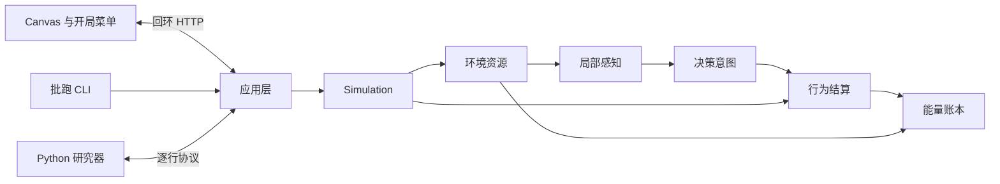

# agentsim 当前架构

本文对应 3.2.0。产品版本来自 `VERSION`。生态规则、实时快照、轨迹和存档各自维护格式版本。

## 入口与依赖

| 模块 | 负责的状态与操作 |
| --- | --- |
| `src/core` | 配置、实体 ID、基因、PCG32、环面向量及感知与动作结构 |
| `src/environment` | 阳光相关生产者、蓝细菌连线和遮蔽、温度、地形、分区养分与残骸 |
| `src/perception` | 从核及受控侦察球的位置采集局部观测，生成食物候选和 24 维感知输入 |
| `src/decision` | 策略注册表、内置算法、线性模型推理、每核决策记忆 |
| `src/behavior` | 行动约束、运动、呼吸、器官与所有权、摄食同化、繁殖和死亡 |
| `src/ledger` | 能量注入、耗散和实体间转移 |
| `src/sim` | 世界构造、逐帧编排、跨模块物质结算、状态指纹和二进制快照 |
| `src/app` | CLI、回环 HTTP、场景与模型发现、材质包、存档、时间轴和研究协议 |
| `frontend` | 本地开局菜单、Canvas、统计曲线、时间轴、调控和离线轨迹查看 |
| `tools` | 构建、发布、确定性门禁、轨迹分析和 Python 示例 |

`agentsim.exe` 支持批跑、服务和研究模式。无参数启动进入暂停的开局菜单。ZIP 版的 `agentsimw.exe` 以无控制台模式运行同目录的后端。发布用单文件 EXE 将 `StandaloneAssets.inc` 中列出的资源放入 PE 资源段，启动时写到 `%LOCALAPPDATA%\agentsim\portable\<版本>\`，写入失败时尝试 EXE 旁的 `.agentsim\<版本>\`。后端和前端按内容更新，已有场景和材质文件保留。后端探测相同版本的已运行服务，优先复用其地址。否则尝试绑定回环端口，端口占用时向后查找。默认通过运行目录下的独立 Edge 配置打开游戏窗口。显式 `--serve <port> --no-open` 时由调用方打开浏览器。

## 世界步进

空间是连续环面，默认宽 1024、高 512。位置跨边界折回，邻居、食物、器官和温度源的距离使用环面位移。模拟帧为固定步长，实时帧率只影响节流与显示。

`Simulation::advance()` 的结算顺序如下。

1. **观测。** 新世界先采集所有活核的同帧观测。目标可能来自核的近身范围，也可能由控制距离内的侦察球发现。食物候选共享蓝细菌可食量判定并携带稳定 ID。
2. **行动。** 内置策略返回方向、速度比例、施力目标和社会参数调制。行为层约束动作，执行运动、呼吸、能量支付及器官相关过程。研究模式可以用外部导航动作代替内置输出。
3. **摄食。** 移动后收集摄食请求，按节点和核 ID 稳定分组。需求超过可食库存时按比例分配。核同化到身体或储能，其余组织成为局部残骸。
4. **生命与器官。** 按已记录的条件处理繁殖。子代继承变异后的基因，建立自己的决策记忆。死亡物质入残骸场，脱离的球入自由球集合。随后推进球的物理与归属。
5. **环境。** 成熟蓝细菌结算光合、代谢、连线能量传输、组织生长及孢子释放。孢子推进成熟倒计时。分区残骸转为养分，场景启用扩散时再同步进行分区间养分运输。
6. **结账。** 推进 tick。审计模式检查全局能量残差及关键局部流量。应用层在帧边界发布快照、写轨迹或制作检查点。

成熟节点从本身的能量和组织库存中拨出一份给孢子。孢子不光合、不连线，在 90 帧后保留 ID 成熟为节点。孢子可以直接被吃。核必须在同一成熟节点的摄食范围内连续 12 帧保持速度 ≤ 0.8。离开、加速或切换目标都会清空驻留进度。摄食受库存、消化能力和储能余量约束。节点耗尽可食部分时死亡，结构残余进入分解过程。

新局的核基础储能上限为 125，移动指令上限为 6。资源球额外容纳 60 能量，并以有限速率供回核。侦察球提供远端局部观测，护盾球降低温度附加代谢。造球选择评估侦察需求、储能需求与温度压力。`grazer` 默认策略根据局部食物阶段、距离和已锁定的驻留目标，选择巡游、接近或停留。

### 能量与物质

能量账将初始或外源注入、光合作用和耗散分别累计。转移只改变存储位置。审计恒等式是 `累计注入 − 累计耗散 ≈ 核 + 球 + 蓝细菌当前能量`。

物质总量由蓝细菌组织、核身体、残骸和养分相加。初始库存和显式播种或施肥更新累计外部物质投入。研究协议提供 `matter_residual` 便于实验独立比较。养分扩散只在分区间搬运养分。寒冬通过临时光照偏移实现，默认 600 模拟帧，温度场独立结算。

### 决策边界和可复现性

`IDecisionPolicy` 消费观察值、可施力目标与当前个体的记忆，返回行动意图。世界修改、资源支付和目标有效性检查由行为层完成。策略注册表供菜单、CLI 和存档验证共用。场景配置和模型权重在开局解析后随世界持有，读取存档时按当时的有效配置恢复。

`--seed` 控制世界和生态随机流。新局的观测在行为前批量采集，旧档保留原先的决策步进语义。同一构建、起始配置、模型和输入序列可用于重复实验。`stateHash()` 是回归与检查点校验的诊断指纹。跨版本对比时应固定目标版本，并记录场景文件、模型和动作来源。 [研究接口](RESEARCH.md)

## 本地 HTTP

默认地址为 `127.0.0.1:8080`。HTTP 线程持有请求状态，模拟线程拥有世界，`ServeBridge` 通过互斥保护的配置、命令和快照交换数据。服务只监听 IPv4 回环。前端为打包的 `frontend/agentsim.html`，其脚本在实时模式轮询本机服务。

| 方法与路径 | 主要载荷 |
| --- | --- |
| `GET /` | 单文件游戏前端 |
| `GET /status` | 可用状态、应用版本和当前帧 |
| `GET /catalog` | 可用场景、策略、已发现的模型及解析错误 |
| `POST /run` | `seed`、`nuclei`、`cyano_nodes`、`policy`、`mod`、`max_fps` |
| `GET /state` | 二进制地图与基因快照 |
| `GET /matter` | 当前帧、养分、残骸、蓝细菌组织、核身体和外部物质累计投入 |
| `GET /env`、`GET /schema` | 环境状态、档位、事件及参数描述 |
| `POST /env` | 多行 `key=value`，如 `axis.light=3`、`event.winter=1`、`seed.cyano=120` |
| `GET /env/event` | 寒冬状态、光照偏移及剩余帧 |
| `POST /control` | `cmd=pause`、`cmd=resume` 或 `cmd=step` |
| `GET /saves`、`POST /save`、`POST /load` | 管理有效存档，写入与加载使用 `name` |
| `POST /rename`、`POST /delete-save` | `old` 与 `new`，或待删除存档的 `name` |
| `GET /timeline`、`POST /seek` | 检查点帧号列表。暂停时可用 `frame` 跳转 |
| `GET /packs`、`POST /set-packs` | 材质包及合成后的颜色，写入采用 `enabled=pack_a,pack_b` |

多数写入使用表单式 `key=value&key=value`。环境调控另有逐行格式。前端的「总帧数」用于离线演示，批跑和研究模式用 `--ticks` 指定上限。

### 实时快照 v3

`/state` 为紧凑小端二进制，头部 80 字节，字段按下列偏移读取。

| 字节偏移 | 字段 |
| --- | --- |
| 0 至 3 | `A`、协议版本 `3`、运行状态、审计状态 |
| 4、8、12 | tick（i32），世界宽与高（f32） |
| 16、20、24、28 | 球数、核数、存活核数、自由球数（i32） |
| 32、36 | 蓝细菌记录数（包括孢子）、连线数（i32） |
| 40、44、48 | 节点平均能量、展示光照（f32），节点上限（i32） |
| 52 至 79 | 以 NUL 结束的状态说明 |

状态字节为运行 `0`、结束 `1`、暂停 `2`。审计字段为未打开 `0`、通过 `1`、失败 `2`。头部后顺序排列球、核、蓝细菌节点与连线记录。

| 记录 | 字节 | 字段 |
| --- | --- | --- |
| 球 | 25 | id、ownerId（u32），x、y、能量（f32），类型（u8），半径（f32） |
| 核 | 128 | id（u32），x、y、能量、容量、速度、色相（f32），存活标记、驻留帧数与 2 个保留字节，24 个基因（f32） |
| 蓝细菌 | 21 | id（u32），x、y、能量、色相（f32），阶段（u8，节点为 0，孢子为 1） |
| 连线 | 8 | 两端蓝细菌 ID（u32） |
| 账本尾部 | 24 | 累计注入、累计耗散和当前世界储能（按此顺序，各为 f64） |

生产端为 `src/app/main.cpp` 中的 `buildStateSnapshot`，前端由 `frontend/js/live-client.js` 解析。球记录不按 4 字节自然对齐，半径从记录偏移 21 开始。

## 存档与时间轴

手动存档在 `saves/<名称>/` 下写入 `save.bin`、`meta.txt` 和 `timeline.bin`。存档外层与时间轴容器均为 v4，实体状态块为 v6，生态规则族为 v2。状态块保存随机流、实体、行为记忆、驻留目标、孢子倒计时、养分单元和账本。配置块保存机制参数、场景与模型。规则 v2 的旧档可读取，并按原配置继续结算。规则 v1 的旧文件需要历史版本。

实时进程默认每 200 帧制作一个检查点，接受环境输入时也会记录。跳转时恢复目标帧之前最近的检查点，再用相同配置补步。继续推进历史位置会丢弃之后的检查点并形成新分支。检查点数有上限，精简时间轴会优先保留输入边界。

## 批跑轨迹与实验判据

`--trace` 输出 JSON v3，顶层字段为 `schemaVersion`、`meta`、`bounds`、`series`、`frames`。时序按帧记录核数、成熟节点数、`spores` 孢子数、能量、累计注入和耗散等指标。`--trace-interval N` 只给空间帧降采样。空间帧达到上限时，`meta.framesTruncated` 标记截断。

| 空间帧字段 | 元组 |
| --- | --- |
| `n` | `[id, x, y, energy, cap, speed, alive]` |
| `b` | `[id, ownerId, x, y, energy, radius, type]` |
| `c` | `[id, x, y, energy, alive, hue]`，孢子追加第七项 `true` |
| `f` | `[idA, idB]` |
| `g` | 启用 `--trace-genome` 时出现，`[id, 24 个基因, hue]` |

基因顺序与 `src/core/Genome.h` 声明一致。`--stats` 另可输出降采样 CSV。`--audit` 开启逐帧对账。批跑退出码 `0` 表示跑完且核仍存在，`2` 为参数错误，`3` 为审计失败，`4` 为文件输出错误，`5` 为结束时核种群灭绝。

`tools/analyze.mjs` 为轨迹生成报告。它查看能量趋势、末段种群波动、捕食相关性，以及可选的基因多样性、色相分化、基线对照。能量趋势使用末 30% 窗口，种群稳定时检查归一化漂移是否小于 0.15。种群波动查看末 20% 的变异系数是否在 0.05 至 0.6，并要求末态核数大于零。基因和对照指标需要 `--trace-genome` 及适用的 `--baseline`。这些判据用于比较生态实验，模拟可在审计通过的情况下灭绝。

## 构建与发布

`tools/build.ps1` 从 `VERSION` 读取产品版本，通过 Visual Studio 2022 x64 工具链生成后端、启动器和单测。前端由 Node.js 将 HTML、CSS 和原生 JS 内联。`tools/gate.bat` 执行依赖检查、编译、单测、前端冒烟、同种子双跑和参数生效探测。`tools/package.ps1` 生成单文件 EXE 和带开发说明、扩展示例的 ZIP，两者由 GitHub Releases 托管。
